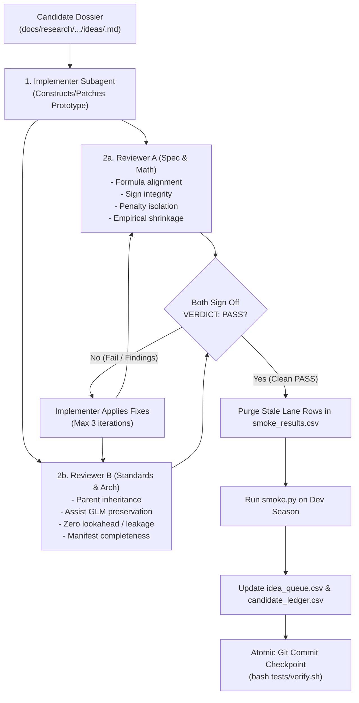

# Explore Candidate

Goal: replace Model Champion (`config/model_selection.json` `champion`) with Candidate that achieves scientific verdict PASS on Historical Promotion Gate (ADR 0066).

**Authority boundary:** Legacy smoke `pass`/`FAIL`, oracle gates and blended-XI comparisons = development diagnostics. They cannot establish scientific Pass, final confirmation, adoption readiness or a new Dead Lever lock. Final verdict uses verified rolling replay evidence, declared projection guards, approved statistical protocol and immutable confirmation registration through the shared evaluator. Follow [operator workflow](../../../docs/testing/operator-workflow.md). Synthetic evidence cannot authorize production adoption; missing empirical admission → wait. Existing Dead Lever locks remain unchanged.

## Run contract (AFK by default)

Runs unattended (Ralph-style loop). Human enters only at Human Gates and Exit.

LLM references in prompts, reports, filenames, and documentation: specialist role, date, source artifact; omit fixed provider, product, model, and version names. Preserve exact FPL projection-model identifiers.

- **Arm goal.** First invocation in conversation, no goal active: call `CreateGoal` once (per `/goal` contract) with objective:
  `explore-candidate <scope or "dual-lane">: frozen Candidate with verified ADR 0066 evidence and registered confirmation, adoption queued in Human Queue — or scope exhausted with every attempt recorded. Smoke diagnostics alone cannot satisfy gate. State: .agents/work-packets/explore-candidate-<slug>.md`
  Goal already active → skip. `CreateGoal` unavailable → continue without goal; packet = state. Then start step 0 same turn.
- **Disk = memory.** Chat is not state. Work Packet `.agents/work-packets/explore-candidate-<slug>.md` (from `.agents/work-packet.md.tmpl`) holds: mode, scope, current step, round, per-lane mechanism / grid / best smoke row, ledger verdicts, `## Human Queue`. Update packet after every step; iteration ends with `Next` = exact next action.
  - **Slug:** Queue = queue CSV's parent folder name (default `candidate-ideation` for `docs/research/candidate-ideation/idea_queue.csv`, or e.g. `component-model-ideas`); Scoped / Dual-lane = topic slug fixed at step 0. Same invocation args → same packet path.
  - **Bind:** invoking this skill = user naming Packet ID `explore-candidate-<slug>` (AGENTS.md Bind satisfied). Packet exists → Bind + resume at `Next` (never re-create from template); else create.
  - **Scratch** `.tmp/agent/explore-candidate/` persists across iterations and interruptions; exempt from end-of-turn scratch cleanup. Deleted only at Exit (a)/(b).
- **Resume after interruption** (quota, chat death, kill). Every invocation, step 0 first:
  1. `pgrep -fl smoke.py` → running run for this packet = wait for it (poll output file); never launch duplicate.
  2. Lane `smoke.csv` holds every grid variant for current Champion (`champion` column) → lane done; go step 4 for it. Partial or missing → re-dispatch lane with same `prototypes.py` + same `--out`: smoke.py skips variants already in `--out` (same season / Champion / GW range) and appends each row as it finishes.
  3. Queue rows `status` = `in-progress-b<N>` = resume batch N first, before new rows.
  4. Champion (`config/model_selection.json`) differs from packet's recorded Champion → prior smoke rows = hints only; re-smoke on new Champion.
- **Never block mid-run.** No `AskQuestion` before Exit. Decision needing human → append to `## Human Queue` (question · options · default taken · evidence path) → take default → continue. Harness/gate crash (traceback, not verdict) ≠ FAIL: queue traceback + command, no ledger verdict; blocks that step only.
- **Human Gates & Checkpoints** (AFK never executes without explicit user prompt): `config/model_selection.json` edit · `commands.evaluate_model_promotion --adopt` · Dead-row override · `git push` · Champion-change ADR acceptance (draft allowed, status Proposed). Note: Local atomic Git commit checkpoints per candidate lane (`chore(candidate): ...`) are explicitly authorized after `bash tests/verify.sh` passes (ADR 0068).
- **Progress guard.** Lane closes after 2 consecutive rounds with no new best `combined_delta`. Mechanism already in lane CSVs or ledger never re-smoked. All lanes closed → Exit.
- **Exit.**
  - (a) Candidate frozen + dev PASS + confirm PASS → draft Champion-change ADR Proposed, queue adoption in Human Queue → halt loop immediately for operator adoption (ADR 0068).
  - (b) Scope exhausted, every attempt in ledger → goal complete (verdict: no win).
  - (c) Only Human Queue items remain (e.g. every scoped mechanism Dead) → BLOCKED; goal stays active.
  - At Exit: write report (template below) into packet + topic note; write packet id to `.agents/handoff-pointer`; run goal completion audit, `UpdateGoal complete` for (a)/(b); final turn presents Human Queue via `AskQuestion`.
  - Packet keeps ≥1 open `- [ ]` Human Queue item until user resolves it (commit-gate treats all-checked packet as finished → deletion loses resume state).

## Mode

Mode resolves in priority order:
1. **Scoped** (user gave idea): idea = exploration scope. Skip queue and dual-lane search. Every lane, prototype, and variant traces to idea mechanism.
2. **Queue** (user points at idea queue CSV, or default queue fallback):
   - If user explicitly points at an idea queue CSV (e.g. `docs/research/component-model-ideas/idea_queue.csv`), use that queue.
   - If no idea or queue is given, check default queue `docs/research/candidate-ideation/idea_queue.csv`. If it exists and contains eligible rows (`status == 'untested'`), automatically run Queue mode on this file first.
   - Queue = scope; one lane per idea row; batches until queue exhausted. See Queue mode below.
3. **Dual-lane** (no idea, default queue missing or exhausted): two parallel lanes.
   - Lane A **iterate stack**: subclass Champion; levers from Ledger Open rows + component-gap crown (`docs/research/champion-component-gap/component_gap_summary.csv` `mse_share`).
   - Lane B **alternative architecture**: new `BaseModel` not inheriting Champion lineage (new form: e.g. learned model over Feature Contract, true scoreline Poisson).

## Queue mode

Queue CSV = work list + state (alongside packet). Columns used: `order`, `idea_id`, `tier`, `mechanism`, `inputs`, `replaces`, `nearest_ledger_row`, `confirm_informative` (re-check vs resolved confirm season), `grid`, `conflicts_with`, `status`, `spec_path`, `ledger_result`. Topic slug = queue's folder; notes/companions go there.

- **Eligible row:** `status` = `untested` or `in-progress-b<N>` (resume first). Skip `needs ruling` (Human Queue "rule on <id>?", default skip), `holdout-first`, `blocked*`, anything already verdicted.
- **Batch:** next ≤5 eligible rows by `order`, pairwise compatible: `conflicts_with` lists ids that never share a batch or stack; `after:<id>` = run only once `<id>` has verdict. Base for `after:` row = current Champion; `<id>` `confirm-pass` unpromoted → row waits. Grid entry naming another row (`+ <id>`) = implicit `after:<id>`; grid token `best` = second smoke round same lane, counts toward ≤6. Deferred rows wait for next batch.
- **Lane id** = `idea_id` lowercased, non-alphanumeric → `_` (e.g. `DEF-05+06` → `def_05_06`); prototype names prefix `<lane id>_`.
- **Batch start:** set batch rows `status` = `in-progress-b<N>`; packet lists batch N rows + recorded Champion.
- **Per batch (ADR 0068):** Lanes execute **serially** (one candidate at a time) using the **3-subagent team** (`Implementer` + `Reviewer A Spec/Math` + `Reviewer B Standards/Arch`). Steps 1–5 with lane = row; brief grid = row `grid` verbatim (fixed); mechanism/hook = `mechanism` + `replaces`; subagent brief includes relative dossier file path (`docs/research/<topic slug>/<spec_path>`). Review-repair loop is capped at max 3 iterations. Purge stale lane rows from `smoke_results.csv` before `smoke.py`. Post-retest: atomic local Git commit checkpoint (`chore(candidate): ...`) upon `bash tests/verify.sh` pass. If a candidate achieves PASS on dev and confirm, freeze prototype, draft ADR Proposed, queue adoption in Human Queue, and halt loop immediately.
- **Row verdict = one atomic edit:** Record diagnostic metrics with diagnostic scope; final `pass`/`fail` requires shared scientific evidence. `inconclusive`/`invalid` never creates a new Dead Lever lock. Persist evidence → ledger record → queue status; never mark `confirm-pass` from legacy smoke or unregistered historical inspection.
- **Loop:** batch with no dev winner → next batch same run. Confirm PASS → Exit (a) (promotion = Human Gate).
- **Step 0 Queue guard:** packet Human Queue holds unresolved adoption and Champion unchanged → Exit (c) "promote or reject Candidate first" (no screening on stale Champion). Champion changed → shipped ids = `confirm-pass` rows whose Candidate is now Champion; rows whose `conflicts_with` names a shipped id → `blocked (conflict shipped)`. Queue has no eligible rows → Exit (b)/(c).

## Seasons (never hard-code)

Roles resolve from `data/archive/YYYY-YY` each run: `uv run python .agents/skills/explore-candidate/smoke.py --show_seasons`. Complete = every fixture finished; seed = prior archive season if present.
- **dev** = latest complete season. Selection + tuning here only.
- **confirm** = second-latest complete season (ADR 0047). One run per frozen Candidate, never tuned on.
- **holdout** = incomplete live season. Sealed (ADR 0046 GW6+): no smoke, tuning, ablation; post-promotion check only.

Record resolved names in packet at step 0. Season completion alone cannot assign fresh confirmation or unseal holdout; use approved protocol windows and registered inspection history. Commands, prototypes, and briefs name roles and exact frozen season identities.

## Hard constraints

- **Zero leakage.** Inputs only from `fit(history_df)` / `predict(features_df)` handed in by walk-forward (as-of `gw`, history before target deadline). No direct file reads. No `players.parquet` season columns (`TERMINAL_PLAYER_COLUMNS`, `features/builder.py`). Prototype source holds no season literal (audit refuses). Holdout sealed.
- **Strict feature audit.** Each prototype declares `FEATURES` manifest; every column literal in source must be declared; `smoke.py` refuses undeclared or terminal columns and fails any run where fit history reaches target GW.
- **Ledger law.** Dead row with `revisit_after` > today = untouchable (rebuild, re-sweep, re-smoke, stack). Only user's explicit words override. Match by mechanism, not name. Retuned grid / wider clamp / new stack order of Dead form = same lever.
- Diagnostic code = `backtesting.model_evaluation.compare_to_reference` / `compare_two_season_gate`; historical blended-XI thresholds retain diagnostic meaning only. Final authority = shared ADR 0066 evaluator over native rolling net-score traces, complete guards and registered confirmation. Never loosen protocol, drop guardrails or shorten registered schedule to manufacture a win.

## Workflow

```
- [ ] 0. Ground (arm goal, packet)
- [ ] 1. Ledger screen
- [ ] 2. Lane plan
- [ ] 3. Dispatch subagents
- [ ] 4. Audit + verify results
- [ ] 5. Iterate to Development Screen win
- [ ] 6. Build Candidate
- [ ] 7. Adopt gate
- [ ] 8. Record + Exit
```

### 0. Ground

Arm goal + create/resume packet (Run contract). Run `smoke.py --show_seasons`; record roles in packet. Read: `docs/research/INDEX.md` Eval canon · `docs/research/candidate-ledger/candidate-ledger.md` + `candidate_ledger.csv` · `docs/testing/archive-testing.md` · `docs/model_name.md` · ADR 0046 + 0047 · Champion module in `models/`. Done when Champion name + its lineage levers (Ledger Shipped) in packet.

### 1. Ledger screen

Map idea (Scoped) or each candidate lever (Dual-lane) to ledger rows by mechanism.
- Dead + revisit future → Human Queue "override Dead row <lever>?" (default: no). Drop mechanism; continue with remaining in-scope mechanisms. None left → Exit (c).
- Shipped → drop (already in Champion).
- Open → cite row; carry blocker into lane brief.
- No row → new mechanism; new row at step 8.

Done when every lever has row verdict or "new" in packet.

### 2. Lane plan

Lanes represent distinct candidate hypotheses.
- **Queue mode (ADR 0068 default):** Lanes execute **serially** (one candidate row at a time) to prevent API 429 quota exhaustion and preserve clean per-candidate Git checkpoints.
- **Scoped mode:** Split idea across pipeline steps it touches (inputs, minutes, event rates, fixture scaling, scoring).
- **Dual-lane mode:** ~3 Lane A (stack/lineage) + ~2 Lane B (alternative architecture).

Each lane brief pre-declares: mechanism, pipeline step, fixed grid (≤6 variants), expected sign, and specification dossier path (`docs/research/<topic slug>/<spec_path>`).

---

### 3. The 3-Subagent Review & Execution Engine (ADR 0068)

For each candidate lane, the orchestrator deploys a dedicated **3-Subagent Team** before running `smoke.py`:



#### Step 3a: Implementer Subagent (`self`)
Spawn an Implementer subagent to construct or patch `docs/research/<topic slug>/prototypes/<lane>/prototypes.py` (or `.tmp/agent/explore-candidate/<lane>/prototypes.py`).
- Inputs strictly via `fit(history_df)` / `predict(features_df)`.
- Respects point-in-time constraints (as-of `gw`, history strictly before target deadline).
- Bounded parameter sweep grid (all declared variants in `_GRID`).

#### Step 3b: Dual-Axis Review Gate (Parallel Subagents)
Spawn two independent reviewer subagents in parallel:

1. **Reviewer A (Spec & Math Integrity, `research`)**:
   - Compares prototype line-by-line against `docs/research/<topic slug>/<spec_path>`.
   - **Checklist**:
     - [ ] Mathematical alignment with dossier formulas (no uncalibrated proxy substitutions like FDR difficulty for xGC).
     - [ ] Sign integrity: adjustments scale in the hypothesized direction (easy vs hard, home vs away) without inverted divisors.
     - [ ] Penalty threat isolation: open-play rates isolate $0.15\text{ xG/90}$ for primary penalty takers.
     - [ ] Small-sample / cold-start priors: proper Empirical Bayes shrinkage and prior weights ($n_{\text{ref}}$, $K$, pseudo-minutes).
     - [ ] Bounded output: sensible clipping on multiplier ratios and probability bounds; non-negative event rates.
     - [ ] Grid completeness: all variants in `_GRID` are present, distinct, and correctly parameterized.
   - Concludes with `VERDICT: PASS` or `VERDICT: FAIL` with line-referenced remediation requirements.

2. **Reviewer B (Standards & Pipeline Architecture, `research`)**:
   - Audits repository inheritance, class contracts, and pipeline collisions.
   - **Checklist**:
     - [ ] Clean inheritance from `DefXgShrinkChallengerModel` or specified `BaseModel` subclass.
     - [ ] Parent pipeline preservation: `predict()` delegates cleanly to `super().predict()`; defender xG rate shrinkage ($K=2400$) is preserved and not double-applied.
     - [ ] Assist GLM interaction: `self._history` and assist features interact cleanly with `MultiFeatureAssistChallengerModel` without being wiped out in GW4–38.
     - [ ] Threshold isolation: rate scaling does not inadvertently cross `HoldChase` minutes thresholds (`_XG_TRIM_BELOW`).
     - [ ] Zero lookahead / leakage: fit window strictly before target deadline; zero terminal columns (`TERMINAL_PLAYER_COLUMNS`).
     - [ ] Code hygiene & manifest: type annotations, ruff clean, input immutability (`features_df.copy()`), and `_MANIFEST` / `FEATURES` declare all accessed columns.
   - Concludes with `VERDICT: PASS` or `VERDICT: FAIL` with line-referenced remediation requirements.

#### Step 3c: Bounded Repair Loop (Max 3 Rounds)
If either reviewer returns `VERDICT: FAIL`, the orchestrator instructs the Implementer to apply the requested remediations and re-invokes the failing reviewer(s).
- **Cap**: Maximum **3 review-repair iterations**.
- **Exit if unresolvable**: If both reviewers do not sign off `VERDICT: PASS` within 3 cycles, flag row as `blocked (review convergence)` in `idea_queue.csv`, log findings to `## Human Queue`, and advance to the next candidate.

---

### 4. Stale Purge, Smoke Execution & Checkpoint

Once both Reviewers sign off with `VERDICT: PASS`:
1. **Purge Stale Rows**: Automatically purge any pre-existing rows for `<lane>` from `smoke_results.csv` to ensure clean diagnostic recording.
2. **Execute Smoke Retest**: Run `uv run python .agents/skills/explore-candidate/smoke.py docs/research/<topic slug>/prototypes/<lane>/prototypes.py --lane <lane> --out docs/research/<topic slug>/smoke_results.csv` on Dev Season (`2025-26`).
3. **Record Results**: Update `docs/research/<topic slug>/idea_queue.csv` and `docs/research/candidate-ledger/candidate_ledger.csv`.
4. **Atomic Git Checkpoint**: Run `bash tests/verify.sh` and commit local checkpoint:
   ```bash
   git add docs/research/<topic slug>/prototypes/<lane>/prototypes.py docs/research/<topic slug>/idea_queue.csv docs/research/<topic slug>/smoke_results.csv
   git commit -m "chore(candidate): complete <lane> prototype fix, two-axis review, and dev retest"
   ```
5. **Confirmation & Dual-Season Halting Protocol**:
   - If a candidate passes both Dev Season and Confirmation Season (Tier 2 & Tier 3 PASS):
     1. Freeze prototype into `models/custom/<name>.py`.
     2. Draft Champion-change ADR Proposed (`docs/adr/XXXX-champion-<name>.md`).
     3. Populate adoption in `## Human Queue`.
     4. **Halt loop immediately** to await human operator authorization before modifying production Champion configuration.

---

### 5. Iterate to Development Screen win

Development Screen win = verified smoke row `pass=True` (development diagnostic; no final gate authority).
- **Isolated winner check (`grid_positives == 1` on a multi-variant tunable grid):** `smoke.py` never blocks `pass=True` on coarse grid neighbours and reports `grid_positives=<pos>/<total>`. When a single variant passes Tier 3 (`pass=True`) and `grid_positives == 1` on a tunable parameter, run a 2-variant local perturbation check (`±10%` around the winner, strictly respecting dossier parameter types: `int` stays `int`, non-negative, probability bounds, ordering invariants) before Step 6. If both local perturbations collapse ($\Delta < 0$), treat as a brittle spike rather than freezing Step 6.
- No win: read `reasons` + segment deltas; next round = new mechanism inside scope (Scoped) or inside lane (Dual-lane), fresh pre-declared grid. Record diagnostic failure without inventing demonstrated scientific harm or a new Dead Lever lock. Apply progress guard.
- All lanes closed → step 8, Exit (b).

**Stack protocol** (≥2 verified dev winners, non-conflicting):
1. Stack = new prototype combining each winner's best variant (prefix `stack_`); one smoke run on dev. Stack must itself be paper win — sum of singles is not evidence.
2. Ablate: leave-one-out variant per lever in same smoke file. Lever whose removal does not lower `combined_delta` → drop; re-smoke reduced stack.
3. Frozen pick = best of {surviving stack, best single} by verified `combined_delta` with `pass=True`.
4. Only diagnostic winners stack; exclude failed or near-miss levers from current stack without assigning unsupported scientific verdicts.
5. Confirm (step 7) runs once, on frozen registered pick only; never on singles then stack. Demonstrated failure of a stack does not establish harm from each member separately. Preserve family history; no confirmation on subsets without new authorized registration.

### 6. Build Candidate

From winning prototype:
1. `models/<name>.py`: `BaseModel`, unique `name`, explicit type annotations, same logic.
2. Catalog row in `docs/model_name.md` (Role: Model Candidate).
3. `tests/test_<name>.py`: contract + lever behavior (pattern: `tests/test_face_value_challenger.py`).
4. Freeze check: `uv run python .agents/skills/explore-candidate/smoke.py --model <name> --out docs/research/<slug>/candidate_gate.csv` reproduces prototype `combined_delta` (±0.01) = dev gate row. Candidate now frozen; no more tuning.

### 7. Adopt gate

1. Step 6 row establishes development-screen eligibility only. Freeze candidate source/parameters, complete evidence identities, approved windows, guards, statistical budget and shared chip calendar before final evaluation.
2. Register one finalist before confirmation. Preserve prior inspected-data/family history; evaluate complete registered schedule through causal admission, native rolling replay and shared evidence evaluator. Legacy `smoke.py --season confirm` is diagnostic and cannot establish fresh confirmation.
   - Required admission, guards, live readiness or numerical approval missing → record `inconclusive`/`invalid` with exact reason; Human Queue, Exit (c). No new Dead lock.
   - Historical native scoring difference → native normalization or disclosed limitation under approved protocol; never substitute sealed holdout automatically.
3. Verified scientific Pass with complete execution → Human Queue exact candidate-bound evidence bundle/hash, approval reference and expected current Champion. Commands and request schema: [operator workflow](../../../docs/testing/operator-workflow.md). No config mutation during research. Draft Champion-change ADR Proposed. Holdout access and adoption/rollback remain separate explicit human decisions; season completion never unseals data.

### 8. Record + Exit

- Topic folder `docs/research/<slug>/` from `docs/research/template/research-note.md`: note + frozen `smoke_results.csv` (append verified lane rows; never overwrite) + `candidate_gate.csv`. Metric section per INDEX conventions.
- Every attempt → `candidate_ledger.csv` evidence record + ledger table view. New Dead lock only for demonstrated scientific failure under approved policy; `inconclusive`, `invalid` and diagnostic failure never imply Dead. Existing locks preserved. `uv run pytest tests/test_candidate_ledger.py`.
- Code touched → `uv run ruff check .`, `uv run pytest`, `bash tests/verify.sh`. Failures fixed before Exit.
- Delete `.tmp/agent/explore-candidate/` only at Exit (a)/(b); keep for (c).
- Exit per Run contract.

## Report

```markdown
**Verdict:** Candidate <name> PASS dev + confirm, adoption awaiting you | no win | BLOCKED on Human Queue
**Lanes:** <lane> · mechanism · best variant · combined_delta · segs · boot P
**Audit:** all prototypes AUDIT PASS, no LEAKAGE FAIL (or list)
**Ledger:** rows added/updated
**Human Queue:** numbered items with default taken + exact command
```
