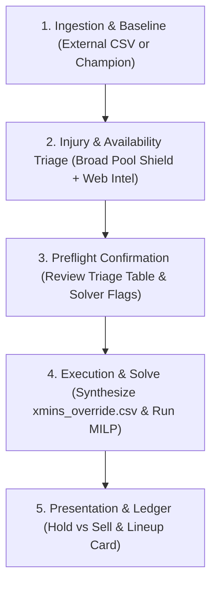

# Transfer Planner

Plan optimal transfers and starting lineups across upcoming Gameweeks for the user's live squad via Mixed-Integer Linear Programming (MILP). Supports the Three-Tier Minutes Cascade: external projections (e.g. FPL Review), automated Broad Pool Shield, and agentic Injury Return Curves decomposed onto Champion scoring rates and Plackett-Luce bonus math.

## Workflow



---

### Step 1: Ingestion & Baseline

Check the user's triggering prompt for an external minutes CSV path (e.g. `/path/to/projection.csv`).

1. **Path provided**: Validate file exists and contains `ID` and `{gw}_xMins` (or `{gw}_mins`) columns. Unlisted players or blank cells will smoothly fall back to Native Champion minutes (Three-Tier Minutes Cascade).
2. **Path omitted**: Ask once:
   > *"Do you have an external xMins CSV to apply? (Reply with file path, or reply 'skip' / 'no' to use native Champion minutes)."*
   - If user provides path: use provided file as Tier 2 baseline.
   - If user skips, declines, or provides no file: proceed with native Champion minutes (`adaptive_causal_challenger` / `def_xg_shrink_challenger`).

---

### Step 2: Injury & Availability Triage

Before solving, detect and triage all flagged assets across the squad and transfer market:

1. **Run Automated Triage Scan**:
   Execute the triage helper to build the Broad Pool Shield and extract flagged assets:
   ```bash
   uv run python -m commands.injury_triage --target_gw <target_gw> --horizon <horizon> [--base-csv <path>] --json
   ```
   - **Tier A (Broad Pool Shield)**: Automatically parses official FPL API return dates and enforces `0.0` xMins prior to club fixture return dates across all 600+ players in the league, preventing the solver from buying any unavailable asset at any price tier.
   - **Flagged Assets**: Extracts flagged players in the user's squad and key market targets segmented across **Position $\times$ Price Brackets** (Budget, Mid-price, Premium).

2. **Targeted Agentic Web Intel**:
   For flagged **User Squad** players and relevant market targets, run `search_web` to inspect recent press conferences, team news, injury severity, and expected return gameweek.

3. **Formulate Non-Linear Injury Return Curves**:
   Synthesize a realistic recovery progression for each flagged player:
   - **Pre-Return GWs**: `0.0 xMins` ($100\% P(\text{DNP})$).
   - **Return GW (Cameo / Sub-in)**: `15–30 xMins` (for multi-week absences) or `40–55 xMins` (for minor knocks / 50-50 tests).
   - **Return GW + 1 (Managed Start)**: `60–70 xMins` (managed 60–70 minutes).
   - **Return GW + 2+ (Full Recovery)**: Healthy starter baseline (`80–85 xMins`, overcoming multi-week DNP baseline depression).

4. **Present Compact Injury Triage Table**:
   Display a compact Markdown summary table in the chat:
   ```markdown
   🏥 **Injury & Availability Triage**:
   | Player | Pos | Price | Status / FPL News | Web Intel / Manager Update | Proposed xMins Curve (GW{start}–GW{end}) |
   |:---|:---:|:---:|:---|:---|:---|
   | Saka | MID | £9.6m | 50% thigh injury | Arteta: trained lightly; late fitness test | GW8: 45m · GW9: 75m · GW10+: 85m |

   🛡️ **Broad Pool Shield**: 69 other flagged pool players automatically shielded (assigned 0.0 xMins before return date).
   ```

---

### Step 3: Parameter Preflight Confirmation

Resolve default parameters:
- **Target Gameweek**: Earliest unfinished GW from `data/processed/gameweeks.parquet` (or explicit user target).
- **Default Planning Horizon**: 8 Gameweeks.
  - *Dynamic expansion*: If the user specifies booking a chip beyond `target_gw + 7` (e.g. Free Hit on GW16 when target is GW8), expand horizon (`horizon = chip_gw - target_gw + 1`).
  - *Long-horizon warning*: If `horizon > 10`, warn the user: *"Planning horizon exceeds 10 Gameweeks; solving to gap 0.0 may take 5–15 minutes. Consider `--gap 0.002` (0.2%) for faster convergence."*
- **Solver Mode**: Strategic (`--arm strategic`, default).
  - *Strategic Variance Controls*:
    - Paid hit hurdle: +1.8 net pts required over free transfer.
    - Starter xMins floor: 65.0 mins (infeasibility-guarded −10.0 pt/starter penalty).
    - 1st bench cover: 65.0 xMins floor (min 12 players with >= 65 xMins, −1.5 pt penalty).
    - Defensive stack cap: Max 2 starting DEF + GK from same club (−1.2 pt penalty).
    - GK transfer friction: 1.5 pt penalty (waived on WC and FH).
  - *Other modes*: Unconstrained (`--arm unconstrained`), No Hit (`--arm no_hit` or `--no-hit`), or 3-Arm Scenarios (`--scenarios`).
- **Default Solver Gap**: 0.0 (exact mathematical optimum).
- **Default Chips**: None booked (all available chips preserved unless specified by user).

Present consolidated preflight card to user:

```markdown
📋 **Transfer Solver Preflight**:
• Target Gameweek: GW{target_gw}
• Horizon: {horizon} Gameweeks (GW{target_gw}–GW{target_gw + horizon - 1})
• Solver Mode: Strategic (`--arm strategic`, default) | Unconstrained | No Hit | 3-Arm Scenarios
• Strategic Controls: 1.8 pt hit hurdle · 65m starter floor · 65m bench cover · max 2 DEF/GK per club · 1.5 pt GK friction
• Projection Source: {External xMins from <path> | Native Champion}
• Injury Triage: {Active with Broad Pool Shield & Proposed Curves}
• Booked Chips: {None | e.g. Free Hit on GW16}
• Solver Gap: {0.0}
• User Squad: Live squad loaded from `data/processed/user_picks.parquet`

👉 Reply "proceed" to run these defaults, or provide any overrides (e.g. "set Saka to 0 in GW8 and 60 in GW9", "horizon 10, FH on GW16").
```

Wait for user confirmation or adjustments before invoking solver.

---

### Step 4: Execution & Solve

1. **Synthesize Final Override CSV**:
   Compile confirmed curves and Broad Pool Shield into `data/planner/xmins_override.csv`:
   ```bash
   uv run python -m commands.injury_triage \
     --target_gw <target_gw> \
     --horizon <horizon> \
     [--base-csv <path>] \
     --set "<pid>:<v1>,<v2>,<v3>..." \
     --output data/planner/xmins_override.csv
   ```

2. **Construct and run solve command**:
   ```bash
   uv run python -m commands.solve \
     --target_gw <target_gw> \
     --horizon <horizon> \
     --gap <gap> \
     --arm <strategic | unconstrained | no_hit> \
     [--hit-friction <pts>] \
     [--starter-xmins-floor <mins>] \
     [--starter-xmins-penalty <pts>] \
     [--bench-cover-min <N>] \
     [--bench-cover-xmins <mins>] \
     [--bench-cover-penalty <pts>] \
     [--def-stack-cap <N>] \
     [--def-stack-penalty <pts>] \
     [--gk-transfer-friction <pts>] \
     --xmins-override data/planner/xmins_override.csv \
     [--use-fh <gw>] \
     [--use-wc <gw>] \
     [--use-bb <gw>] \
     [--use-tc <gw>] \
     [--scenarios] \
     --force
   ```

---

### Step 5: Presentation & Ledger

Present weekly results cleanly:

1. **Transfer Ledger Table**:
   - Per Gameweek: action taken (Player Bought, Player Sold, or Roll FT), Buy Price, Sell Price, remaining Bank (£m ITB).
   - **Injured Player Hold vs Sell Callout**: Clearly state whether injured squad members are held (benched with coverage) or sold immediately.
2. **Weekly Lineup Card**:
   - Starting XI formation shape (e.g. 3-5-2 or 3-4-3)
   - Designated Captain (**C**) and Vice-Captain (**V**)
   - Bench order (Slots 1–4)
   - Lineup projected points (xPts)
3. **Strategic Variance Audit** (when Strategic mode active):
   - Paid Hit Hurdle checks
   - Starter xMins floor violations / slacks
   - 1st Outfield Bench xMins coverage
   - Defensive Club Stacking (DEF+GK)
   - Goalkeeper Transfer Friction
4. **Chip Strategy Summary**:
   - Highlight activated chip (e.g. Free Hit, Wildcard).
5. **Artifact Link**:
   - Link to saved plan: [`data/solution.json`](file:///home/jubileez/fpl-jubilee-ascent/data/solution.json).
