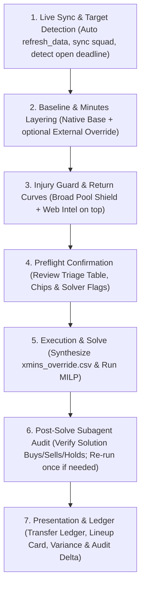

# Transfer Planner

Plan optimal transfers and starting lineups across upcoming Gameweeks for the user's live squad via Mixed-Integer Linear Programming (MILP). Built upon the Ground-Up Three-Tier Minutes Cascade: Layer 1 (Native In-House Champion baseline), Layer 2 (Optional External Minutes override), and Layer 3 (Injury Guard on top: automated Broad Pool Shield + Agentic Return Curves) decomposed onto Champion scoring rates and Plackett-Luce bonus math.

## Ground-Up Minutes Cascade Architecture

```
┌────────────────────────────────────────────────────────┐
│  Layer 3 (Top Guard Layer): Injury Guard & Overwrites   │
│  • Broad Pool Shield (auto 0.0m on injured assets)     │
│  • Targeted Injury Return Curves (e.g. Saka recovery)  │
│  👉 Overwrites everything below it                      │
├────────────────────────────────────────────────────────┤
│  Layer 2 (Middle Layer): External Minutes Override     │
│  • External CSV (e.g., FPL Review {gw}_xMins)          │
│  👉 Overwrites Layer 1 for players in the file         │
├────────────────────────────────────────────────────────┤
│  Layer 1 (Base Foundation): Native In-House Champion   │
│  • Zero-leakage causal panel / Ridge rates & duration   │
│  👉 Default foundation for every player in the league  │
└────────────────────────────────────────────────────────┘
```

## Workflow



---

### Step 1: Live Sync & Target Gameweek Auto-Detection

Always refresh data first to ensure planning operates on the true real-world state:

1. **Execute Live Ingest & Squad Sync**:
   Run the refresh pipeline to sync official FPL bootstrap, fixtures, player availability, and authenticated User Squad:
   ```bash
   uv run python -m commands.refresh_data
   ```
   - Automatically authenticates via `.env` credentials (`FPL_EMAIL` and `FPL_PASSWORD`) to download live User Squad into `data/processed/user_picks.parquet`.
   - If offline or credentials are missing, gracefully falls back to existing local parquet cache with a clear note.

2. **Strict Open-Deadline Target Gameweek Detection**:
   Inspect `data/processed/gameweeks.parquet`:
   - Checks `deadline_time` against current UTC time (`deadline_time > now_utc`).
   - Any in-flight or passed Gameweek (e.g. GW8 when deadline passed Oct 23) is locked and cannot receive transfers.
   - Automatically sets **Transfer Plan Start** (`target_gw`) to the **first Gameweek with an open, future deadline** (e.g. GW9).
   - Announces live lock state if a passed/in-play Gameweek was detected.

3. **Present Live Sync Card**:
   ```markdown
   🔄 **Live FPL Sync**:
   • Data Status: Bootstrap & fixtures updated to current live state
   • Next Open Deadline: GW{target_gw} ({deadline_date_str})
   • User Squad: 15 picks loaded (Entry #{entry_id} · £{itb}m ITB · {free_transfers} Free Transfer)
   ```

---

### Step 2: Baseline & Minutes Layering (Layers 1 & 2)

Check the user's prompt for an external minutes CSV path (e.g. `/path/to/projection.csv`).

1. **Path provided**: Validate file exists and contains `ID` and `{gw}_xMins` (or `{gw}_mins`) columns. Activates **Layer 2 (External Minutes Override)** on top of Layer 1.
2. **Path omitted**: Ask once:
   > *"Do you have an external xMins CSV to apply on top of the base? (Reply with file path, or reply 'skip' / 'no' to use native Champion minutes)."*
   - If user provides path: wire file into Layer 2.
   - If user skips or provides no file: proceed with **Layer 1 (Native In-House Champion)** (`adaptive_causal_challenger` / `def_xg_shrink_challenger`) as complete baseline.

---

### Step 3: Injury Guard & Triage Overwrite (Layer 3 on Top)

Before solving, apply the protective guard layer on top of all baselines:

1. **Run Automated Triage Scan**:
   Execute the triage helper to build the Broad Pool Shield and extract flagged assets:
   ```bash
   uv run python -m commands.injury_triage --target_gw <target_gw> --horizon <horizon> [--base-csv <path>] --json
   ```
   - **Broad Pool Shield (Layer 3 Top)**: Automatically parses official FPL API return dates and enforces `0.0` xMins prior to club fixture return dates across all 600+ players in the league, preventing the solver from buying any unavailable asset at any price tier—even if an external CSV gave them minutes.
   - **Flagged Assets**: Extracts flagged players in the User Squad and key market targets segmented across **Position $\times$ Price Brackets** (Budget, Mid-price, Premium).

2. **Targeted Agentic Web Intel**:
   For flagged **User Squad** players and relevant market targets, run `search_web` to inspect recent press conferences, team news, injury severity, and expected return gameweek.

3. **Formulate Non-Linear Injury Return Curves**:
   Synthesize a realistic recovery progression for each flagged player:
   - **Pre-Return GWs**: `0.0 xMins` ($100\% P(\text{DNP})$).
   - **Return GW (Cameo / Sub-in)**: `15–30 xMins` (for multi-week absences) or `40–55 xMins` (for minor knocks / 50-50 tests).
   - **Return GW + 1 (Managed Start)**: `60–70 xMins` (managed 60–70 minutes).
   - **Return GW + 2+ (Full Recovery)**: Healthy starter baseline (`80–85 xMins`, overcoming multi-week DNP baseline depression).

4. **Present Compact Injury Triage Table**:
   Display a compact Markdown summary table in the chat:
   ```markdown
   🏥 **Injury & Availability Triage (Layer 3 Guard on Top)**:
   | Player | Pos | Price | Status / FPL News | Web Intel / Manager Update | Proposed xMins Curve (GW{start}–GW{end}) |
   |:---|:---:|:---:|:---|:---|:---|
   | Saka | MID | £9.6m | 50% thigh injury | Arteta: fluid in quad; out several weeks | GW9: 0m · GW10: 0m · GW11: 30m · GW12+: 75m |

   🛡️ **Broad Pool Shield**: 175 other flagged pool players automatically shielded (assigned 0.0 xMins before return date).
   ```

---

### Step 4: Parameter Preflight Confirmation

Resolve default parameters:
- **Target Gameweek**: First open deadline GW (`deadline_time > now_utc`, e.g. GW9).
- **Default Planning Horizon**: 8–10 Gameweeks (clamped to max 10; dynamic expansion if chips booked e.g. Free Hit on GW16).
  - *Long-horizon warning*: If `horizon > 10`, warn user that solving to gap 0.0 beyond 10 GWs requires `--gap 0.002` (0.2%).
- **Solver Mode**: Strategic (`--arm strategic`, default).
  - *Strategic Variance Controls*:
    - Paid hit hurdle: +1.8 net pts required over free transfer.
    - Starter xMins floor: 65.0 mins (infeasibility-guarded −10.0 pt/starter penalty).
    - 1st bench cover: 65.0 xMins floor (min 12 players with >= 65 xMins, −1.5 pt penalty).
    - Defensive stack cap: Max 2 starting DEF + GK from same club (−1.2 pt penalty).
    - GK transfer friction: 1.5 pt penalty (waived on WC and FH).
- **Default Solver Gap**: 0.0 (exact mathematical optimum).
- **Booked Chips**: Note any specified chips (e.g. Free Hit on GW16).

Present consolidated preflight card to user:

```markdown
📋 **Transfer Solver Preflight**:
• Target Gameweek: GW{target_gw} (First Open Deadline: {deadline})
• Horizon: {horizon} Gameweeks (GW{target_gw}–GW{target_gw + horizon - 1})
• Solver Mode: Strategic (`--arm strategic`, default) | Unconstrained | No Hit | 3-Arm Scenarios
• Strategic Controls: 1.8 pt hit hurdle · 65m starter floor · 65m bench cover · max 2 DEF/GK per club · 1.5 pt GK friction
• Minutes Stack: Layer 1 (Native Champion) + Layer 2 ({External CSV | None}) + Layer 3 (Broad Pool Shield & Confirmed Curves)
• Booked Chips: {None | e.g. Free Hit on GW16}
• Solver Gap: {0.0}
• User Squad: Live squad loaded from `data/processed/user_picks.parquet`

👉 Reply "proceed" to run these defaults, or provide any overrides.
```

Wait for user confirmation or adjustments before invoking solver.

---

### Step 5: Execution & Solve

1. **Synthesize Final Override CSV**:
   Compile confirmed curves and Broad Pool Shield into `data/planner/xmins_override.csv`:
   ```bash
   uv run python -m commands.injury_triage \
     --target_gw <target_gw> \
     --horizon <horizon> \
     [--base-csv <path>] \
     --set "<pid>:<v1>,<v2>,<v3>..." \
     --output data/planner/xmins_override.csv
   ```
   *Note: `data/planner/xmins_override.csv` is the synthesized consolidated override file and is distinct from any user-provided external CSV.*

2. **Construct and run solve command**:
   ```bash
   uv run python -m commands.solve \
     --target_gw <target_gw> \
     --horizon <horizon> \
     --gap <gap> \
     --arm <strategic | unconstrained | no_hit> \
     --xmins-override data/planner/xmins_override.csv \
     [--use-fh <gw>] \
     [--use-wc <gw>] \
     [--use-bb <gw>] \
     [--use-tc <gw>] \
     [--scenarios] \
     --force
   ```

---

### Step 6: Post-Solve LLM Subagent Verification & Re-run Loop

Once `data/solution.json` is generated, execute a focused audit specifically on the players involved in the solver's decisions:

1. **Extract Solution Players Manifest**:
   ```bash
   uv run python -m commands.injury_triage --audit-solution data/solution.json --output data/planner/xmins_override.csv --json
   ```
   Extracts:
   - **Transfers In**: Every player bought across the horizon.
   - **Transfers Out**: Every player sold across the horizon.
   - **Flagged Assets Held**: Every flagged player retained in the squad.

2. **Dispatch Verification Subagent**:
   Invoke a `self` subagent (Role: `Solution Curve Verifier`) with the audit manifest and prompt:
   - Search recent press conferences (`search_web`) for any player bought or held who has a status flag or doubtful news.
   - Verify:
     a) Is any player being bought while actively injured or doubtful?
     b) Are injured players held given realistic non-linear return curves?
     c) Were any players prematurely sold right before a confirmed return?
   - Return structured verdict:
     ```json
     {
       "status": "PASS" | "CORRECTION_NEEDED",
       "explanation": "Summary of verification findings...",
       "corrections": {
         "<player_id>": [v1, v2, v3, ...]
       }
     }
     ```

3. **Convergence Guardrail (Max 1 Re-run)**:
   - **If `PASS`**: Proceed directly to Step 7 (Presentation).
   - **If `CORRECTION_NEEDED`**:
     a) Re-synthesize `data/planner/xmins_override.csv` applying the subagent's corrected curves (`--set "<pid>:<new_curve>"`).
     b) Execute **one final re-solve** with the updated overrides (`max_iterations = 1`).
     c) Proceed to Step 7 (Presentation) and include the **Audit & Correction Card** showing the verified delta.

---

### Step 7: Presentation & Ledger

Present weekly results cleanly:

1. **Audit & Correction Card** (when corrections were applied by subagent):
   - Highlight the subagent's findings, cited manager quotes, adjusted curves, and how the transfer sequence adapted.
2. **Transfer Ledger Table**:
   - Per Gameweek: action taken (Player Bought, Player Sold, or Roll FT), Buy Price, Sell Price, remaining Bank (£m ITB).
   - **Injured Player Hold vs Sell Callout**: Clearly state whether injured squad members are held (benched with coverage) or sold immediately.
3. **Weekly Lineup Card**:
   - Starting XI formation shape (e.g. 3-5-2 or 3-4-3)
   - Designated Captain (**C**) and Vice-Captain (**V**)
   - Bench order (Slots 1–4)
   - Lineup projected points (xPts)
4. **Strategic Variance Audit**:
   - Paid Hit Hurdle checks
   - Starter xMins floor violations / slacks
   - 1st Outfield Bench xMins coverage
   - Defensive Club Stacking (DEF+GK)
   - Goalkeeper Transfer Friction
5. **Minutes Audit**:
   - Transparently tag each starting and transfer asset with their minutes source: `[Native Champion]`, `[External CSV]`, `[Shield: 0m]`, or `[Custom Curve: Xm]`.
6. **Artifact Link**:
   - Link to saved plan: [`data/solution.json`](file:///home/jubileez/fpl-jubilee-ascent/data/solution.json).
