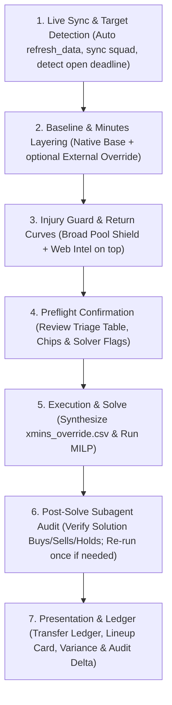

# Transfer Planner

Plan optimal transfers and starting lineups across upcoming Gameweeks for the user's live squad via Mixed-Integer Linear Programming (MILP). Built upon the Ground-Up Three-Tier Minutes Cascade: Layer 1 (Native In-House Champion baseline), Layer 2 (Optional External Minutes override), and Layer 3 (Injury Guard on top: automated Broad Pool Shield + Agentic Return Curves) decomposed onto Champion scoring rates and Plackett-Luce bonus math.

## Ground-Up Minutes Cascade Architecture

```
┌────────────────────────────────────────────────────────┐
│  Layer 3 (Top Guard Layer): Injury Guard & Overwrites   │
│  • Broad Pool Shield (auto 0.0m on injured assets)     │
│  • Targeted Injury Return Curves (e.g. Saka recovery)  │
│  👉 Overwrites everything below it                      │
├────────────────────────────────────────────────────────┤
│  Layer 2 (Middle Layer): External Minutes Override     │
│  • External CSV (e.g., FPL Review {gw}_xMins)          │
│  👉 Overwrites Layer 1 for players in the file         │
├────────────────────────────────────────────────────────┤
│  Layer 1 (Base Foundation): Native In-House Champion   │
│  • Zero-leakage causal panel / Ridge rates & duration   │
│  👉 Default foundation for every player in the league  │
└────────────────────────────────────────────────────────┘
```

## Workflow



---

### Step 1: Live Sync & Target Gameweek Auto-Detection

Always refresh data first to ensure planning operates on the true real-world state:

1. **Execute Live Ingest & Squad Sync**:
   Run the refresh pipeline to sync official FPL bootstrap, fixtures, player availability, and User Squad:
   ```bash
   uv run python -m commands.refresh_data [--entry-id <entry_id>]
   ```
   - **With Credentials**: If `.env` contains `FPL_EMAIL` and `FPL_PASSWORD`, it automatically logs in via Playwright to retrieve live bank, chips, and pending mid-week transfers into `data/processed/user_picks.parquet`.
   - **Without Credentials (`.env` missing or login fails)**:
     - **Never silently guess or assume Entry ID** from git commit authors, repo owners, or test fixtures (the current user may be a different manager).
     - **Check Prompt & Saved Preference**:
       - If the user provided an Entry ID or User Squad in their prompt, use that directly.
       - Otherwise, check `data/planner/preferences.json` or `FPL_ENTRY_ID` in `.env`:
         - If a saved Entry ID exists, ask for confirmation:
           > *"No FPL credentials in `.env`. Found saved Entry ID: #{id}. Would you like to use this Entry ID, enter a different Entry ID, or provide your User Squad directly?"*
         - If no saved Entry ID exists, prompt the user:
           > *"FPL credentials (.env) are not configured. To load your User Squad, please provide either:*
           > *1. Your **FPL Entry ID** (found in your team URL on the FPL site: `fantasy.premierleague.com/entry/{id}/event/...`), or*
           > *2. Your **User Squad details directly** (list of 15 players / IDs, plus optional Bank ITB, Free Transfers, and selling prices)."*

2. **Resolving User Squad from User Response**:
   - **Option A: User provides Entry ID**:
     - Run `uv run python -m commands.refresh_data --entry-id <entry_id>`.
     - Automatically reconstructs User Squad picks from the latest locked deadline, replaying public transfer history and `cost_change_start` to compute purchase prices, selling prices, Chip Set 1/2 inventories, and accrued Free Transfers.
     - **Confirm Reconstructed User Squad & Overrides**: Present reconstructed squad picks, selling prices, bank, and FTs, and ask if any post-deadline transfers or overrides should be applied:
       ```markdown
       👤 **Reconstructed User Squad** (Entry #{entry_id} · {entry_name} by {player_name}):
       • 15 Picks & Selling Prices: {player_name (£sell_price_m), ...}
       • Bank: £{bank}m ITB · Free Transfers: {ft} · Squad Value: £{value}m
       👉 *Note: If you made any transfers after the last deadline or want to override Bank, Free Transfers, or any player's selling price, state them now; otherwise reply "proceed" to use these values.*
       ```
   - **Option B: User provides User Squad directly**:
     - Parse player names or IDs into 15 squad picks (2 GKP, 5 DEF, 5 MID, 3 FWD).
     - **Missing Details Confirmation**: If the user omits Bank ITB, Free Transfers, or custom selling prices, **always ask to confirm before proceeding**:
       > *"You provided your 15 User Squad players, but didn't specify Bank ITB, Free Transfers, or custom selling prices. Would you like to provide those? (e.g. 'Bank: £0.5m, FT: 2, Saka sell price: £9.8m')*
       > *If not provided, we will assume standard defaults:*
       > *• Bank: £0.0m ITB*
       > *• Free Transfers: 1 FT*
       > *• Selling prices: current market price (`now_cost`) for all players.*
       > *Reply with your values, or reply 'proceed' to use these defaults."*
     - Once confirmed, format into `data/raw/my_team_0.json` and `data/raw/me.json` (`{"player": {"entry": 0}}`, using integer `0` as the synthetic `entry_id` so `features.processor.process_directory` selects and parses `int(selected_team_file.stem.split("_")[-1])` cleanly) and run `process_directory` to write `user_picks.parquet`, `user_state.parquet`, and `user_chips.parquet`.

3. **Strict Open-Deadline Target Gameweek Detection**:
   Inspect `data/processed/gameweeks.parquet`:
   - Checks `deadline_time` against current UTC time (`deadline_time > now_utc`).
   - Any in-flight or passed Gameweek (e.g. GW8 when deadline passed Oct 23) is locked and cannot receive transfers.
   - Automatically sets **Transfer Plan Start** (`target_gw`) to the **first Gameweek with an open, future deadline** (e.g. GW9).
   - Announces live lock state if a passed/in-play Gameweek was detected.

4. **Present Live Sync Card**:
   ```markdown
   🔄 **Live FPL Sync**:
   • Data Status: Bootstrap & fixtures updated to current live state
   • Next Open Deadline: GW{target_gw} ({deadline_date_str})
   • User Squad: 15 picks loaded (Entry #{entry_id} · £{itb}m ITB · {free_transfers} Free Transfer)
   ```

---

### Step 2: Baseline & Minutes Layering (Layers 1 & 2)

Check the user's prompt for an external minutes CSV path (e.g. `/path/to/projection.csv`).

1. **Path provided**: Validate file exists and contains `ID` and `{gw}_xMins` (or `{gw}_mins`) columns. Activates **Layer 2 (External Minutes Override)** on top of Layer 1.
2. **Path omitted**: Ask once:
   > *"Do you have an external xMins CSV to apply on top of the base? (Reply with file path, or reply 'skip' / 'no' to use native Champion minutes)."*
   - If user provides path: wire file into Layer 2.
   - If user skips or provides no file: proceed with **Layer 1 (Weekly Planner Model Preflight)** resolved automatically by `commands.solve` (`resolve_weekly_planner_model`):
     - Checks remote protected `origin/main` first; if remote Champion changed, stops with `StaleCheckoutError` requiring manual `git pull` (auto-pull is disabled).
     - Syncs read-only `validation-evidence` scorecards and `ExclusionLedger`.
     - If offline (`unverified`), serves only locally recorded Confirmed Champion (`selection.champion`).
     - On a sealed slate with complete common settled GW1..N prefix, ranks non-excluded slate models by cumulative paired replay net points (`verified_scorecard_leader`, ties Champion first then frozen podium rank). Supports one-plan overrides `--champion` or `--model <candidate>`.

---

### Step 3: Minutes Guard & Squad Triage Overwrite (Layer 3 on Top)

Before solving, apply the protective guard layer on top of all baselines:

1. **Run Automated Triage & Squad Minutes Audit Scan**:
   Execute the triage helper to build the Broad Pool Shield, audit all 15 **User Squad** Players (flagged and unflagged), and extract flagged market candidates:
   ```bash
   uv run python -m commands.injury_triage --target_gw <target_gw> --horizon <horizon> [--base-csv <path>] --json
   ```
   - **Broad Pool Shield (Layer 3 Top)**: Automatically parses official FPL API return dates across all 600+ Players:
     - **Suspensions (`status == 's'`)**: Enforces `0.0` xMins strictly prior to `return_gw`, then restores match-fit minutes immediately upon `return_gw` (no cameo ramp).
     - **Injuries (`status == 'i'`)**: Enforces `0.0` xMins prior to `return_gw`, applies a `20m -> 65m` **Injury Return Curve** on `return_gw` / `return_gw + 1`, and defers post-recovery steady-state weeks (`return_gw + 2+`) to positive Layer 2 External CSV projections before falling back to healthy historical baselines.
     - **Unknown-return flags (`i`, `s`, `u`, `n`)**: Zeroed across the horizon unless overridden via `--set`.
   - **Squad Minutes Audit (`squad_rotation_risk`)**: Inspects all 15 **User Squad** Players—even unflagged `status == 'a'` Players—for: (a) recent `< 60m` or non-start appearances, (b) material gaps (`> 25m`) between recent minutes and Layer 2 External CSV `xMins`, or (c) multi-week Layer 2 cliffs (`>= 25m` drop below `65m`).
   - **Flagged Market Players (`market_flagged_by_tier`)**: Extracts flagged market candidates segmented across **Position $\times$ Price Brackets** (Budget, Mid-price, Premium).

2. **Market review queue**:
   - Scan each Premier League Club before deadline for signings, direct replacements, returns, and rotations. Use dated club news and confirmed lineups. Check both Players when role moves between teammates. Club scan surfaces leads. Individual minutes review limited to shortlisted Players, User Squad, and existing flagged market triage.
   - Save sourced leads as JSON list. Fields: `player_id`, `kind` (`new_signing`, `replacement`, `return`, `rotation`), `source` (HTTPS URL), `published_at` (timezone-aware ISO timestamp), `first_gw`, `last_gw`, `detail` (direct competitor and uncertainty), `minutes_impact` (absolute estimated change per affected fixture, 0–90; omit if unclear). Use same receipts for model comparisons at same deadline. Omit file when no sourced leads.
   - Run `uv run python -m commands.transfer_scouting --target-gw <gw> --horizon <h> [--base-csv <path>] [--role-evidence <json>]`. Omit `--model` so shortlist uses Confirmed Champion regardless of Step 2 solve model. Record both models in preflight.
   - Review up to 30 additional market Players once per deadline: 4 GKP, 10 DEF, 10 MID, 6 FWD. User Squad and flagged market triage sit outside quota. Within position, take sourced leads in descending minutes impact, then fill slots using Champion projected points across price bands. Use recent starts and minutes sensitivity to inform reviews.
   - Record `adjust`, `keep`, or `unresolved` with reason and source. Single start or uncertain role opens review. Apply following criteria before proposing one-fixture overrides:
     - **Outfield return:** Establish usual role from at least five starts in last six fit, eligible league fixtures before injury. Include fit benchings. Exclude documented absences and injury-onset fixture. Match-fit reference = median minutes from starts in window. Cleared flag alone opens review. After comeback appearance, propose up to 60 minutes when manager confirms start readiness with uncertain workload, or 65 minutes when fresh readiness evidence supports progression without reported setback. Cap at match-fit reference. Fit loss of place blocks injury restoration.
     - **Goalkeeper role:** Review both keepers after explicit manager backing for next fixture or two consecutive league starts ahead of rival available for both. Injury cover and uncertain availability leave role unresolved. Propose paired minutes based on selection certainty (75/15 for plausible starter, 90/0 when source supports clear selection).
     - **Scope:** Reassess next deadline. For a Blank Gameweek or Double Gameweek with fixture-specific evidence, show unresolved instead of applying one-fixture evidence to Gameweek-total CSV.
   - Shadow comparison: append `--shadow` for shared 18-player baseline plus 30-player queue on same inputs. Review union once. Attribute evidence-backed curves to eligible queues. Use scratch outputs for triage, curves and paired plans. Log queue changes, forecast changes, first-action delta, and elapsed review time. Carry only separately confirmed curves into live plan.

   Also review **flagged User Squad Players**, **unflagged `squad_rotation_risk` Players**, and relevant **flagged market Players** for injury severity, suspension dates, tactical benchings, and expected return Gameweek.

3. **Formulate Non-Linear Curves & Squad Adjustments**:
   Use the one-fixture criteria above for newly cleared returns and goalkeeper role changes. Existing injury-guard and confirmed manager-specific curves follow:
   - **Pre-Return GWs**: `0.0 xMins` ($100\% P(\text{DNP})$).
   - **Suspensions**: `0.0 xMins` before `return_gw`, then immediate full baseline on `return_gw+`.
   - **Injury Return GW (Cameo / Sub-in)**: `15–30 xMins` (multi-week absences) or `40–55 xMins` (minor knocks / 50-50 tests).
   - **Injury Return GW + 1 (Managed Start)**: `60–70 xMins`.
   - **Injury Return GW + 2+ (Full Recovery)**: Positive Layer 2 steady-state or healthy starter baseline (`75–85 xMins`).
   - **Unflagged Dropped / Rotated Squad Players**: Adjust down from stale Layer 2 projections (e.g., `15–25 xMins` for a benched sub, or custom rotation expectation) when web/recent evidence confirms lost starter status.
   - **Reviewed Market Players**: Limit override to supported GWs. Recheck when role, fitness, or competitor changes. Use `--set-gw <pid>:<gw>:<minutes>` for individual cells.

4. **Present Compact Injury & Squad Minutes Triage Table**:
   Show per-position reviewed counts and proposed changes. Tag `[Squad]` and market Players. Include current projected minutes and source model or external input, proposed minutes, affected fixture or GWs, and dated evidence. Summarize unresolved decisions that matter to plausible moves.
   ```markdown
   🏥 **Injury & Squad Minutes Triage (Layer 3 Guard on Top)**:
   | Player | Pos | Price | Status / News / Audit Trigger | Web Intel / Manager Update | Proposed xMins Curve (GW{start}–GW{end}) |
   |:---|:---:|:---:|:---|:---|:---|
   | Egan `[Squad]` | DEF | £4.1m | Unflagged (`recent_non_start_or_sub60`, `recent_vs_external_gap`) | Unused sub in GW11 win | GW12: 15m · GW13+: 20m |
   | Saka | MID | £9.4m | `0%` Thigh injury - Expected back 20 Dec | Arteta: ~4 weeks left; no surgery | GW12–15: 0m · GW16: 20m · GW17: 65m · GW18+: 79.1m |

   🛡️ **Broad Pool Shield**: 179 flagged pool Players automatically shielded (0.0m pre-return; direct post-ban restoration for suspensions; 20m→65m ramp for injuries).
   ```

---

### Step 4: Parameter Preflight Confirmation

Resolve default parameters:
- **Target Gameweek**: First open deadline GW (`deadline_time > now_utc`, e.g. GW12).
- **Default Planning Horizon**: 10 Gameweeks (recommended: ≤ 12 Gameweeks; hard cap: 19 Gameweeks).
  - *Long-horizon warning*: If `horizon > 12`, advise user that solving beyond 12 GWs up to the 19-GW half-season hard cap should use `--gap 0.002` (0.2%) to prevent prolonged branch-and-bound runtimes on large formulations.
- **Solver Mode**: Strategic (`--arm strategic`, default).
  - *Strategic Variance Controls* (display **effective horizon-scaled** values for the selected `horizon` and `decay_base=0.85` per ADR 0065, where `scale = sum(0.85^k, k=0..H-1) / sum(0.85^k, k=0..4)`, e.g. `1.4437x` at `H=10`):
    - Effective paid hit hurdle: `4.0 + 1.8 * scale` net xP over free transfer (`6.60 xP` at `H=10`; base `1.8 pt` at `H=5`).
    - Starter xMins floor: `65.0` mins (infeasibility-guarded `−10.0 pt`/starter penalty).
    - 1st bench cover: `65.0` xMins floor (`min 12` Players with `>= 65` xMins, `−1.5 pt` penalty).
    - Defensive stack cap: Max `2` starting DEF + GK from same Club (`−1.2 pt` penalty).
    - Effective GK transfer friction: `1.5 * scale` pt penalty (`2.17 pt` at `H=10`; waived on WC and FH).
- **Default Solver Gap**: 0.0 (exact mathematical optimum).
- **Booked Chips**: Note any specified chips (e.g. Free Hit on GW14).

Present consolidated preflight card to user:

```markdown
📋 **Transfer Solver Preflight**:
• Target Gameweek: GW{target_gw} (First Open Deadline: {deadline})
• Horizon: {horizon} Gameweeks (GW{target_gw}–GW{target_gw + horizon - 1})
• Solver Mode: Strategic (`--arm strategic`, default) | Unconstrained | No Hit | 3-Arm Scenarios
• Effective Strategic Controls (H={horizon}, scale {scale:.2f}x): {effective_hit_hurdle:.1f} xP hit hurdle · 65m starter floor · 65m bench cover · max 2 DEF/GK per Club · {effective_gk_friction:.2f} pt GK friction
• Minutes Stack: Layer 1 (Weekly Preflight: {effective_model} · {selection_reason} · {freshness_status}) + Layer 2 ({External CSV | None}) + Layer 3 (Broad Pool Shield, Squad Minutes Audit & Confirmed Curves)
• Market review: {Confirmed Champion scouting model} · {GKP/DEF/MID/FWD counts} · {current → proposed xMins, fixture, source} · {material unresolved roles}
• Settled Prefix: Local GW{latest_settled_gw} · Verified Scorecard GW1..GW{verified_prefix_end_gw} · Scores: {comparable_scores}
• Overrides: One-plan override available via `--champion` or `--model <eligible_model>` (manual edit never mutates `config/model_selection.json`).
• Booked Chips: {None | e.g. Free Hit on GW14}
• Solver Gap: {0.0}
• User Squad: Live squad loaded from `data/processed/user_picks.parquet`

👉 Reply "proceed" to run these defaults, or provide any overrides.
```

Wait for user confirmation or adjustments before invoking solver:
- **Override Fast-Path**: If the user replies with clear adjustments (e.g., adjusting a Player's minutes, changing horizon/chip/arm), apply the overrides and proceed straight to Step 5–7 without a second confirmation pause; pause again *only* if an override is ambiguous or conflicts with constraints (such as an unavailable chip or GW outside horizon).

---

### Step 5: Execution & Solve

1. **Synthesize Final Override CSV**:
   Compile only confirmed targeted changes and existing Broad Pool Shield into `data/planner/xmins_override.csv`. Use sparse `--set-gw` cells for confirmed one-fixture overrides:
   ```bash
   uv run python -m commands.injury_triage \
     --target_gw <target_gw> \
     --horizon <horizon> \
     [--base-csv <path>] \
     [--set "<pid>:<v1>,<v2>,<v3>..."] \
     [--set-gw "<pid>:<gw>:<minutes>"] \
     --output data/planner/xmins_override.csv
   ```
   *Note: `data/planner/xmins_override.csv` is the synthesized consolidated override file and is distinct from any user-provided external CSV.*

2. **Construct and run solve command**:
   ```bash
   uv run python -m commands.solve \
     --target_gw <target_gw> \
     --horizon <horizon> \
     --gap <gap> \
     --arm <strategic | unconstrained | no_hit> \
     --xmins-override data/planner/xmins_override.csv \
     [--champion | --model <eligible_model>] \
     [--use-fh <gw>] \
     [--use-wc <gw>] \
     [--use-bb <gw>] \
     [--use-tc <gw>] \
     [--scenarios] \
     --force
   ```
   *Note: Initial `--xmins-override` runs do NOT pin prior `data/solution.json` models; pass `--rerun` only for Step 6 injury-audit reruns.*

---

### Step 6: Post-Solve LLM Subagent Verification & Re-run Loop

Once `data/solution.json` is generated, execute a focused audit specifically on the Players involved in the solver's decisions:

1. **Extract Solution Players Manifest**:
   ```bash
   uv run python -m commands.injury_triage --audit-solution data/solution.json --output data/planner/xmins_override.csv --json
   ```
   Extracts:
   - **Transfers In**: Every Player bought across the horizon.
   - **Transfers Out**: Every Player sold across the horizon.
   - **Free Hit Picks (`free_hit_picks`)**: Non-owned Players selected on any `FH` Gameweek (`starter` vs `bench`).
   - **Flagged Players Held (`held_flagged`)**: Every flagged Player retained in the squad.
   - **Unflagged Held Rotation Risks (`held_rotation_risk`)**: Any unflagged permanent squad Player matching **Squad Minutes Audit** triggers.

2. **Dispatch Verification Subagent**:
   Invoke a `self` subagent (Role: `Solution Curve Verifier`) with the audit manifest and prompt:
   - Search recent press conferences (`search_web`) for all Players in `transfers_in`, `free_hit_picks`, `held_flagged`, `held_rotation_risk`, and any notable `transfers_out`.
   - Verify:
     a) Is any bought or Free Hit Player actively injured, doubtful, suspended, or recently benched?
     b) Are held flagged/rotated Players given realistic non-linear curves?
     c) Were any Players prematurely sold right before a confirmed return?
   - Return structured verdict:
     ```json
     {
       "status": "PASS" | "CORRECTION_NEEDED",
       "explanation": "Summary of verification findings...",
       "corrections": {
         "<player_id>": [v1, v2, v3, ...]
       }
     }
     ```

3. **Convergence Guardrail (Max 1 Re-run)**:
   - **If `PASS`**: Proceed directly to Step 7 (Presentation).
   - **If `CORRECTION_NEEDED`**:
     a) Re-synthesize `data/planner/xmins_override.csv` applying the subagent's corrected curves (`--set "<pid>:<new_curve>"`).
     b) Execute **one final re-solve** with updated overrides (`max_iterations = 1`), passing `--rerun` (or `--pin-reviewed-model <reviewed_base_model>`) so the reviewed base model from `data/solution.json` (`meta.reviewed_base_model`) is preserved unless invalidated by terminal exclusion, expired deadline, or remote protected Champion change.
     c) Proceed to Step 7 (Presentation) and include the **Audit & Correction Card** showing the verified delta, explicitly calling out any newly swapped-in Player introduced by the rerun if it was not yet web-verified.

---

### Step 7: Presentation & Ledger

Render all six sections by default on every run:

1. **Audit & Correction Card**:
   - Subagent verification verdict (`PASS` or `CORRECTION_NEEDED`), cited findings, adjusted curves (including Squad Minutes Audit overrides), resulting transfer delta, and any unverified new buy from a Step 6 rerun.
2. **Transfer Ledger Summary Table**:
   - Columns: `GW`, `Chip`, `FT Before`, `Used`, `FT Left`, `Hits`, `Move (Sell £m → Buy £m, or Roll FT)`, `Bank After (£m)`.
   - Read `ft` (`FT Before`), `ft_used` (`Used`), `ft_after` (`FT Left`, i.e., FTs available entering `GW + 1`), and `transfer_count` directly from `data/solution.json` (`weeks[]`) — never reconstruct them with mental math.
   - **Chip FT Rules**:
     - `FH`: `Used = 0`, `FT Left = FT Before` (preserved unchanged — never add `+1 FT` and never label `FH` as `Roll FT`).
     - `WC`: `Used = 0` (render `{transfer_count} WC swaps` or individual buys/sells in `Move`), `FT Left = FT Before` (preserved unchanged — never deduct FTs and never add `+1 FT`).
     - `BB` / `TC`: Normal FT arithmetic (`ft_used = transfer_count`, `ft_after = min(5, max(1, ft - ft_used + 1))`).
   - **Injured / Dropped Player Callout**: State whether injured or dropped squad members are held on bench or sold.
3. **Every-Gameweek Transfer & Lineup Cards (`GW{start}`–`GW{end}`)**:
   - Render one card per Gameweek across the full horizon:
     - Header: `### GW{gw} — {lineup_xpts} xPts ({Starting Shape})` (+ chip badge if active)
     - **Transfer:** `Sell {Player} (£{sell}m) → Buy {Player} (£{buy}m)`, `Free Hit Squad ({15} temporary picks)` on `FH`, `Wildcard Rebuild ({transfer_count} swaps)` on `WC`, or `Roll FT` (only on non-`FH`/non-`WC` 0-transfer weeks)
     - **FT & Bank:** `{ft} before → {ft_used} used → {ft_after} FT left · Hits: {hits} · Bank: £{bank_before}m → £{bank_after}m` (using `ft`, `ft_used`, and `ft_after` directly from `data/solution.json`)
     - **Captaincy:** `Captain: {Name} (C) ({xpts}) · Vice-Captain: {Name} (V) ({xpts})`
     - **Starting XI by position (`GK`, `DEF`, `MID`, `FWD`)** with each Player's `xPts` and `(C)` / `(V)` tags
     - **Ordered Bench (`GK`, `1`, `2`, `3`)** with each Player's `xPts`
4. **Top 10 Final Projections by Position (`GKP`, `DEF`, `MID`, `FWD`)**:
   - Aggregate the final post-cascade `ProjectionContract` (`model.predict(df_feat, horizon)` with `xmins_override=data/planner/xmins_override.csv`) across `GW{start}..GW{end}`; sort each position by `Total xPts` descending; top 10 per position.
   - Use unified `/GW` naming so component rates sum directly to `xPts/GW`. Order columns left-to-right from headline decision metrics to positive position drivers, with deductions (`GC/GW`, `Other/GW`) last:
     - **Base columns (all positions):** `Rank`, `Player`, `Club`, `Price`, `GW{target_gw} xPts`, `Total xPts`, `xPts/GW`, `xPts/£m`, `xMins/GW`
     - **GKP component columns:** `App/GW`, `CS/GW`, `Save/GW`, `Bonus/GW`, `GC/GW`, `Other/GW`
     - **DEF component columns:** `App/GW`, `CS/GW`, `DefCon/GW`, `Goal/GW`, `Ast/GW`, `Bonus/GW`, `GC/GW`, `Other/GW`
     - **MID component columns:** `App/GW`, `Goal/GW`, `Ast/GW`, `CS/GW`, `DefCon/GW`, `Bonus/GW`, `Other/GW`
     - **FWD component columns:** `App/GW`, `Goal/GW`, `Ast/GW`, `Bonus/GW`, `DefCon/GW`, `Other/GW`
5. **Strategic Variance Audit**:
   - Paid Hit Hurdle checks, Starter xMins floor violations/slacks, 1st Outfield Bench xMins coverage, Defensive Club Stacking (DEF+GK), Goalkeeper Transfer Friction.
6. **Minutes Audit & Artifact Links**:
   - Tag starting, Free Hit, and transfer Players with minutes source: `[Native Champion]`, `[External CSV]`, `[Shield: 0m]`, or `[Custom Curve: Xm]` (noting Squad Minutes Audit overrides).
   - Link to [`data/solution.json`](file:///Users/jubilee/fpl-jubilee-ascent/data/solution.json) and [`data/planner/xmins_override.csv`](file:///Users/jubilee/fpl-jubilee-ascent/data/planner/xmins_override.csv).
