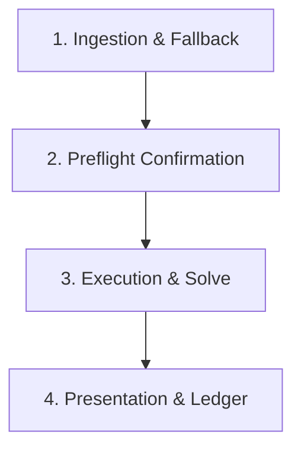

# Transfer Planner

Plan optimal transfers and starting lineups across upcoming Gameweeks for the user's live squad via Mixed-Integer Linear Programming (MILP). Supports external minutes predictions (e.g. FPL Review) decomposed onto Champion per-90 scoring rates, or native Champion participation modeling.

## Workflow



---

### Step 1: Ingestion & Fallback

Check the user's triggering prompt for an external minutes CSV path (e.g. `/path/to/projection.csv`).

1. **Path provided**: Validate file exists and contains `ID` and `{gw}_xMins` (or `{gw}_mins`) columns.
2. **Path omitted**: Ask once:
   > *"Do you have an external xMins CSV to apply? (Reply with file path, or reply 'skip' / 'no' to use native Champion minutes)."*
   - If user provides path: use provided file.
   - If user skips, declines, or provides no file: proceed with native Champion minutes (`def_xg_shrink_challenger`).

---

### Step 2: Parameter Preflight Confirmation

Resolve default parameters:
- **Target Gameweek**: Earliest unfinished GW from `data/processed/gameweeks.parquet` (or explicit user target).
- **Default Planning Horizon**: 8 Gameweeks.
  - *Dynamic expansion*: If the user specifies booking a chip in a Gameweek beyond `target_gw + 7` (e.g. Free Hit on GW16 when target is GW7), expand the horizon to include that Gameweek (`horizon = chip_gw - target_gw + 1`).
  - *Long-horizon warning*: If `horizon > 10`, warn the user: *"Planning horizon exceeds 10 Gameweeks; solving to gap 0.0 may take 5–15 minutes. Consider `--gap 0.002` (0.2%) for faster convergence."*
- **Default Hit Limit**: 0 hits (`weekly_hit_limit=0`, `--no-hit`).
- **Default Solver Gap**: 0.0 (exact mathematical optimum).
- **Default Chips**: None booked (all available chips preserved unless specified by user).

Present the consolidated preflight card to the user:

```markdown
📋 **Transfer Solver Preflight**:
• Target Gameweek: GW{target_gw}
• Horizon: {horizon} Gameweeks (GW{target_gw}–GW{target_gw + horizon - 1})
• Projection Source: {External xMins from <path> | Native Champion}
• Hit Policy: 0 hits (`weekly_hit_limit=0`)
• Booked Chips: {None | e.g. Free Hit on GW16}
• Solver Gap: {0.0}
• User Squad: Live squad loaded from `data/processed/user_picks.parquet`

👉 Reply "proceed" to run these defaults, or provide any overrides (e.g. "horizon 10, FH on GW16, allow 1 hit").
```

Wait for user confirmation or adjustments before invoking the solver.

---

### Step 3: Execution & Solve

Construct and run the command:

```bash
uv run python -m commands.solve \
  --target_gw <target_gw> \
  --horizon <horizon> \
  --gap <gap> \
  [--xmins-override <path>] \
  [--use-fh <gw>] \
  [--use-wc <gw>] \
  [--use-bb <gw>] \
  [--use-tc <gw>] \
  [--allow-hits | --hit-limit <N>] \
  --force
```

- When `--xmins-override` is provided, `commands.solve` automatically builds external features, projects expected points through the Champion model rates and Plackett-Luce bonus distribution, and optimizes against the resulting datasource.
- The resulting plan is saved to `data/solution.json`.

---

### Step 4: Presentation & Ledger

Present the weekly results cleanly:

1. **Transfer Ledger Table**:
   - For each Gameweek: action taken (Player Bought, Player Sold, or Roll FT), Buy Price, Sell Price, and remaining Bank (£m ITB).
2. **Weekly Lineup Card**:
   - Starting XI formation shape (e.g. 3-5-2 or 3-4-3)
   - Designated Captain (**C**) and Vice-Captain (**V**)
   - Bench order (Slots 1–4)
   - Lineup projected points (xPts)
3. **Chip Strategy Summary**:
   - Highlight any activated chip (e.g. Free Hit, Wildcard).
4. **Artifact Link**:
   - Link to saved plan: [`data/solution.json`](file:///Users/jubilee/fpl-jubilee-ascent/data/solution.json).
