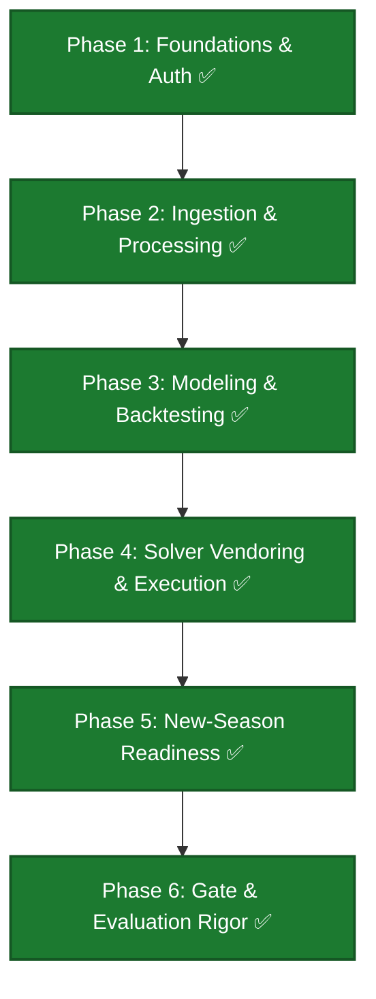

# FPL-Jubilee-Ascent - Project Roadmap

This roadmap tracks the development progress, target architecture, and phases for **FPL-Jubilee-Ascent**.

> **Agents:** read [`docs/agents/current-state.md`](docs/agents/current-state.md) first for what is built today vs this plan.

---

## Personas

| Persona | Goal | Primary surface |
|---------|------|-----------------|
| **User** | Run data refresh, backtest models, run solver to get optimal transfer plans | CLI |
| **Developer** | Plug in new score projection models | Python classes / CLI |

---

## Current Project Status: **Backtesting foundation Phase 2 next**

### Backtesting/promotion foundation — implementation active

- Phase 0 complete: versioned evidence contracts, entry-point inventory, recommendation-only CI guard; reviewed/verified, accepted existing timing exception.
- Phase 1 engineering accepted: strict synthetic causal admission, source/fixture checks and complete-origin requirements inventory; empirical coverage/admission remains unverified. 61 focused passes, lint/type clean, accepted existing full-suite timing exception.
- [ ] Phase 2: native state transitions, financial/chip accounting and season-aware scoring contracts.
- Current team: `phase_01_implement` (GPT-6.1 Terra Medium), `phase_01_review_standards` + `phase_01_review_spec` (GPT-6.1 Sol xhigh). Exactly three fresh agents per phase; record review/validation/commit transitions in `docs/testing/foundation-delivery.md`.
- Later phases: temporary `implementation_plan.md`; Q1-Q28 rationale in `docs/research/backtesting-promotion-foundation/`. Sequential Terra Medium implementation, Sol xhigh review, per-phase commits; no push. Numerical/protocol/adoption approvals pending.

Wayfinder Map: [Promotion Gate & Evaluation Rigor Overhaul (ADR 0064) #166](https://github.com/JubileeZ/fpl-jubilee-ascent/issues/166) completed. Resolved 4 structural distortions identified in quantitative audit: unseeded confirmation regime mismatch, short-panel Nickell bias, unconstrained LegalXI churn blindness, circular bootstrap boundary bugs, and endogenous playable pool masking across 7 closed decision tickets (#167–#173).

---

## Implementation Phases

### ✅ Phase 1: Repo Infrastructure, Foundations & Auth (Completed)
All repository scaffolding, tiered authentication (Playwright, direct HTTP, environment tokens), and developer checks (ruff, pytest) are fully implemented.

---

### ✅ Phase 2: Ingestion, Processing & Archiving (Completed)
Raw data refresh pipeline, historical season snapshot scripts, and raw-to-parquet processors are fully implemented.

---

### ✅ Phase 3: Pluggable Modeling & Backtesting (Completed)
Baseline models, feature and projection exporters, and historical backtesting evaluations are fully implemented.

---

### ✅ Phase 4: Solver Vendoring & Execution (Completed)
Vendored MILP solver, multi-period transfer optimization wrapper, and top-picks console/CSV rank reports are fully implemented.

---

### ✅ Phase 5: New-Season Readiness (Completed)

Prior-season seed component model, Cold-Start, long-format Feature Contract, Modified FDR, CLI reports, Champion/solver tuning. Issues #75–#87 closed. Design: `docs/adr/0003`. Vocabulary: `CONTEXT.md`.

---

### ✅ Phase 6: Promotion Gate & Evaluation Rigor Overhaul (Completed Map #166)

Re-architected Historical Promotion Gate (`backtesting/promotion.py`, `backtesting/metrics.py`, `backtesting/walkforward.py`, `models/ml_panel_features.py`) under ADR 0064:
- Ingest and wire 2023-24 warm confirmation seed archive ([#167](https://github.com/JubileeZ/fpl-jubilee-ascent/issues/167)) ✅.
- Short-panel Empirical Bayes priors & continuous $N_{\text{eff}}$ ML shrinkage ([#168](https://github.com/JubileeZ/fpl-jubilee-ascent/issues/168)) ✅.
- Constrained Legal Formation XI (£83.5m budget cap, 3-per-club max, deterministic tie-breaking) and squad churn guardrail ([#169](https://github.com/JubileeZ/fpl-jubilee-ascent/issues/169)) ✅.
- Exogenous Playable Pool mask & Active-Window Guardrails ([#170](https://github.com/JubileeZ/fpl-jubilee-ascent/issues/170)) ✅.
- Non-wrapping Moving Block Bootstrap ($L=5$, Active GWs) & Pooled Stratified Gate ([#171](https://github.com/JubileeZ/fpl-jubilee-ascent/issues/171)) ✅.
- $\sqrt{n_s}$-scaled segment floors ([#172](https://github.com/JubileeZ/fpl-jubilee-ascent/issues/172)) ✅.
- Verification suite, candidate re-evaluations, and ADR 0064 ([#173](https://github.com/JubileeZ/fpl-jubilee-ascent/issues/173)) ✅.

---

> [!NOTE]
> **Pre-commit gate:** run all test and lint commands successfully before proposing commits.
