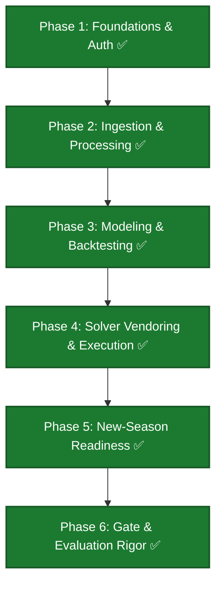

# FPL-Jubilee-Ascent - Project Roadmap

This roadmap tracks the development progress, target architecture, and phases for **FPL-Jubilee-Ascent**.

> **Agents:** read [`docs/agents/current-state.md`](docs/agents/current-state.md) first for what is built today vs this plan.

---

## Personas

| Persona | Goal | Primary surface |
|---------|------|-----------------|
| **User** | Run data refresh, backtest models, run solver to get optimal transfer plans | CLI |
| **Developer** | Plug in new score projection models | Python classes / CLI |

---

## Current Project Status: **Map #184 (`#185`–`#189`) complete; Candidate Search (`explore-candidate` / `ideate-candidate`) active under ADR 0069**

- **Champion adoption (`ADR 0070`, Map [#190](https://github.com/JubileeZ/fpl-jubilee-ascent/issues/190)):** [#201](https://github.com/JubileeZ/fpl-jubilee-ascent/issues/201) sparse confirmation certified (`advisory` mode on `seed=20103`, false full pass upper 95% `0.0441 <= 0.05`, GW38 power lower 95% `0.3665 >= 1/3`, terminal false exclusion upper 95% `0.0214 <= 0.05`, digest `9e7234b1...`); [#198](https://github.com/JubileeZ/fpl-jubilee-ascent/issues/198) portable `validation-evidence` producer/verifier (`collect`/`freeze`/`replay`/`scorecard`/`bootstrap-s1-baseline`) & [non-live fixture inventory](docs/testing/pilot-fixture-inventory.md) delivered (`has_admissible_historical_gw15_passing_fixture=False`, missing prerequisites recorded); [#200](https://github.com/JubileeZ/fpl-jubilee-ascent/issues/200) protected adoption transaction, shared reservation, App-token PR API merge, & planner freshness delivered; [#199](https://github.com/JubileeZ/fpl-jubilee-ascent/issues/199) local pilot harness (`5/5` covering `#197`) & [read-only production preflight](docs/testing/production-preflight-report.json) (`3/10` pass, `7/10` blocked) recorded in [pilot & preflight report](docs/testing/champion-adoption-pilot-report.md) on `/code-review`-remediated `feat/champion-adoption-v1` (`1217` pytest, `29/29` `verify.sh`). Canonical review branch pushed; live isolated private GitHub pilot awaiting operator pilot repo/App/inbox/approval; live rollout disabled.

### Map [#184](https://github.com/JubileeZ/fpl-jubilee-ascent/issues/184) Decision & Implementation Schedule (ADR 0069)

Governs **Annual Rolling Validation (`S`=`2026-27` quarantined via `Randdalf/fplcache` `<= 24h`, `S-1`=`2025-26` Dev, `S-2`=`2024-25` Filter)** and **Dual-Tier (`Provisional Active` + `Confirmed Champion`)** readiness, preserving `#175`–`#179` engineering designs from superseded Map [#174](https://github.com/JubileeZ/fpl-jubilee-ascent/issues/174).

| Ticket | State | Scope & Decision |
|---|---|---|
| [**#185**](https://github.com/JubileeZ/fpl-jubilee-ascent/issues/185) `SeasonLifecycle`, `2026-27` rules & `fplcache` ingestion | **CLOSED (2026-11-15)** | `config/season_lifecycle.json` (`active_validation`=`2026-27`, `development`=`2025-26`, `historical_filter`=`2024-25`, `prior_seed_only`=`2023-24`), `native-2026-27-v1` `SeasonRules` & `< gw` fit isolation, `Randdalf/fplcache` `GW1–38` ingestion (`GW1–10` admitted `0.63h–12.37h`, `GW1–9` settled reconciled, `config/fplcache_2026_27_manifest.json`). |
| [**#186**](https://github.com/JubileeZ/fpl-jubilee-ascent/issues/186) Calibrated `FWER <= 5%`, Early-Harm Fallback & `M<=2` podium rules | **CLOSED (2026-11-16, HITL)** | Consistent one-sided Kendall-PW + Bartlett HAC Student-$t$ superiority, OBF spend (`0.0005`/`0.010`/`0.0395`, halved for `M=2`), pure statistical Early-Harm (`min_gw=6`, `p_harm <= 0.025` or guard `FAIL`), data-derived `S-1` guards (`max(0.05 * S-1 mean, 1 * S-1 GW_SE)`), `0.5*(S1+S2)` ranking, sealed `M<=2` slate, symmetric `alpha/M` tracking + `#1->#2` rotation. |
| [**#189**](https://github.com/JubileeZ/fpl-jubilee-ascent/issues/189) Unified `mode="empirical"`, Strategic parity & Stage A->B replay | **CLOSED (2026-11-17)** | Pinned `2025-26` dev (`GW1..7`, `vaastav` `1..38` blocked `GW8` `Partial Prefix`, `29747` rows, zero-diff), `2024-25` filter (`GW1..1`, blocked `GW2`, `27283` rows) & `2024-25` seed (`784` retained, `20` pos-5 excluded) manifests; unified `mode="empirical"` + 8 negative tests (`#178`); `ADR 0065` Strategic parity + `QualityPolicy(target_gap=0.0)` + Stage A (`0/8` censored, `226.29s`, `929.66 MB` RSS) & Stage B B1–B4 pass (`1111` tests). |
| [**#187**](https://github.com/JubileeZ/fpl-jubilee-ascent/issues/187) Dual-Tier serving, `GW15`/`GW30`/`GW38` evaluator & verification | **CLOSED (2026-11-17)** | Dual-Tier serving (`Provisional Active` Transfer Plan default, `Confirmed Champion` Explorer default & one switch away, manual `adopt_champion`), Kendall-PW + Bartlett HAC (`<= 5%` FWER OBF `GW15`/`GW30`/`GW38`), `min_gw=6` Early-Harm, `S-1` guard calibration + GW-clustered checks, `M<=2` podium/rotation, `S->S-1->S-2` summer rollover, dry-run & two-axis review. |
| [**#188**](https://github.com/JubileeZ/fpl-jubilee-ascent/issues/188) Freeze initial finalists & authorize `GW1–15` + search | **CLOSED (2026-11-18)** | `0` qualifiers on `S-1`/`S-2` (`adaptive_causal`, `club_def_prior` failed vs Champion); `provisional_active=null`, `podium_sealed=false`; `2026-27 GW1–10` Champion baseline `604`; `explore-candidate`/`ideate-candidate` resumed. |

- **Map [#184](https://github.com/JubileeZ/fpl-jubilee-ascent/issues/184) Completion (`2026-11-18`, ADR 0069):** Operationalized annual rolling firewall (`S=2026-27` quarantined via `Randdalf/fplcache`, `S-1=2025-26` Dev, `S-2=2024-25` Filter), calibrated `GW15`/`GW30`/`GW38` `<= 5%` FWER + `min_gw=6` Early-Harm evaluator (`Dual-Tier` serving), Stage A->B `mode="empirical"` parity, post-`GW1` IRL `>3` club-overage hold legality (`replay_state.py`, `rolling_replay.py`, `native_transfer_solver.py`), two-part `S-1`/`S-2` vs `S` boundary (`CONTEXT.md`, `ADR 0069`), `2026-27 GW1–10` Champion baseline `604`, and `0` existing qualifiers (`provisional_active=null`, `podium_sealed=false`, `96` active `candidate_ledger.csv` dead locks intact); Candidate Search (`explore-candidate`/`ideate-candidate`) resumed.
- **Preserved Prior Map [#174](https://github.com/JubileeZ/fpl-jubilee-ascent/issues/174) Foundations (`#175`–`#179`, CLOSED 2026-11-12):** [Input freshness #175](https://github.com/JubileeZ/fpl-jubilee-ascent/issues/175) · [Coverage/lineage #176](https://github.com/JubileeZ/fpl-jubilee-ascent/issues/176) · [Inference review #177](https://github.com/JubileeZ/fpl-jubilee-ascent/issues/177) · [Empirical admission #178](https://github.com/JubileeZ/fpl-jubilee-ascent/issues/178) · [Replay budget #179](https://github.com/JubileeZ/fpl-jubilee-ascent/issues/179) (superseded `#180`–`#183`).
- **Pre-completion Session Log Archive:** Oct–Nov 2026 detailed chronological checkpoints archived in [docs/archive/2026-11-18-session-history.md](docs/archive/2026-11-18-session-history.md).

### Backtesting/promotion foundation — delivered (ADR 0066)

- Phase 0 complete `a96af707`: versioned evidence contracts, entry-point inventory, recommendation-only CI guard.
- Phase 1 complete `d4536c42`: strict synthetic causal admission, source/fixture checks and complete-origin inventory.
- Phase 2 complete `d8fa3ad6`: native state transitions, financial/chip accounting and explicit season scoring.
- Phase 3 complete `2676a568`: causal issue-by-target forecasts, strict export, identity/cache/resume storage.
- Phase 4 complete `324a20eb`: neutral GW1 ownership anchor construction, exact two-stage tie-breaking and freezing.
- Phase 5 complete `98537076`: independent rolling replay implementation and verification.
- Phase 6 complete `265fbb0a`: substantive projection guards and staged diagnostics.
- Phase 7 complete `e171dc23`: transfer plan replay profiler within bounded experiment.
- Phase 8 complete `4f56e975`: numerical and statistical evaluation protocol, stored-score block bootstrap, family-wise error control.
- Phase 9 complete `d3f1d72b`: confirmation admission, immutable attempt registry, tamper detection, dead-lever checks.
- Phase 10 complete `4157dd35`: prospective capture, shadow replay state transitions, outcome finalization, rollback recommendations.
- Phase 11 complete `e803e2fc`: unify recommendation paths, read-only pipelines, explicit manual adoption.
- Phase 12 complete `f5e71b7e`: legacy candidate ledger audit using recorded evidence only; lock preservation verified.
- Phase 13 complete `6f60734d`: adopt durable documentation, ADR 0066, operator workflow, and workflow/skill migration.
- Phase 14 complete: full delivery validation (869 tests pass), temporary implementation plan and finished packet deleted.
- Durable canon: [ADR 0066](docs/adr/0066-backtesting-and-promotion-foundation.md), [Operator Workflow](docs/testing/operator-workflow.md), [Delivery Record](docs/testing/foundation-delivery.md), and [Foundation Topic](docs/research/backtesting-promotion-foundation/). `Confirmed Champion` `def_xg_shrink_challenger` unchanged (`2026-27 GW6+` static seal superseded by `ADR 0069` rolling firewall).

Wayfinder Map: [Promotion Gate & Evaluation Rigor Overhaul (ADR 0064) #166](https://github.com/JubileeZ/fpl-jubilee-ascent/issues/166) completed. Resolved 4 structural distortions identified in quantitative audit: unseeded confirmation regime mismatch, short-panel Nickell bias, unconstrained LegalXI churn blindness, circular bootstrap boundary bugs, and endogenous playable pool masking across 7 closed decision tickets (#167–#173).

---

## Implementation Phases

### ✅ Phase 1: Repo Infrastructure, Foundations & Auth (Completed)
All repository scaffolding, tiered authentication (Playwright, direct HTTP, environment tokens), and developer checks (ruff, pytest) are fully implemented.

---

### ✅ Phase 2: Ingestion, Processing & Archiving (Completed)
Raw data refresh pipeline, historical season snapshot scripts, and raw-to-parquet processors are fully implemented.

---

### ✅ Phase 3: Pluggable Modeling & Backtesting (Completed)
Baseline models, feature and projection exporters, and historical backtesting evaluations are fully implemented.

---

### ✅ Phase 4: Solver Vendoring & Execution (Completed)
Vendored MILP solver, multi-period transfer optimization wrapper, and top-picks console/CSV rank reports are fully implemented.

---

### ✅ Phase 5: New-Season Readiness (Completed)

Prior-season seed component model, Cold-Start, long-format Feature Contract, Modified FDR, CLI reports, Champion/solver tuning. Issues #75–#87 closed. Design: `docs/adr/0003`. Vocabulary: `CONTEXT.md`.

---

### ✅ Phase 6: Promotion Gate & Evaluation Rigor Overhaul (Completed Map #166)

Re-architected Historical Promotion Gate (`backtesting/promotion.py`, `backtesting/metrics.py`, `backtesting/walkforward.py`, `models/ml_panel_features.py`) under ADR 0064:
- Ingest and wire 2023-24 warm confirmation seed archive ([#167](https://github.com/JubileeZ/fpl-jubilee-ascent/issues/167)) ✅.
- Short-panel Empirical Bayes priors & continuous $N_{\text{eff}}$ ML shrinkage ([#168](https://github.com/JubileeZ/fpl-jubilee-ascent/issues/168)) ✅.
- Constrained Legal Formation XI (£83.5m budget cap, 3-per-club max, deterministic tie-breaking) and squad churn guardrail ([#169](https://github.com/JubileeZ/fpl-jubilee-ascent/issues/169)) ✅.
- Exogenous Playable Pool mask & Active-Window Guardrails ([#170](https://github.com/JubileeZ/fpl-jubilee-ascent/issues/170)) ✅.
- Non-wrapping Moving Block Bootstrap ($L=5$, Active GWs) & Pooled Stratified Gate ([#171](https://github.com/JubileeZ/fpl-jubilee-ascent/issues/171)) ✅.
- $\sqrt{n_s}$-scaled segment floors ([#172](https://github.com/JubileeZ/fpl-jubilee-ascent/issues/172)) ✅.
- Verification suite, candidate re-evaluations, and ADR 0064 ([#173](https://github.com/JubileeZ/fpl-jubilee-ascent/issues/173)) ✅.

---

> [!NOTE]
> **Pre-commit gate:** run all test and lint commands successfully before proposing commits.
