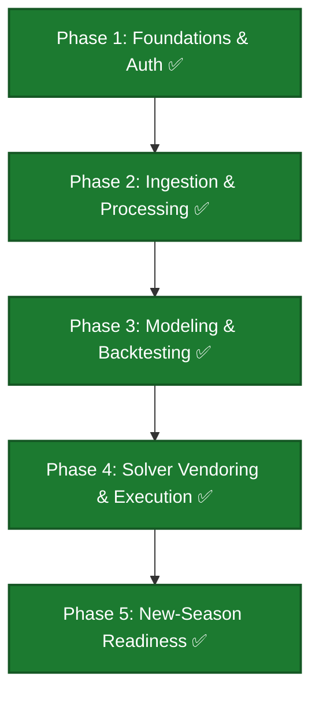

# FPL-Jubilee-Ascent - Project Roadmap

This roadmap tracks the development progress, target architecture, and phases for **FPL-Jubilee-Ascent**.

> **Agents:** read [`docs/agents/current-state.md`](docs/agents/current-state.md) first for what is built today vs this plan.

---

## Personas

| Persona | Goal | Primary surface |
|---------|------|-----------------|
| **User** | Run data refresh, backtest models, run solver to get optimal transfer plans | CLI |
| **Developer** | Plug in new score projection models | Python classes / CLI |

---

## Current Project Status: **Phases 1-5 complete**

Active map: none. Promotion gate refined per ADR 0062: binary segs >= 2/3 replaced by Non-Catastrophic Segment Loss Guardrails (cold-start parity >= -0.05, active loss >= -0.15, active win > 0). [Decoupled Minutes & Event Architecture with Decomposed Event Challenger #159](https://github.com/JubileeZ/fpl-jubilee-ascent/issues/159) completed; decision tickets #160–#165 closed. ML Component Champion Blueprint executed: zero-leakage Causal Panel Feature Engine (`models/ml_panel_features.py`) and Candidate `ml_component_challenger` built; dev gate +0.342 pts/GW boot P 0.740, but failed early_mid segment guardrail (-0.998 < -0.15; late won +1.470); Candidate Ledger updated (`revisit_after = 2027-10-21`); Champion `def_xg_shrink_challenger` stands. Prior Map #150 completed. Champion `def_xg_shrink_challenger` (ADR 0055, provisional). Pending: 2026-27 GW6+ post-promotion check.

---

## Implementation Phases

### ✅ Phase 1: Repo Infrastructure, Foundations & Auth (Completed)
All repository scaffolding, tiered authentication (Playwright, direct HTTP, environment tokens), and developer checks (ruff, pytest) are fully implemented.

---

### ✅ Phase 2: Ingestion, Processing & Archiving (Completed)
Raw data refresh pipeline, historical season snapshot scripts, and raw-to-parquet processors are fully implemented.

---

### ✅ Phase 3: Pluggable Modeling & Backtesting (Completed)
Baseline models, feature and projection exporters, and historical backtesting evaluations are fully implemented.

---

### ✅ Phase 4: Solver Vendoring & Execution (Completed)
Vendored MILP solver, multi-period transfer optimization wrapper, and top-picks console/CSV rank reports are fully implemented.

---

### ✅ Phase 5: New-Season Readiness (Completed)

Prior-season seed component model, Cold-Start, long-format Feature Contract, Modified FDR, CLI reports, Champion/solver tuning. Issues #75–#87 closed. Design: `docs/adr/0003`. Vocabulary: `CONTEXT.md`.

---

> [!NOTE]
> **Pre-commit gate:** run all test and lint commands successfully before proposing commits.
