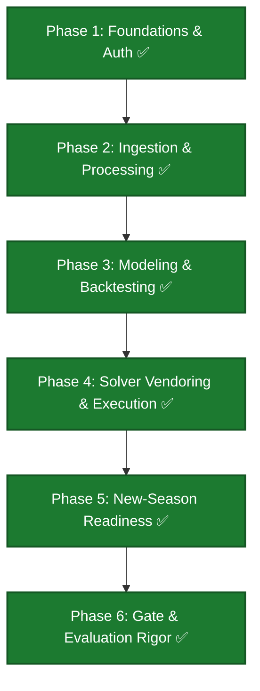

# FPL-Jubilee-Ascent - Project Roadmap

This roadmap tracks the development progress, target architecture, and phases for **FPL-Jubilee-Ascent**.

> **Agents:** read [`docs/agents/current-state.md`](docs/agents/current-state.md) first for what is built today vs this plan.

---

## Personas

| Persona | Goal | Primary surface |
|---------|------|-----------------|
| **User** | Run data refresh, backtest models, run solver to get optimal transfer plans | CLI |
| **Developer** | Plug in new score projection models | Python classes / CLI |

---

## Current Project Status: **Foundation engineering repaired; empirical admission/calibration pending**

- Correctness repair checkpoint, 2026-10-30: Phase 1–14 Standards/Spec findings resolved; final reviews 0 confirmed findings on both axes. Full suite 1007 passed, Ruff/core types clean; unchanged diagnostic smoke baseline types recorded. Native replay and verified evidence authority validated synthetically. Empirical admission, numerical calibration/approval and prospective validation remain separate prerequisites; no Champion change. Local checkpoint/temporary packet cleanup pending.

### Backtesting/promotion foundation — delivered (ADR 0066)

- Phase 0 complete `a96af707`: versioned evidence contracts, entry-point inventory, recommendation-only CI guard.
- Phase 1 complete `d4536c42`: strict synthetic causal admission, source/fixture checks and complete-origin inventory.
- Phase 2 complete `d8fa3ad6`: native state transitions, financial/chip accounting and explicit season scoring.
- Phase 3 complete `2676a568`: causal issue-by-target forecasts, strict export, identity/cache/resume storage.
- Phase 4 complete `324a20eb`: neutral GW1 ownership anchor construction, exact two-stage tie-breaking and freezing.
- Phase 5 complete `98537076`: independent rolling replay implementation and verification.
- Phase 6 complete `265fbb0a`: substantive projection guards and staged diagnostics.
- Phase 7 complete `e171dc23`: transfer plan replay profiler within bounded experiment.
- Phase 8 complete `4f56e975`: numerical and statistical evaluation protocol, stored-score block bootstrap, family-wise error control.
- Phase 9 complete `d3f1d72b`: confirmation admission, immutable attempt registry, tamper detection, dead-lever checks.
- Phase 10 complete `4157dd35`: prospective capture, shadow replay state transitions, outcome finalization, rollback recommendations.
- Phase 11 complete `e803e2fc`: unify recommendation paths, read-only pipelines, explicit manual adoption.
- Phase 12 complete `f5e71b7e`: legacy candidate ledger audit using recorded evidence only; lock preservation verified.
- Phase 13 complete `6f60734d`: adopt durable documentation, ADR 0066, operator workflow, and workflow/skill migration.
- Phase 14 complete: full delivery validation (869 tests pass), temporary implementation plan and finished packet deleted.
- Durable canon: [ADR 0066](docs/adr/0066-backtesting-and-promotion-foundation.md), [Operator Workflow](docs/testing/operator-workflow.md), [Delivery Record](docs/testing/foundation-delivery.md), and [Foundation Topic](docs/research/backtesting-promotion-foundation/). Production Model Champion `def_xg_shrink_challenger` stands unchanged; sealed season 2026-27 GW6+ protected.

Wayfinder Map: [Promotion Gate & Evaluation Rigor Overhaul (ADR 0064) #166](https://github.com/JubileeZ/fpl-jubilee-ascent/issues/166) completed. Resolved 4 structural distortions identified in quantitative audit: unseeded confirmation regime mismatch, short-panel Nickell bias, unconstrained LegalXI churn blindness, circular bootstrap boundary bugs, and endogenous playable pool masking across 7 closed decision tickets (#167–#173).

---

## Implementation Phases

### ✅ Phase 1: Repo Infrastructure, Foundations & Auth (Completed)
All repository scaffolding, tiered authentication (Playwright, direct HTTP, environment tokens), and developer checks (ruff, pytest) are fully implemented.

---

### ✅ Phase 2: Ingestion, Processing & Archiving (Completed)
Raw data refresh pipeline, historical season snapshot scripts, and raw-to-parquet processors are fully implemented.

---

### ✅ Phase 3: Pluggable Modeling & Backtesting (Completed)
Baseline models, feature and projection exporters, and historical backtesting evaluations are fully implemented.

---

### ✅ Phase 4: Solver Vendoring & Execution (Completed)
Vendored MILP solver, multi-period transfer optimization wrapper, and top-picks console/CSV rank reports are fully implemented.

---

### ✅ Phase 5: New-Season Readiness (Completed)

Prior-season seed component model, Cold-Start, long-format Feature Contract, Modified FDR, CLI reports, Champion/solver tuning. Issues #75–#87 closed. Design: `docs/adr/0003`. Vocabulary: `CONTEXT.md`.

---

### ✅ Phase 6: Promotion Gate & Evaluation Rigor Overhaul (Completed Map #166)

Re-architected Historical Promotion Gate (`backtesting/promotion.py`, `backtesting/metrics.py`, `backtesting/walkforward.py`, `models/ml_panel_features.py`) under ADR 0064:
- Ingest and wire 2023-24 warm confirmation seed archive ([#167](https://github.com/JubileeZ/fpl-jubilee-ascent/issues/167)) ✅.
- Short-panel Empirical Bayes priors & continuous $N_{\text{eff}}$ ML shrinkage ([#168](https://github.com/JubileeZ/fpl-jubilee-ascent/issues/168)) ✅.
- Constrained Legal Formation XI (£83.5m budget cap, 3-per-club max, deterministic tie-breaking) and squad churn guardrail ([#169](https://github.com/JubileeZ/fpl-jubilee-ascent/issues/169)) ✅.
- Exogenous Playable Pool mask & Active-Window Guardrails ([#170](https://github.com/JubileeZ/fpl-jubilee-ascent/issues/170)) ✅.
- Non-wrapping Moving Block Bootstrap ($L=5$, Active GWs) & Pooled Stratified Gate ([#171](https://github.com/JubileeZ/fpl-jubilee-ascent/issues/171)) ✅.
- $\sqrt{n_s}$-scaled segment floors ([#172](https://github.com/JubileeZ/fpl-jubilee-ascent/issues/172)) ✅.
- Verification suite, candidate re-evaluations, and ADR 0064 ([#173](https://github.com/JubileeZ/fpl-jubilee-ascent/issues/173)) ✅.

---

> [!NOTE]
> **Pre-commit gate:** run all test and lint commands successfully before proposing commits.
