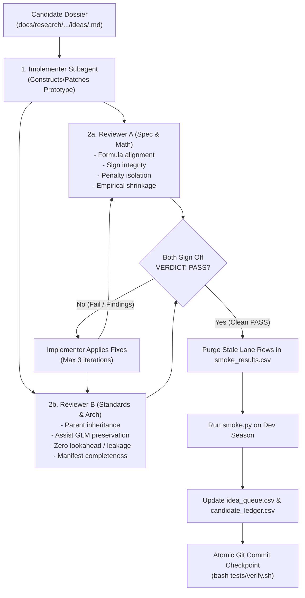

# Two-Axis Pre-Execution Candidate Review Protocol

Candidate exploration harnesses require rigorous pre-execution code and mathematical verification before running compute-heavy walkforward backtests or committing diagnostic verdicts to historical ledgers.

We establish the mandatory **3-Subagent Team per Candidate** architecture across Queue mode and all specification-backed candidate exploration workflows.

---

## 1. Context & Motivation

During autonomous candidate exploration (e.g. `EXT-01` through `EXT-31`), single-agent prototype construction resulted in severe silent implementation defects:
1. **Mathematical Inversion & Proxy Substitution**: Prototypes substituted FDR fixture difficulty for point-in-time empirical opponent xGC, omitted required penalty isolation, or inverted home-advantage signs ($v_h/v_a$ ratios penalizing home teams).
2. **Pipeline Collisions & Signal Wiping**: Prototypes attempting to model player xA rates had their signals 100% wiped out in Gameweeks 4–38 by parent `MultiFeatureAssistChallengerModel._project_event_components` overwriting `components["xp_assists"]`.
3. **Threshold Corruption**: Pre-`predict` feature mutations caused uncalibrated jumps across `HoldChaseChallengerModel._XG_TRIM_BELOW = 0.10` playing time thresholds.
4. **Degenerate No-Ops**: Attempting to scale multipliers in GW2–38 where `apply_matchup_share_overlay` had already forced `attack_multiplier = 1.0` and `defence_multiplier = 1.0`, resulting in 100% no-ops.

When flawed prototypes are evaluated directly under `smoke.py`, they yield false-negative diagnostic failures, corrupt candidate history, and risk erroneous dead-lever moratoria.

---

## 2. Decision: The 3-Subagent Review Architecture

Before executing `smoke.py` on any candidate proposal with an idea specification dossier, the orchestrator MUST deploy a specialized 3-subagent team:

### Roles & Responsibilities

1. **Implementer Subagent (`self`)**:
   - Implements or patches `docs/research/<topic>/prototypes/<lane>/prototypes.py` strictly following the idea dossier, mathematical formulation, and repository conventions.
   - Applies targeted code remediations when reviewers return findings.

2. **Reviewer A (Spec & Math Integrity, `research`)**:
   - Compares the code line-by-line against the candidate dossier (`docs/research/<topic>/ideas/<id>.md`).
   - Verifies algebraic formulas, signs, monotonic scaling, and non-amplification invariants.
   - Enforces penalty isolation ($0.15\text{ xG/90}$ unscaled for primary penalty takers).
   - Validates small-sample / cold-start priors (Empirical Bayes shrinkage, seed sample counts $n_t$).
   - Confirms all declared parameter sweep variants in `_GRID` are present and distinct.

3. **Reviewer B (Standards & Pipeline Architecture, `research`)**:
   - Audits class inheritance and parent method overrides (e.g. `DefXgShrinkChallengerModel`, `LearnedStartChallengerModel`, `MultiFeatureAssistChallengerModel`).
   - Ensures assist rate modeling interacts cleanly with `self._history` and does not get wiped out in GW4–38.
   - Ensures minutes thresholds (`HoldChase`) are isolated from rate scaling.
   - Enforces zero lookahead: fit window strictly before target deadline; zero terminal columns (`TERMINAL_PLAYER_COLUMNS`).
   - Verifies typing, Ruff linting, input immutability (`features_df.copy()`), and `_MANIFEST` completeness.

---

## 3. Operational Protocols

1. **Serialized Lane Execution**:
   - Candidate lanes in Queue mode execute sequentially (one candidate at a time with its 3 subagents) rather than parallelizing all 5 lanes simultaneously, preventing API 429 quota exhaustion and isolating walkforward processes.

2. **Bounded Review-Repair Loop**:
   - The review-repair loop between Implementer and Reviewers is capped at **3 repair iterations**.
   - If both reviewers do not sign off `VERDICT: PASS` within 3 cycles, the lane is flagged `blocked (review convergence)` in `idea_queue.csv`, logged to `## Human Queue`, and the orchestrator advances to the next candidate.

3. **Stale Diagnostic Purge**:
   - Prior to launching `smoke.py` for a verified prototype, the orchestrator automatically purges any existing rows for that lane from `smoke_results.csv`, ensuring only verified, legitimate evaluations exist in the diagnostic ledger.

4. **Autonomous Local Git Checkpoints**:
   - The skill is authorized to commit atomic local Git checkpoints (`chore(candidate): complete <lane> prototype fix, two-axis review, and dev retest`) after each candidate finishes, provided `bash tests/verify.sh` passes.
   - Outward actions (`git push` and production Champion adoption) remain strictly gated on user instruction.

5. **Dual-Season Pass Halting Protocol**:
   - If a candidate achieves verified PASS on both Dev Season (2025–26) and Confirmation Season (2024–25):
     1. Freeze the winning prototype into `models/custom/<name>.py`.
     2. Draft Champion-change ADR Proposed (`docs/adr/XXXX-champion-<name>.md`).
     3. Populate adoption in `## Human Queue`.
     4. Immediately halt the queue loop to await human operator authorization before modifying production configuration.

---

## 4. Status

**Status:** Accepted.

Governs `.agents/skills/explore-candidate/` as the default execution engine for Queue mode and all specification-backed candidate exploration workflows.
