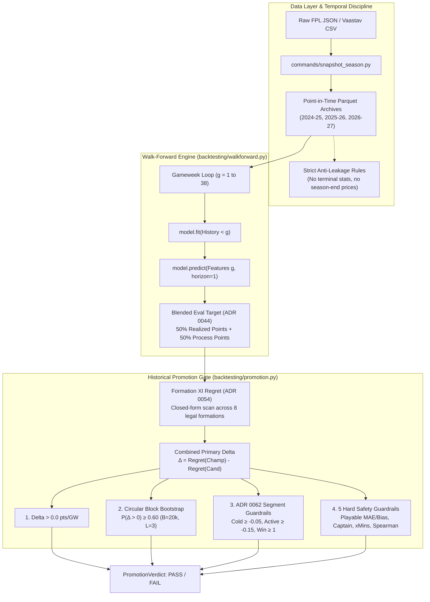

# Brief 02: FPL Backtesting & Promotion Gate Adversarial Audit

**Target Audience**: Independent frontier language model
**Task Type**: Statistical Audit, Methodology Review & Algorithmic Reform Plan  
**Repository**: `fpl-jubilee-ascent`  
**Current Gate Authority**: ADR 0046, ADR 0047, ADR 0049, ADR 0054, ADR 0062  
**Core Python Implementation**: `backtesting/promotion.py`, `backtesting/evaluator.py`, `backtesting/metrics.py`, `backtesting/walkforward.py`

---

## Part 1: Copy-Paste Prompt for the 3rd-Party LLM

```markdown
You are a Principal Statistical Auditor and Quantitative Validation Lead specializing in sports forecasting, walk-forward backtesting architectures, and statistical model governance.

### Context & System Environment
You are conducting a formal audit of `fpl-jubilee-ascent`, an advanced open-source Fantasy Premier League (FPL) projection and combinatorial optimization engine.

In our repository, a newly developed model (a "Candidate") can only displace the incumbent "Model Champion" if it passes a rigorous, automated **Historical Promotion Gate** across two complete historical English Premier League seasons (76 gameweeks, >45,000 player-match observations).

Our current Model Champion is `adaptive_causal_challenger` (promoted under ADR 0063). It displaced `def_xg_shrink_challenger` by demonstrating statistical superiority under our gate:
- Dev Season (2025–26, seeded with 2024–25 archive): $\Delta = +0.7359$ pts/GW (+28.0 legal XI points), circular block bootstrap $P = 0.9918$, 5/5 guardrails passed, ADR 0062 segment guardrails passed.
- Confirmation Season (2024–25, completely unseeded): $\Delta = +0.2259$ pts/GW (+8.6 legal XI points), circular block bootstrap $P = 0.6556$, 5/5 guardrails passed, ADR 0062 segment guardrails passed.

Despite this success, our engineering team has uncovered 4 deep methodological tensions and potential failure modes in our evaluation machinery that require an external adversarial audit.

### Your Mission
Conduct an adversarial audit of our backtesting and promotion gate architecture, rigorously critique our methodology across the 4 specific dilemmas outlined below, and deliver a comprehensive, mathematically grounded Reform & Fix Plan.

### The 4 Core Dilemmas to Audit

#### Dilemma 1: The "Unseeded Confirmation Season" Paradox
- **Current Setup**: Candidates are tuned on the 2025–26 "Development Season" with a prior-season historical seed (2024–25 processed data). To prevent data mining, the Candidate is then frozen and subjected to a single-shot confirmation run on the 2024–25 season with ZERO prior-season seed (completely unseeded cold-start).
- **The Symptom**: Machine learning candidates (`apex_predator_challenger`, `bounded_causal_challenger`, `ml_component_challenger`) achieve massive statistical victories on the seeded dev season (+0.34 to +0.84 pts/GW, bootstrap $P > 0.90$), but repeatedly suffer catastrophic failure on the unseeded confirmation season ($\Delta = -0.15$ to $-2.28$ pts/GW). Because unseeded ML models must build parameters from scratch in GW1–10, they over-regularize early talisman hauls (e.g. Cole Palmer's 2024–25 4-goal match).
- **Audit Mandate**: Is requiring an unseeded confirmation season a sound protection against overfitting, or is it a structurally flawed hurdle that permanently discriminates against adaptive/learning models in favor of static, hard-coded heuristics? Propose an alternative out-of-sample confirmation protocol.

#### Dilemma 2: Metric Divergence — Formation XI Regret vs. Multi-Period Transfer Plan Walk-Forward
- **Current Setup**: The promotion gate ranks models purely on single-gameweek **Legal Formation XI Regret** (ADR 0054). In every gameweek, the model selects the theoretical best 11-player lineup across 8 legal formations, unconstrained by player costs, previous squads, or transaction limits.
- **The Symptom**: In the real application, the user runs a HiGHS MILP solver (`commands.solve`) optimizing transfers over a rolling 5–10 GW horizon, subject to a £100m budget, 15-man squad balance, 1–2 free transfers, 4-point hit costs, and 5 Strategic variance constraints (ADR 0061).
- **Audit Mandate**: Does evaluating models via myopic single-week 11-man regret select for high-turnover, "fluke-chasing" projections that degrade multi-week transfer plans and squad equity? What is the mathematical and operational feasibility of integrating Transfer Plan Walk-Forward directly into the promotion gate?

#### Dilemma 3: Circular Block Bootstrap Mechanics ($B=20,000, L=3, P \ge 0.60$)
- **Current Setup**: To account for temporal autocorrelation in weekly football results, we use a circular block bootstrap (ADR 0046, ADR 0049) resampling blocks of $L=3$ consecutive gameweeks across $B=20,000$ iterations. A candidate passes if $P(\bar{\Delta}_{\text{bootstrap}} > 0) \ge 0.60$.
- **Audit Mandate**: Is a 3-week block length sufficient when Premier League fixture difficulty swings typically span 4 to 6 weeks? Does the circular boundary condition (which wraps GW38 directly back to GW1) distort early-season cold-start vs late-season high-sample regimes? Is $P \ge 0.60$ too lenient, or does it properly balance Type I and Type II errors?

#### Dilemma 4: Non-Catastrophic Segment Loss Guardrails (ADR 0062)
- **Current Setup**: ADR 0062 replaced a binary segment win rule ($\ge 2/3$ segments) with continuous regret guardrails:
  - Cold-start parity: $\Delta_{\text{cold\_start}} \ge -0.05$ pts/GW (GW1–4).
  - Active segment bounds: $\Delta_{\text{early\_mid}} \ge -0.15$ and $\Delta_{\text{late}} \ge -0.15$ pts/GW (GW5–19 and GW20–38).
  - Active win: $\max(\Delta_{\text{early\_mid}}, \Delta_{\text{late}}) > 0.0$ pts/GW.
- **Audit Mandate**: Does this continuous formulation provide sufficient protection against margin gaming? How does the vast sample size asymmetry (4 games in cold-start vs 19 games in late season) affect the statistical power of these segment tests?

### Required Output Structure
1. **Executive Audit Assessment & Risk Matrix**: High-level verdict on our gating soundness, vulnerability severity ratings (Critical, Major, Moderate), and potential for false positives/negatives.
2. **Deep-Dive Mathematical Analysis**: Rigorous theoretical critique of each of the 4 dilemmas.
3. **Proposed Architectural Reforms**: Exact mathematical equations, updated algorithmic workflows, concrete statistical tests, and parameter thresholds.
4. **Implementation & Verification Plan**: Step-by-step roadmap to implement and validate the reformed gate within `backtesting/promotion.py` without breaking reproducibility.

Review the complete technical context below before delivering your audit.
```

---

## Part 2: Technical Architecture of the Backtesting & Gating Engine



### 1. Temporal Integrity & Point-in-Time Backtest Discipline (ADR 0046)

Backtest leakage is strictly guarded against in `features/processor.py` and `features/builder.py`:
1. **Expanding-Window Information Boundary**:
   At gameweek $g$, models and feature generators may only access matches and events strictly occurring before the official deadline:
   $$\mathcal{H}_{<g} = \{ (i, t, y_{i,t}) \mid t < g \}$$
2. **Terminal Attribute Stripping**:
   `players.parquet` in season archives contains terminal columns (e.g. `total_points`, `final_cost`, `status`). The backtest pipeline automatically drops these columns and reconstructs as-of player pricing, availability, and club affiliations exclusively from lagged performance logs (`player_performances.parquet`).
3. **No Target Leakage in Feature Scalers**:
   Feature scalers (e.g. `CausalFeatureScaler` in `models/ml_panel_features.py`) are fit strictly on $\mathcal{H}_{<g}$ and transform test rows $g$ using historical means and standard deviations.

---

### 2. Primary Promotion Metric: Legal Formation XI Regret (ADR 0054)

Prior to ADR 0054, the engine used unconstrained `top_11_regret` (picking the 11 highest-projected players regardless of position). This allowed models to win by picking 10 forwards, an illegal lineup in FPL. ADR 0054 instituted closed-form Legal Formation XI Regret.

#### Mathematical Definition
Let $\mathcal{P}_g$ be the set of available players in gameweek $g$. Each player $i$ has projected points $\hat{y}_{i,g}$ and target points $y_{i,g}$.

1. **Legal Formation Space $\mathcal{F}$**:
   FPL rules require an 11-player starting lineup with:
   - Exactly 1 Goalkeeper (GKP).
   - 3 to 5 Defenders (DEF).
   - 2 to 5 Midfielders (MID).
   - 1 to 3 Forwards (FWD).
   This yields exactly 8 mutually exclusive legal formation templates:
   $$\mathcal{F} = \{ (1, 3, 5, 2), (1, 3, 4, 3), (1, 4, 4, 2), (1, 4, 3, 3), (1, 4, 5, 1), (1, 5, 3, 2), (1, 5, 4, 1), (1, 5, 2, 3) \}$$

2. **Model Selection**:
   For candidate model $M$, the starting XI $\mathbf{x}^{(M)}_g$ is chosen to maximize projected points:
   $$\mathbf{x}^{(M)}_g = \arg\max_{\mathbf{x} \in \text{LegalXI}} \sum_{i \in \mathbf{x}} \hat{y}^{(M)}_{i,g}$$

3. **Theoretical Optimal Legal XI**:
   $$\mathbf{x}^*_g = \arg\max_{\mathbf{x} \in \text{LegalXI}} \sum_{i \in \mathbf{x}} y_{i,g}$$

4. **Per-Gameweek Decision Regret**:
   $$\text{Regret}(M, g) = \sum_{i \in \mathbf{x}^*_g} y_{i,g} - \sum_{i \in \mathbf{x}^{(M)}_g} y_{i,g}$$

5. **Primary Improvement Delta ($\Delta$)**:
   $$\Delta_g = \text{Regret}(\text{Champion}, g) - \text{Regret}(\text{Candidate}, g)$$
   $$\bar{\Delta} = \frac{1}{N} \sum_{g=1}^N \Delta_g$$
   - $\bar{\Delta} > 0$: The Candidate's starting lineup decisions yielded more real fantasy points than the Champion.

---

### 3. The 4-Condition Historical Promotion Gate (`backtesting/promotion.py`)

To achieve promotion, a Candidate must pass all 4 requirements on both development and confirmation seasons:

#### Condition 1: Combined Primary Delta
$$\bar{\Delta} > 0.0 \text{ pts/GW}$$

#### Condition 2: Circular Block Bootstrap ($P \ge 0.60$, ADR 0049)
Football outcomes exhibit temporal clustering. Standard i.i.d. bootstrapping underestimates standard errors.
- Resamples blocks of $L=3$ consecutive gameweeks.
- Number of bootstrap replicates: $B = 20,000$.
- Probability of positive mean delta across draws must satisfy:
  $$P\left( \bar{\Delta}_{\text{bootstrap}} > 0 \right) \ge 0.60$$

```python
def block_bootstrap_win_probability(
    deltas: Sequence[float], *, draws: int = 20_000, block: int = 3, seed: int = 0
) -> float:
    values = np.asarray(deltas, dtype=float)
    n = len(values)
    size = min(block, n)
    starts = np.random.default_rng(seed).integers(0, n, size=(draws, -(-n // size)))
    idx = ((starts[:, :, None] + np.arange(size)) % n).reshape(draws, -1)[:, :n]
    return float((values[idx].mean(axis=1) > 0).mean())
```

#### Condition 3: Non-Catastrophic Segment Loss Guardrails (ADR 0062)
Replaced the older binary rule (`segment_wins >= 2`) which failed models that tied cold start ($0.00 < 0.00 \implies \text{False}$).
1. **Cold-Start Parity (GW1–4)**:
   $$\Delta_{\text{cold\_start}} \ge -0.05 \text{ pts/GW}$$
2. **Active Segment Non-Catastrophic Regression (GW5–19 and GW20–38)**:
   $$\Delta_{\text{early\_mid}} \ge -0.15 \quad \text{and} \quad \Delta_{\text{late}} \ge -0.15 \text{ pts/GW}$$
3. **Active In-Season Win**:
   $$\max(\Delta_{\text{early\_mid}}, \Delta_{\text{late}}) > 0.0 \text{ pts/GW}$$

#### Condition 4: The 5 Hard Safety Guardrails
Evaluated across all 38 gameweeks:

| Guardrail Metric | Mathematical Condition | Target Sub-Pool | Failure Mechanism Prevented |
|---|---|---|---|
| **Playable Pool MAE** | $\text{MAE}_{\text{cand}} \le \text{MAE}_{\text{champ}} \times 1.01$ | $\hat{y} \ge 2.0$ or Mins $\ge 30$ | Point prediction error on viable starting assets. |
| **Playable Pool Bias** | $|\text{Bias}_{\text{cand}}| \le |\text{Bias}_{\text{champ}}| + 0.01$ | Same Playable Pool | Systematic inflation or deflation of active players. |
| **Captaincy Regret** | $\text{CapRegret}_{\text{cand}} \le \text{CapRegret}_{\text{champ}} + 0.15$ | Highest projected starter | Benchmarking error on the $2\times$ captain pick. |
| **Minutes MAE** | $\text{xMinsMAE}_{\text{cand}} \le \text{xMinsMAE}_{\text{champ}} \times 1.01$ | All active players | Uncalibrated minutes forecasts. |
| **Spearman Correlation** | $\rho_{\text{cand}} \ge \rho_{\text{champ}} - 0.005$ | All active players | Squad-wide ranking degradation. |

---

### 4. Deep-Dive Empirical Case Studies for the Audit

To assist the auditor, here are the exact results of recent candidate models that triggered the current architectural crisis:

#### Case 1: `bounded_causal_challenger` (October 2026)
- **Concept**: Attempted to activate Causal Panel ML at GW10 instead of GW20, with strict $[-10\%, +10\%]$ bounding clamps on goal rates to prevent noise.
- **2025–26 Dev Season (Seeded)**: PASS
  - $\bar{\Delta} = +0.156$ pts/GW, Bootstrap $P = 0.803$, Segment wins: 1/3, all guardrails passed.
- **2024–25 Confirmation Season (Unseeded)**: CATASTROPHIC REGRESSION
  - $\bar{\Delta} = -2.280$ pts/GW, Bootstrap $P = 0.012$, Segment wins: 0/3.
  - Early-mid regression: $\Delta_{\text{early\_mid}} = -5.775$ pts/GW ($<-0.15$ threshold).
  - Captaincy Regret regressed to $4.993$ vs Champion $4.256$.
- **Audit Question**: Why did a model with a conservative $[-10\%, +10\%]$ output clamp collapse by $-5.775$ pts/GW in early-mid when unseeded?

#### Case 2: `apex_predator_challenger` (October 2026)
- **Concept**: Composite Causal ML model activating at GW10 with schedule congestion logit penalty.
- **2025–26 Dev Season (Seeded)**: PASS
  - $\bar{\Delta} = +0.840$ pts/GW (+31.9 points), Bootstrap $P = 0.992$, Segment wins: 2/3, 5/5 guardrails green.
- **2024–25 Confirmation Season (Unseeded)**: FAIL
  - $\bar{\Delta} = -0.153$ pts/GW, Bootstrap $P = 0.376$, Segment wins: 1/3.
  - Early-mid regression: $\Delta_{\text{early\_mid}} = -0.959$ pts/GW.
  - Congestion penalty failed across historical confirmation games.

#### Case 3: `adaptive_causal_challenger` (Active Champion, ADR 0063)
- **Concept**: 100% Champion fallback in GW1–19; activates ML at GW20+ only.
- **2025–26 Dev Season**: $\Delta = +0.7359$ pts/GW, Bootstrap $P = 0.9918$.
- **2024–25 Confirmation Season**: $\Delta = +0.2259$ pts/GW, Bootstrap $P = 0.6556$.
- **Audit Question**: By forcing 100% fallback for 19 gameweeks, did we artificially construct a model to pass the gate rather than solving the underlying sample estimation challenge?
