# Candidate Ideation & External Model Collaboration

**Updated**: 2026-10-28 (+07:00)
**Data stamp**: Completed dev rows in `smoke_results.csv`; no confirmation or holdout results
**Season**: Multi-season (2024-25, 2025-26, 2026-27)  
**Status**: Queue exhausted; EXT-07/08/09/11/12 full dev FAIL; EXT-10/13 blocked in Human Queue; no passing Candidate; Champion `adaptive_causal_challenger` unchanged  
**Purpose**: Generate, curate, and queue innovative candidate projection model hypotheses from frontier LLMs for empirical gating.  
**Scope**: Ingests external model ideation proposals, filters against proven dead-lever archetypes, and executes autonomous gating via `explore-candidate`.  
**Related**: [Eval canon](../INDEX.md) · [Candidate Ledger](../candidate-ledger/candidate-ledger.md) · [ADR 0064](../../adr/0064-promotion-gate-and-evaluation-rigor-overhaul.md) · [ADR 0063](../../adr/0063-champion-adaptive-causal-challenger.md)  
**Artifact**: [idea_queue.csv](idea_queue.csv) `order` / `idea_id` / `tier` / `status` / `spec_path` — primary candidate work queue index.  
**Dossiers**: [ideas/](ideas/) — full LaTeX formulations, cold-start strategies, and Python code skeletons.  
**Smoke Results**: [smoke_results.csv](smoke_results.csv) — empirical dev-season gate runs across prototype variants.
**Agent Reports**: [Minutes](minutes-ideation-response.md) · [Attack](attack-ideation-response.md) · [Defense](defense-ideation-response.md); frontier language-model review, 2026-10-28.

LLM references: capability-neutral; specialist role, date, source artifact for provenance. No fixed provider/model/version recommendations. FPL projection-model identifiers retained for reproducibility.

---

## Exploration execution (2026-10-28, completed)

Mode: default queue. All 13 queue ideas evaluated or screened. Fixed grids from dossiers; no widening. Dev 2025-26 GW1-38 seeded 2024-25; confirm 2024-25 seeded 2023-24; live holdout sealed.
- Five dead-matches: EXT-01, EXT-02, EXT-03, EXT-04, EXT-06 (dropped at step 1 ledger screen).
- Seven full dev failures: EXT-05 (Huber panel), EXT-07 (exposure replay), EXT-08 (joint xGI allocation k2-k16), EXT-09 (binomial anchor exposure), EXT-11 (opponent role allocation lambda 25-100), EXT-12 (change detection h48/h24 phi05/10). All logged Dead in `candidate_ledger.csv` until 2027-10-28.
- Two blocked mechanisms: EXT-10 (blocked on dead EXT-07 decoder prerequisite and absent seed hazard summaries); EXT-13 (blocked on deadline-valid schedule provenance).
- Champion `adaptive_causal_challenger` stands unchanged. Exit (b) (verdict: no win).

Audited implementations and synthetic checks preserved in [prototypes/](prototypes/README.md). Parent independently audited manifests (`AUDIT PASS`) and ran preserved checks (`checks.py`, `checks_role.py`). Zero leakage. Full pytest suite 693 passed; `verify.sh` 219 passed; Ruff clean. Work Packet: `.agents/work-packets/explore-candidate-candidate-ideation.md`; handoff pointer committed.

<!-- exploration-results:start -->
## Completed development evidence

Generated from [smoke_results.csv](smoke_results.csv), keyed by `variant`; cached columns `combined_delta`, `segs`, `boot_p_gt0`, `guardrails_passed`, `pass`. Full failed-mechanism reasons retained in companion. Partial grid rows never imply whole-lane verdict.

- `ext_09_binomial_fixture_exposure`: FAIL; dev 2025-26 GW1-38; delta +0.000000 points/GW; 0/3 segments; bootstrap P 0.57790; guardrails True.
- `ext_07_replay_final_states`: FAIL; dev 2025-26 GW1-38; delta -0.605263 points/GW; 0/3 segments; bootstrap P 0.20845; guardrails False.
- `ext_08_k2`: FAIL; dev 2025-26 GW1-38; delta -0.653026 points/GW; 0/3 segments; bootstrap P 0.00000; guardrails True.
- `ext_08_k4`: FAIL; dev 2025-26 GW1-38; delta -0.267500 points/GW; 0/3 segments; bootstrap P 0.00000; guardrails True.
- `ext_08_k8`: FAIL; dev 2025-26 GW1-38; delta -0.267500 points/GW; 0/3 segments; bootstrap P 0.00000; guardrails True.
- `ext_08_k16`: FAIL; dev 2025-26 GW1-38; delta -0.573158 points/GW; 0/3 segments; bootstrap P 0.00000; guardrails True.
- `ext_11_role_l100`: FAIL; dev 2025-26 GW1-38; delta +0.000000 points/GW; 0/3 segments; bootstrap P 0.00000; guardrails True.
- `ext_11_role_l50`: FAIL; dev 2025-26 GW1-38; delta +0.000000 points/GW; 0/3 segments; bootstrap P 0.00000; guardrails True.
- `ext_11_role_l25`: FAIL; dev 2025-26 GW1-38; delta +0.000000 points/GW; 0/3 segments; bootstrap P 0.00000; guardrails True.
- `ext_12_h48_phi10`: FAIL; dev 2025-26 GW1-38; delta -0.471053 points/GW; 0/3 segments; bootstrap P 0.00000; guardrails True.
- `ext_12_h24_phi05`: FAIL; dev 2025-26 GW1-38; delta -0.689211 points/GW; 0/3 segments; bootstrap P 0.04320; guardrails True.
- `ext_12_h48_phi05`: FAIL; dev 2025-26 GW1-38; delta -0.695526 points/GW; 0/3 segments; bootstrap P 0.00000; guardrails True.
- `ext_12_h24_phi10`: FAIL; dev 2025-26 GW1-38; delta -0.716974 points/GW; 0/3 segments; bootstrap P 0.00000; guardrails True.

<!-- exploration-results:end -->

## Agent Ideation Review (Batch 2: 2026-10-28)

Three independent specialist reviews; lanes: minutes/budget starters, attacking events, defensive/GKP events. Full prompt plus all 93 ledger rows screened. Reports contain eight specialist proposals; shared exposure reconstruction merged into one mechanism, leaving seven unique hypotheses. Ranking below reflects source evidence and implementation feasibility, never measured predictive improvement.

1. **Exposure-coherent participation reconstruction**: First investigate deterministic correctness. Late ML writes final participation/minutes and `xp_minutes`, while event values remain copied from earlier `champ_proj`; attack multipliers act on those earlier values. Replay unchanged scoring links at final coherent states, preserving rates and GW1-19 fallback. Minutes and defense agents found same path independently. Before any experiment, resolve probability simplex, capped conditional-duration/P(60) semantics, inherited effective rate transformations, and single bonus allocation. See [source assembly](../../../models/ml_component_challenger.py#L366).
2. **Joint xGI intensity and allocation**: First standalone event-rate hypothesis. Joint own xG/xA process model shares information between total involvement and shooter/creator allocation. Nonzero cross-signal derivative distinguishes proposal from independent scalar shrinkage. Existing history sufficient; four proposed variants. Untested generalized likelihood and prior coupling remain risks.
3. **Binomial fixture opportunities in inherited start anchor**: Replace player-GW any-start Bernoulli target with starts out of observed fixture opportunities. Active causal panel already fixture-level; proposal targets inherited learned-start anchor only. Singleton variant; effect may be narrow or absorbed by existing mass preservation/H1. Never infer missing rows as DNP.
4. **Full-duration survival likelihood**: Replace H3 duration-offset likelihood with censored starting-duration survival model; derive mean minutes and P(60) jointly. Distinct from direct Beta-binomial threshold fit. Requires explicit immutable seed-hazard summaries and coherent decoder; four proposed variants. Short-panel uncertainty remains unresolved.
5. **Opponent conditional attacking-role allocation**: Relative opponent-by-attacker-profile concession signal, with total attacking expectation preserved. Distinctness depends on conditional role contrasts, not scalar opponent strength. Three proposed variants. Coarse profiles, schedule composition, and final normalization ordering require care.
6. **Sequential attacking-opportunity change detection**: Continuous xG/xA rate-change likelihood against stationary reference. Four proposed variants; highest numerical/false-change risk among event proposals. No participation HMM or fixed-decay retune.
7. **Habit-adjusted cumulative playing dose**: Deferred pending schedule provenance. Actual recent played-minute dose relative to habitual exposure supplies proposed new signal, beyond fixed rest-day congestion shift. Historical scheduled dates must have been known at each deadline; final archive schedule alone insufficient. Missing provenance requires fallback or separately specified deadline-only dose. Four variants remain paper specification, not executable queue work.

### Source corrections and decision

Default Champion uses `clip((GW-3)/5, 0, 1)`, already full weight at GW20; documented five-GW late ramp is not executed. Active constructor leaves `use_neff_alpha=False`; continuous N_eff helper is optional. Prompt corrected without model behavior change. Warm seed enters feature construction; model-fit history must not be assumed to contain raw prior-season rows.

Decision: seven deduplicated hypotheses added to queue with full dossiers, source context, and mechanism audits. Six `untested`; workload `blocked (historical schedule provenance)`. Survival carries `after:EXT-07`; prerequisite failure never authorizes stacking a dead lever. Prior six verdict rows preserved. No candidate implementations, empirical runs, ledger verdicts, or holdout inspection. Mechanism screens provisional until implementation matches stated distinctions; recheck authoritative ledger before experimentation.

Queue dossiers, in priority order:

- [EXT-07: Exposure reconstruction](ideas/EXT-07-exposure-coherent-participation-reconstruction.md).
- [EXT-08: Joint xGI intensity/allocation](ideas/EXT-08-joint-xgi-intensity-and-allocation.md).
- [EXT-09: Binomial fixture opportunities](ideas/EXT-09-binomial-fixture-exposure-for-the-inherited-start-anchor.md).
- [EXT-10: Duration survival](ideas/EXT-10-full-duration-survival-likelihood-for-starting-players.md), after EXT-07.
- [EXT-11: Opponent role allocation](ideas/EXT-11-opponent-conditional-attacking-role-allocation.md).
- [EXT-12: Opportunity change detection](ideas/EXT-12-sequential-attacking-opportunity-change-detection.md).
- [EXT-13: Habit-adjusted playing dose](ideas/EXT-13-habit-adjusted-cumulative-playing-dose.md), blocked.

Priority: deterministic state/exposure audit, then joint xGI coupling. Treat remaining mechanisms independently; shared decoder prerequisite must not conceal incremental effects of new estimated heads. Expected gains, occurrence frequency of state inconsistencies, and promotion success unknown.

Reproduce: regenerate prompt, read three named agent reports and current ledger, recheck referenced source paths, consolidate shared mechanism once. Preserve GW1-19 parity, confirmation freeze, and sealed 2026-27 GW6+ boundary. Report contains no new empirical metric cache.

## Queue Exploration Verdict (Batch 1: 2026-10-26)

**Verdict:** Queue exhausted (Exit b: no win); Model Champion `adaptive_causal_challenger` stands unchanged.

### Queue Status & Results Summary

| Order | Idea ID | Component | Mechanism | Status | dev combined_delta | segs | boot P | Nearest Ledger Row / Verdict |
|---|---|---|---|---|---|---|---|---|
| 1 | `EXT-01` | `xp_minutes` | Asymmetric Conditional Substitution Hazard & Beta-Binomial 60-Min Survival | `dead-match` | — | — | — | Dead Row 61: `Empirical-Bayes P(60\|state) Beta-binomial` (revisit 2027-09-29) |
| 2 | `EXT-02` | `xp_goals` | State-Decoupled Cameo Event Intensity & Late-Game Fatigue | `dead-match` | — | — | — | Dead Row 11: `Assist finishing offsets (goals+assists pooled)` (revisit 2027-09-28) |
| 3 | `EXT-03` | `xp_assists` | Leave-One-Out Teammate Receiver Finishing Multiplier | `dead-match` | — | — | — | Dead Row 11: `Assist finishing offsets (goals+assists pooled)` (revisit 2027-09-28) |
| 4 | `EXT-04` | `xp_saves` | Shot-Quality Decoupled Goalkeeper Save Volume | `dead-match` | — | — | — | Dead Row 72: `Club SoT volume x pooled save rate` (revisit 2027-09-29) |
| 5 | `EXT-05` | `xp_minutes` | Price-Stratified Huber Causal Panel + Continuous $N_{\text{eff}}$ Ramp | `fail` | −1.0036 | 1/3 | 0.0116 | All 4 variants failed dev; early_mid catastrophic regression (−2.643 < −0.15) |
| 6 | `EXT-06` | `xp_defcon` | Opponent Possession-Adjusted Defcon Threshold Survival | `dead-match` | — | — | — | Dead Row 81: `Defcon venue and opposition pressure scaling` (revisit 2027-09-30) & ARCH-12 |

---

## Detailed Findings: EXT-05 (Lane `ext_05`)

### Hypothesis & Formulation

`EXT-05` attempted to address potential budget-enabler misranking under the £83.5m Constrained Legal Formation XI by:
1. Replacing global squared-error Ridge with L2-penalized Huber regression ($\delta \in [1.20, 1.50]$) on player duration offsets.
2. Partitioning players into 3 price tiers (Budget $\le £5.5\text{m}$, Mid $£5.6\text{m}–£7.9\text{m}$, Premium $\ge £8.0\text{m}$) and centering ML adjustments within each tier on playable assets.
3. Replacing the discrete GW 20 step ramp in `adaptive_causal_challenger` with continuous effective sample-size blending $N_{\text{eff}, g} = 0.5 N_{\text{seed}} + N_{\text{in\_season}, <g}$ with $N_{\min} \in [3000, 4000]$ and $N_{\text{full}} \in [7000, 8000]$.

### Empirical Results (Dev Season 2025–26 GW1–38)

| Variant | $N_{\min}$ | $N_{\text{full}}$ | Huber $\delta$ | L2 $\lambda$ | dev combined_delta | segs | boot P | Guardrails | Reasons |
|---|---|---|---|---|---|---|---|---|---|
| `ext_05_n3000_n7000_d120_l100` | 3000 | 7000 | 1.20 | 100.0 | −1.0036 | 1/3 | 0.0116 | FAIL | early_mid catastrophic regression (−2.643 < −0.15); xMins MAE regressed |
| `ext_05_n3500_n7500_d150_l100` | 3500 | 7500 | 1.50 | 100.0 | −1.0036 | 1/3 | 0.0116 | FAIL | early_mid catastrophic regression (−2.643 < −0.15); xMins MAE regressed |
| `ext_05_n3500_n7500_d135_l50` | 3500 | 7500 | 1.35 | 50.0 | −1.0036 | 1/3 | 0.0116 | FAIL | early_mid catastrophic regression (−2.643 < −0.15); xMins MAE regressed |
| `ext_05_n4000_n8000_d135_l75` | 4000 | 8000 | 1.35 | 75.0 | −1.0036 | 1/3 | 0.0116 | FAIL | early_mid catastrophic regression (−2.643 < −0.15); xMins MAE regressed |

### Root Cause Analysis

In a warm-seeded regime ($N_{\text{seed}} \approx 7600$), effective sample size $N_{\text{eff}, g} = 0.5(7600) + N_{\text{in\_season}} \ge 3800$ immediately crosses $N_{\min} = 3500$ in the opening gameweeks. Consequently, continuous $N_{\text{eff}}$ shrinkage activates within-season ML models during the `early_mid` window (GW5–19).

Even with Huber regularization and price-tier centering, within-season causal ML features (such as 6-GW rolling starts, early hook rates, and short turnaround indicators) are highly non-stationary across early gameweeks due to squad rotation, cup fixtures, and managerial tactics. Activating ML before round-robin schedule completion (>19 matches) induces severe captaincy regret and minutes volatility ($\Delta_{\text{early\_mid}} = -2.643$ pts/GW, xMins MAE 13.81 vs 13.65).

This reinforces the core architecture of Model Champion `adaptive_causal_challenger`: 100% Champion stability across GW1–19 is mathematically necessary to protect against short-panel volatility.

The lever is logged as **Dead** in `docs/research/candidate-ledger/candidate_ledger.csv` (`revisit_after = 2027-10-26`).

---

## Metrics Documentation

### 1. Combined Regret Delta ($\Delta_{\text{combined}}$)
- **Definition**: Difference in Blended Constrained Legal Formation XI Regret between Champion and Candidate: $\Delta = \overline{\text{Regret}}_{\text{champ}} - \overline{\text{Regret}}_{\text{cand}}$.
- **Direction**: Higher $\uparrow$ is better (positive indicates Candidate achieves lower regret than Champion).
- **Ideal Benchmark**: $\Delta > 0.0$ pts/GW with no minimum effect (ADR 0049, ADR 0064).

### 2. Moving Block Bootstrap Probability ($P(\Delta > 0)$)
- **Definition**: Non-wrapping paired Moving Block Bootstrap probability ($L=5$ blocks, 20,000 draws, seed 0) that paired weekly regret difference is strictly positive.
- **Direction**: Higher $\uparrow$ is better.
- **Ideal Benchmark**: $P \ge 0.75$ on Dev season, $P \ge 0.65$ on Confirmation season, $P \ge 0.85$ Pooled Stratified (ADR 0064).

### 3. Non-Catastrophic Segment Loss Floors
- **Definition**: Segment-level regret delta evaluated across three seasonal partitions:
  - Cold Start (GW1–4): $\Delta \ge -0.25$ pts/GW
  - Early-Mid (GW5–19): $\Delta \ge -0.15$ pts/GW
  - Late (GW20–38): $\Delta \ge -0.13$ pts/GW
  - Active-Window In-Season Win: $\max(\Delta_{\text{early\_mid}}, \Delta_{\text{late}}) > 0$
- **Direction**: Higher $\uparrow$ is better.
- **Ideal Benchmark**: All segment floors satisfied with $\ge 1$ active in-season win.

---

## Sources & Ideation Pipeline

- **Primary**: Frontier LLM Collaborations via structured prompt briefs.
- **Repository data**: [`candidate_ledger.csv`](../candidate-ledger/candidate_ledger.csv), [`config/model_selection.json`](../../config/model_selection.json), [`backtesting/promotion.py`](../../backtesting/promotion.py).

```mermaid
flowchart LR
    State["Repo State\n(Champion, Dead Levers, ADR 0064 Gate)"] --> GenPrompt["generate_prompt.py\n(Dynamic Prompt Builder)"]
    GenPrompt --> PromptFile["candidate_model_ideation_prompt.md"]
    PromptFile --> ExtLLM["Frontier language-model review"]
    ExtLLM --> Response["Raw Model Ideas"]
    Response --> Ingest["ingest_ideas.py\n(Schema & Dead-Lever Validator)"]
    Ingest --> Queue["idea_queue.csv\n(explore-candidate Default Queue)"]
    Queue --> ExploreSkill["/explore-candidate\n(Autonomous Smoke & Gating)"]
```

