# Candidate Ideation & External Model Collaboration

**Updated**: 2026-10-26T18:35:00+07:00  
**Data stamp**: ADR 0064 Promotion Gate & Wayfinder Map #166  
**Season**: Multi-season (2024-25, 2025-26, 2026-27)  
**Status**: Active  
**Purpose**: Generate, curate, and queue innovative candidate projection model hypotheses from frontier LLMs for empirical gating.  
**Scope**: Ingests external model ideation proposals, filters against proven dead-lever archetypes, and maintains the primary work queue for `explore-candidate`.  
**Related**: [Eval canon](../INDEX.md) · [Candidate Ledger](../candidate-ledger/candidate-ledger.md) · [ADR 0064](../../adr/0064-promotion-gate-and-evaluation-rigor-overhaul.md) · [ADR 0063](../../adr/0063-champion-adaptive-causal-challenger.md)  
**Artifact**: [idea_queue.csv](idea_queue.csv) `order` / `idea_id` / `tier` / `status` — primary candidate work queue.

---

## Sources

- **Primary**: Frontier LLM Collaborations (Claude 3.5 Sonnet, GPT-4o, Gemini 1.5/2.0 Pro) via structured prompt briefs.
- **Repository data**: [`candidate_ledger.csv`](../candidate-ledger/candidate_ledger.csv), [`config/model_selection.json`](../../config/model_selection.json), [`backtesting/promotion.py`](../../backtesting/promotion.py).

**Source boundary**: External model suggestions are hypotheses only. No proposed mechanism or formula enters the codebase without passing the ADR 0064 Historical Promotion Gate under non-wrapping Moving Block Bootstrap and Constrained Legal Formation XI.

---

## Agent Prompt

```text
Full redo docs/research/candidate-ideation/candidate-ideation.md

1. Re-read all primary sources and inspect current repository conventions.
2. Refresh candidate_model_ideation_prompt.md with current Champion and promotion gate standards.
3. Parse new proposals from external models into idea_queue.csv with standard explore-candidate schema.
4. Update Updated, Data stamp, Status, and Active Ideation Queue counts.
5. Ensure zero leakage and strict adherence to Candidate Ledger revisit rules.
```

---

## Workflow & Architecture

```mermaid
flowchart LR
    State["Repo State\n(Champion, Dead Levers, ADR 0064 Gate)"] --> GenPrompt["generate_prompt.py\n(Dynamic Prompt Builder)"]
    GenPrompt --> PromptFile["candidate_model_ideation_prompt.md"]
    PromptFile --> ExtLLM["External Frontier LLMs\n(Claude, GPT-4o, Gemini)"]
    ExtLLM --> Response["Raw Model Ideas"]
    Response --> Ingest["ingest_ideas.py\n(Schema & Dead-Lever Validator)"]
    Ingest --> Queue["idea_queue.csv\n(explore-candidate Default Queue)"]
    Queue --> ExploreSkill["/explore-candidate\n(Autonomous Smoke & Gating)"]
```



### Components:
1. **Dynamic Prompt Brief**: [`candidate_model_ideation_prompt.md`](candidate_model_ideation_prompt.md) serves as the canonical brief fed to frontier reasoning models.
2. **Work Queue**: [`idea_queue.csv`](idea_queue.csv) stores structured candidate rows consumed by [`explore-candidate`](../../.agents/skills/explore-candidate/SKILL.md).
3. **Skill Automation**: Tooling in `.agents/skills/ideate-candidate/` provides `generate_prompt.py` and `ingest_ideas.py` to bridge external ideation with automated backtesting.
