```mermaid
flowchart LR
    State["Repo State\n(Champion, Dead Levers, ADR 0064 Gate)"] --> GenPrompt["generate_prompt.py\n(Dynamic Prompt Builder)"]
    GenPrompt --> PromptFile["candidate_model_ideation_prompt.md"]
    PromptFile --> ExtLLM["External Frontier LLMs\n(Claude, GPT-4o, Gemini)"]
    ExtLLM --> Response["Raw Model Ideas"]
    Response --> Ingest["ingest_ideas.py\n(Schema & Dead-Lever Validator)"]
    Ingest --> Queue["idea_queue.csv\n(explore-candidate Default Queue)"]
    Queue --> ExploreSkill["/explore-candidate\n(Autonomous Smoke & Gating)"]
```

# Candidate Ideation & External Model Collaboration

**Updated**: 2026-10-26T20:25:00+07:00  
**Data stamp**: ADR 0064 Promotion Gate & Wayfinder Map #166  
**Season**: Multi-season (2024-25, 2025-26, 2026-27)  
**Status**: Queue Exhausted (Exit b) — Model Champion `adaptive_causal_challenger` stands  
**Purpose**: Generate, curate, and queue innovative candidate projection model hypotheses from frontier LLMs for empirical gating.  
**Scope**: Ingests external model ideation proposals, filters against proven dead-lever archetypes, and executes autonomous gating via `explore-candidate`.  
**Related**: [Eval canon](../INDEX.md) · [Candidate Ledger](../candidate-ledger/candidate-ledger.md) · [ADR 0064](../../adr/0064-promotion-gate-and-evaluation-rigor-overhaul.md) · [ADR 0063](../../adr/0063-champion-adaptive-causal-challenger.md)  
**Artifact**: [idea_queue.csv](idea_queue.csv) `order` / `idea_id` / `tier` / `status` / `spec_path` — primary candidate work queue index.  
**Dossiers**: [ideas/](ideas/) — full LaTeX formulations, cold-start strategies, and Python code skeletons.  
**Smoke Results**: [smoke_results.csv](smoke_results.csv) — empirical dev-season gate runs across prototype variants.

---

## Queue Exploration Verdict (Batch 1: 2026-10-26)

**Verdict:** Queue exhausted (Exit b: no win); Model Champion `adaptive_causal_challenger` stands unchanged.

### Queue Status & Results Summary

| Order | Idea ID | Component | Mechanism | Status | dev combined_delta | segs | boot P | Nearest Ledger Row / Verdict |
|---|---|---|---|---|---|---|---|---|
| 1 | `EXT-01` | `xp_minutes` | Asymmetric Conditional Substitution Hazard & Beta-Binomial 60-Min Survival | `dead-match` | — | — | — | Dead Row 61: `Empirical-Bayes P(60\|state) Beta-binomial` (revisit 2027-09-29) |
| 2 | `EXT-02` | `xp_goals` | State-Decoupled Cameo Event Intensity & Late-Game Fatigue | `dead-match` | — | — | — | Dead Row 11: `Assist finishing offsets (goals+assists pooled)` (revisit 2027-09-28) |
| 3 | `EXT-03` | `xp_assists` | Leave-One-Out Teammate Receiver Finishing Multiplier | `dead-match` | — | — | — | Dead Row 11: `Assist finishing offsets (goals+assists pooled)` (revisit 2027-09-28) |
| 4 | `EXT-04` | `xp_saves` | Shot-Quality Decoupled Goalkeeper Save Volume | `dead-match` | — | — | — | Dead Row 72: `Club SoT volume x pooled save rate` (revisit 2027-09-29) |
| 5 | `EXT-05` | `xp_minutes` | Price-Stratified Huber Causal Panel + Continuous $N_{\text{eff}}$ Ramp | `fail` | −1.0036 | 1/3 | 0.0116 | All 4 variants failed dev; early_mid catastrophic regression (−2.643 < −0.15) |
| 6 | `EXT-06` | `xp_defcon` | Opponent Possession-Adjusted Defcon Threshold Survival | `dead-match` | — | — | — | Dead Row 81: `Defcon venue and opposition pressure scaling` (revisit 2027-09-30) & ARCH-12 |

---

## Detailed Findings: EXT-05 (Lane `ext_05`)

### Hypothesis & Formulation

`EXT-05` attempted to address potential budget-enabler misranking under the £83.5m Constrained Legal Formation XI by:
1. Replacing global squared-error Ridge with L2-penalized Huber regression ($\delta \in [1.20, 1.50]$) on player duration offsets.
2. Partitioning players into 3 price tiers (Budget $\le £5.5\text{m}$, Mid $£5.6\text{m}–£7.9\text{m}$, Premium $\ge £8.0\text{m}$) and centering ML adjustments within each tier on playable assets.
3. Replacing the discrete GW 20 step ramp in `adaptive_causal_challenger` with continuous effective sample-size blending $N_{\text{eff}, g} = 0.5 N_{\text{seed}} + N_{\text{in\_season}, <g}$ with $N_{\min} \in [3000, 4000]$ and $N_{\text{full}} \in [7000, 8000]$.

### Empirical Results (Dev Season 2025–26 GW1–38)

| Variant | $N_{\min}$ | $N_{\text{full}}$ | Huber $\delta$ | L2 $\lambda$ | dev combined_delta | segs | boot P | Guardrails | Reasons |
|---|---|---|---|---|---|---|---|---|---|
| `ext_05_n3000_n7000_d120_l100` | 3000 | 7000 | 1.20 | 100.0 | −1.0036 | 1/3 | 0.0116 | FAIL | early_mid catastrophic regression (−2.643 < −0.15); xMins MAE regressed |
| `ext_05_n3500_n7500_d150_l100` | 3500 | 7500 | 1.50 | 100.0 | −1.0036 | 1/3 | 0.0116 | FAIL | early_mid catastrophic regression (−2.643 < −0.15); xMins MAE regressed |
| `ext_05_n3500_n7500_d135_l50` | 3500 | 7500 | 1.35 | 50.0 | −1.0036 | 1/3 | 0.0116 | FAIL | early_mid catastrophic regression (−2.643 < −0.15); xMins MAE regressed |
| `ext_05_n4000_n8000_d135_l75` | 4000 | 8000 | 1.35 | 75.0 | −1.0036 | 1/3 | 0.0116 | FAIL | early_mid catastrophic regression (−2.643 < −0.15); xMins MAE regressed |

### Root Cause Analysis

In a warm-seeded regime ($N_{\text{seed}} \approx 7600$), effective sample size $N_{\text{eff}, g} = 0.5(7600) + N_{\text{in\_season}} \ge 3800$ immediately crosses $N_{\min} = 3500$ in the opening gameweeks. Consequently, continuous $N_{\text{eff}}$ shrinkage activates within-season ML models during the `early_mid` window (GW5–19).

Even with Huber regularization and price-tier centering, within-season causal ML features (such as 6-GW rolling starts, early hook rates, and short turnaround indicators) are highly non-stationary across early gameweeks due to squad rotation, cup fixtures, and managerial tactics. Activating ML before round-robin schedule completion (>19 matches) induces severe captaincy regret and minutes volatility ($\Delta_{\text{early\_mid}} = -2.643$ pts/GW, xMins MAE 13.81 vs 13.65).

This reinforces the core architecture of Model Champion `adaptive_causal_challenger`: 100% Champion stability across GW1–19 is mathematically necessary to protect against short-panel volatility.

The lever is logged as **Dead** in `docs/research/candidate-ledger/candidate_ledger.csv` (`revisit_after = 2027-10-26`).

---

## Metrics Documentation

### 1. Combined Regret Delta ($\Delta_{\text{combined}}$)
- **Definition**: Difference in Blended Constrained Legal Formation XI Regret between Champion and Candidate: $\Delta = \overline{\text{Regret}}_{\text{champ}} - \overline{\text{Regret}}_{\text{cand}}$.
- **Direction**: Higher $\uparrow$ is better (positive indicates Candidate achieves lower regret than Champion).
- **Ideal Benchmark**: $\Delta > 0.0$ pts/GW with no minimum effect (ADR 0049, ADR 0064).

### 2. Moving Block Bootstrap Probability ($P(\Delta > 0)$)
- **Definition**: Non-wrapping paired Moving Block Bootstrap probability ($L=5$ blocks, 20,000 draws, seed 0) that paired weekly regret difference is strictly positive.
- **Direction**: Higher $\uparrow$ is better.
- **Ideal Benchmark**: $P \ge 0.75$ on Dev season, $P \ge 0.65$ on Confirmation season, $P \ge 0.85$ Pooled Stratified (ADR 0064).

### 3. Non-Catastrophic Segment Loss Floors
- **Definition**: Segment-level regret delta evaluated across three seasonal partitions:
  - Cold Start (GW1–4): $\Delta \ge -0.25$ pts/GW
  - Early-Mid (GW5–19): $\Delta \ge -0.15$ pts/GW
  - Late (GW20–38): $\Delta \ge -0.13$ pts/GW
  - Active-Window In-Season Win: $\max(\Delta_{\text{early\_mid}}, \Delta_{\text{late}}) > 0$
- **Direction**: Higher $\uparrow$ is better.
- **Ideal Benchmark**: All segment floors satisfied with $\ge 1$ active in-season win.

---

## Sources & Ideation Pipeline

- **Primary**: Frontier LLM Collaborations (Claude 3.5 Sonnet, GPT-4o, Gemini 1.5/2.0 Pro) via structured prompt briefs.
- **Repository data**: [`candidate_ledger.csv`](../candidate-ledger/candidate_ledger.csv), [`config/model_selection.json`](../../config/model_selection.json), [`backtesting/promotion.py`](../../backtesting/promotion.py).

