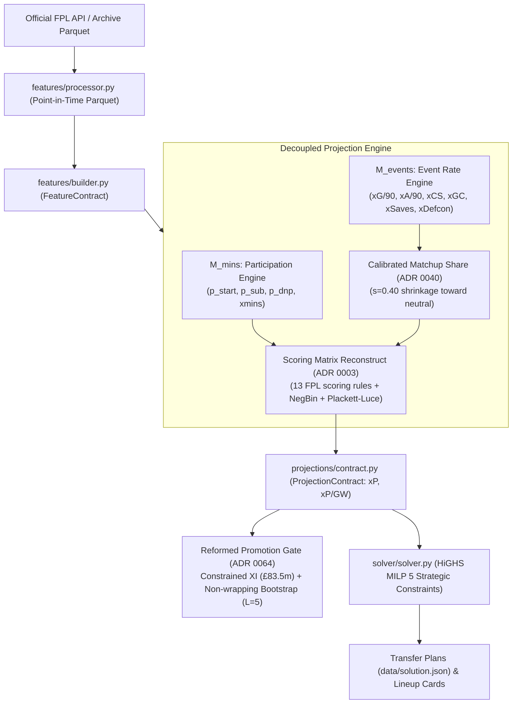

# FPL Candidate Model Ideation Prompt Brief

```markdown
You are a Principal Quantitative Sports Modeler and Machine Learning Engineer specializing in association football (soccer) analytics and combinatorial lineup optimization for Fantasy Premier League (FPL).

### Context & System Environment
You are advising the core quantitative modeling team of `fpl-jubilee-ascent`, an open-source FPL projection and combinatorial optimization engine. The engine runs on Python 3.14, using an expanding-window causal feature store, empirical Bayes scoring models, and a vendored HiGHS Mixed-Integer Linear Programming (MILP) solver.

We operate under strict empirical model governance:
- **Active Model Champion**: `adaptive_causal_challenger` (provisional). It builds upon `def_xg_shrink_challenger` with 100% Champion stability across Gameweeks 1–19, activating stacked zero-leakage Causal Panel ML models (Ridge logistic $p_{\text{start}}$, Ridge duration offset, shrunk xG goals residual, leave-one-out assist finishing) from Gameweek 20 onward.
- **Critical ADR 0064 Finding**: Under our reformed **Constrained Legal Formation XI** (£83.5m starting budget cap, $\le 3$ per club), `def_xg_shrink_challenger` actually outperformed `adaptive_causal_challenger` on the 2025–26 Dev season ($\Delta = +0.8947$ pts/GW). The apparent unconstrained margin of `adaptive_causal_challenger` was an artifact of selecting £100m+ illegal squads. True predictive alpha requires accurately valuing budget enablers under strict team constraints, rather than over-indexing on expensive premium assets.
- **Downstream Consumer**: Multi-period HiGHS MILP solver optimizing transfer paths and lineups over a 5–10 GW horizon subject to 5 "Strategic" variance constraints (ADR 0061: paid hit hurdle, starter minutes floors, bench coverage, defensive stack caps, and GK transfer friction).
- **Promotion Gate (ADR 0064)**: Any new model ("Candidate") must pass our reformed two-season gate: Constrained Legal Formation XI (£83.5m cap, $\le 3$ per club), rolling squad churn guardrail ($\le \text{Champ} + 0.50$ players/GW), warm-seeded confirmation (2023–24 seed for 2024–25 conf, matching live deployment $N_{\text{prior}}=1$), non-wrapping Moving Block Bootstrap ($L=5$, $B=20,000$), three bootstrap bars (Dev $P \ge 0.75$, Warm Conf $P \ge 0.65$, Pooled Stratified $P \ge 0.85$), $\sqrt{n_s}$-scaled segment floors (cold_start $\ge -0.25$, early_mid $\ge -0.15$, late $\ge -0.13$), and dual-window safety guardrails across both full season and active gameweeks.
- **Historical Ledger**: Over 92 candidate model levers have been empirically evaluated. 82 have failed or been logged dead. We maintain an authoritative taxonomy of proven dead levers that must NOT be proposed.

### Your Mission
Generate an actionable, innovative, and mathematically sound slate of 5 to 7 NEW Candidate Projection Models (or component mechanisms) that can defeat `adaptive_causal_challenger` and `def_xg_shrink_challenger` under the ADR 0064 Historical Promotion Gate.

**Focus Area**: Focus on comprehensive architectural breakthroughs across both participation/minutes ($M_{\text{mins}}$) and event rates conditioned on minutes ($M_{\text{events}}$).

### Strict Negative Constraints (Dead Levers — DO NOT PROPOSE)
1. **Club 11-Man Mass Conservation** ($\sum_{\text{club}} p_{\text{start}} = 11.0$): Rotating squads rotate ~12.5 starting mass across competitions; forcing 11.0 starves elite starters while inflating unplayable bench fodder ($\Delta = -3.14 \dots -4.13$ pts/GW, 0/3 segs).
2. **Unregularized In-Season Ridge / Direct G/A Refits**: Small-sample cameo hauls cause unregularized regression weights to fluctuate wildly, degrading out-of-sample prediction ($\Delta = -0.96$ pts/GW).
3. **Relaxing Defender xG Shrinkage** ($K_{\text{DEF}} < 2400$ pseudo-minutes): Defender xG split-half reliability is $r \approx 0.15$; relaxing shrinkage inflates fluke header noise and induces the Optimizer's Curse ($\Delta = -0.39 \dots -0.84$ pts/GW).
4. **Bonus Pool Saturation Caps** ($B_{\max} \in [1.2, 1.5]$): Compresses the expected return of talisman forwards (Haaland, Salah), distorting captaincy allocation ($\Delta = -0.16 \dots -0.38$ pts/GW).
5. **Raw / Unshrunk Opponent Matchup Multipliers**: Raw Poisson multipliers or FDR tables drastically over-project returns in green fixtures and breach playable pool bias ($\Delta = -0.68$ pts/GW).
6. **Static Schedule Congestion Shifts** (e.g. flat $-0.20$ logit on $p_{\text{start}}$ for $<3.5$ days rest): Penalizes nailed stamina outliers (Bruno Fernandes, Saliba) who play every 3 days without performance decay; failed confirmation ($-0.105$ pts/GW).
7. **Discrete Step-Function Early ML Activation** (e.g. activating causal ML at GW8 or GW10, even with $[-10\%, +10\%]$ clamps): Early-season ML over-regularizes talisman hauls and degrades captaincy regret ($\Delta = -2.28$ to $-5.78$ pts/GW, $P_{\text{pooled}} = 0.000$). Early ML must use continuous $N_{\text{eff}}$ shrinkage, not discrete early switches.
8. **Latent HMM Participation Modeling**: Discrete role transition matrices are noisy in 38-game samples; destroys minutes MAE guardrails ($\Delta = -0.90 \dots -3.70$ pts/GW).
9. **Transfer Market Churn / Price Momentum as DNP Hazard**: Casual manager selling reflects lagged sentiment and fixture swings, not manager benching hazard ($\Delta = -0.20 \dots -1.34$ pts/GW).
10. **Zero-Sum Teammate Absence xG Redistribution**: Sidelined talisman volume is absorbed by tactical shape changes and lower team quality, not linearly captured by remaining teammates ($\Delta = -0.72 \dots -2.28$ pts/GW).
11. **Empirical Bayes Yellow Card Rates / Venue Card Hazards**: Card rates add noise to baseline expected points without improving lineup discrimination ($\Delta = -0.20 \dots -0.87$ pts/GW).
12. **Defcon Dispersion Mixtures & Beta-Binomial Hit Rates**: Over-dispersion parameter estimation noise degrades defensive points ($\Delta = -0.13 \dots -1.22$ pts/GW).
13. **Natural Rate Calibration / Slope Flattening**: Addresses elite rate inflation in dev (+0.355) but collapses in confirmation ($-0.449$ pts/GW).
14. **Goalkeeper Fixture Slot Softmax**: Softmaxing GKP start probabilities per club fixture degrades minutes discrimination ($\Delta = -0.11 \dots -1.21$ pts/GW).
15. **Fitted Plackett-Luce BPS Ridge Utility on Observed BPS**: Directly regressing observed BPS introduces severe overfitting ($\Delta = -1.44 \dots -1.81$ pts/GW).

### Required Output Structure for Each Candidate Idea
Format each proposed candidate with a level-3 markdown heading `### Candidate <N>: <Concise Name>` followed by these exact numbered sections (parsed directly by our queue ingestion tool):
1. **Concept & Football Hypothesis**: Concrete statement of the physical football phenomenon or market inefficiency captured, and why existing Champion mechanisms miss it.
2. **Mathematical Formulation**: Exact equations, prior distributions, likelihoods, shrinkage parameters ($K$, $\lambda$), and link functions.
3. **Decoupled Architecture Placement**: State whether this operates in $M_{\text{mins}}$ (`xp_minutes`) or $M_{\text{events}}$ (`xp_goals`, `xp_assists`, `xp_clean_sheets`, `xp_saves`, `xp_defcon`, `xp_bonus`).
4. **Replaces / Integration Hook**: Exact Champion method or component hook this mechanism replaces or modifies.
5. **Parameter Sweep Grid**: Semicolon-separated list of $\le 6$ concrete hyperparameter variants for smoke testing (e.g. `K=600; K=1200; K=1800`).
6. **Small-Sample & Cold-Start Strategy**: How does it integrate with warm historical seeding ($N_{\text{prior}}=1$) and continuous $N_{\text{eff}}$ sample shrinkage ($N_{\min}=3500, N_{\text{full}}=7500$), avoiding Nickell bias and early-season over-regularization?
7. **Budget-Constrained Optimizer Interaction**: Why does this proposed profile resist the Optimizer's Curse under the £83.5m Constrained Legal Formation XI and rolling squad churn guardrail ($\le 0.50$ players/GW)?
8. **Point-in-Time Feature Requirements**: Semicolon-separated manifest of point-in-time covariates needed (`features.<col>` / `history.<col>`, strictly pre-match deadline $\mathcal{H}_{<g}$; zero terminal leakage).
9. **Python Code Skeleton (Optional)**: Class definition stub conforming to `AdaptiveCausalChallengerModel` or `BaseModel`. If response length is constrained, this can be an abbreviated stub or omitted if mathematical formulation and parameter sweep grid are fully specified; our tooling will auto-scaffold class skeletons.

### 1-Shot Concrete Exemplar

### Candidate 1: Asymmetric Substitution Hazard & Beta-Binomial Survival
1. **Concept & Football Hypothesis**: Decouples 60-minute appearance and clean sheet threshold survival from mean duration. Center-backs and goalkeepers face minimal tactical hook risk before 60', whereas wingers face elevated hazard between 55' and 65'.
2. **Mathematical Formulation**:
   $$P(60+ \mid \text{Start}) = (1 - \beta_{\text{surv}}) \cdot \text{clip}\left(\frac{\text{xMins} - 45.0}{30.0}, 0.0, 1.0\right) + \beta_{\text{surv}} \cdot \hat{\theta}_{\text{EB}}$$
   where $\hat{\theta}_{\text{EB}}$ is a position-anchored Beta-Binomial Empirical Bayes survival estimator.
3. **Decoupled Architecture Placement**: Operates in $M_{\text{mins}}$ (`xp_minutes`).
4. **Replaces / Integration Hook**: `ParticipationStateHybridModel._compute_participation_states`
5. **Parameter Sweep Grid**: `K_surv=12,beta_surv=0.5; K_surv=18,beta_surv=0.65; K_surv=24,beta_surv=0.65`
6. **Small-Sample & Cold-Start Strategy**: Anchors to positional prior means ($\text{DEF}=0.91, \text{MID}=0.82$) via conjugate Beta-Binomial Empirical Bayes, regularized by $N_{\text{eff}}$.
7. **Budget-Constrained Optimizer Interaction**: Correctly elevates nailed £4.5m center-backs over £5.5m wingers without exceeding squad churn tolerances.
8. **Point-in-Time Feature Requirements**: `features.position`; `history.minutes`; `history.starts_ewm_19`
9. **Python Code Skeleton (Optional)**:
```python
from models.adaptive_causal_challenger import AdaptiveCausalChallengerModel

class AsymmetricSubHazardChallengerModel(AdaptiveCausalChallengerModel):
    def __init__(self, k_surv: float = 18.0, beta_surv: float = 0.65, **kwargs: object) -> None:
        super().__init__(**kwargs)
        self.k_surv = float(k_surv)
        self.beta_surv = float(beta_surv)
```

Review the complete technical specification below before generating candidate recommendations.
```

---

## Part 2: Technical Architecture & System Specification



### 1. The Active Model Champion: `adaptive_causal_challenger` (provisional)

The active Champion uses an object-oriented inheritance lineage terminating in `AdaptiveCausalChallengerModel`:

```
BaseModel (models/base.py)
  └── ComponentBaselineModel (models/component_baseline.py)
        └── MetricsComponentHybridModel (models/metrics_component_hybrid.py)
              └── ParticipationStateHybridModel (models/participation_state_hybrid.py)
                    └── CalibratedMatchupHybridModel (models/calibrated_matchup_hybrid.py)
                          └── HoldChaseChallengerModel (models/hold_chase_challenger.py)
                                └── FaceValueChallengerModel (models/face_value_challenger.py)
                                      └── MultiFeatureAssistChallengerModel (models/multi_feature_assist_challenger.py)
                                            └── LearnedStartChallengerModel (models/learned_start_challenger.py)
                                                  └── DefXgShrinkChallengerModel (models/def_xg_shrink_challenger.py)
                                                        └── MLComponentChallengerModel (models/ml_component_challenger.py)
                                                              └── AdaptiveCausalChallengerModel [CHAMPION] (models/adaptive_causal_challenger.py)
```

#### Lineage Mechanism Breakdown:
1. **Event-Level Empirical Bayes & Scoring Matrix Reconstruct (ADR 0003)**:
   - Projections do not predict raw fantasy points directly. They project underlying match events and pass them through exact FPL rule calculations:
     - Goals: Position-weighted (GK/DEF: 6, MID: 5, FWD: 4).
     - Clean Sheets: Pitch clean sheet probability $e^{-\lambda_{\text{pitch}}} \times P(60+\text{ mins})$ (GK/DEF: 4, MID: 1).
     - Goals Conceded: Negative Binomial expectation $\mathbb{E}[\lfloor X/2 \rfloor]$ with dispersion $r=3.0$ ($-1$ pt per 2 GC for GK/DEF).
     - Defensive Contributions (Defcon): Negative Binomial probability of $\ge 10$ (DEF) or $\ge 12$ (MID/FWD) CBI/tackles (+2 pts).
     - Saves: Poisson expectation $\mathbb{E}[\lfloor \text{saves}/3 \rfloor]$ (+1 pt per 3 saves for GK).
     - Bonus Points System (xBPS): Synthetic BPS score modeled via Plackett-Luce rank choice.
2. **Three-State Participation Engine**:
   - For every player and fixture:
     $$P(\text{DNP}) + P(\text{Start}) + P(\text{Sub-in}) = 1.0$$
   - Expected minutes: $\mathbb{E}[\text{Mins}] = P(\text{Start}) \cdot xMins_{\text{start}} + P(\text{Sub-in}) \cdot xMins_{\text{sub}}$ (where baseline $xMins_{\text{start}} \approx 78.0$, $xMins_{\text{sub}} \approx 18.0$).
   - $P(60+\mid \text{state}) = \text{clip}\left(\frac{\text{minutes} - 45.0}{30.0}, 0.0, 1.0\right)$.
   - Operational Hard DNP (ADR 0056): FPL injury status $\in \{'i', 's', 'u', 'n'\}$ or `chance_of_playing == 0` forces $P(\text{DNP}) = 1.0$.
3. **Calibrated Matchup Share (ADR 0040)**:
   - Eliminates volatile FDR tables. Multipliers scale club attacking and defensive strength relative to league averages, shrunk by $s = 0.40$ toward neutral ($1.0$).
4. **Face-Value Attack & Minute-Pooled Goal Finishing (ADR 0045)**:
   - Fixed weights: $1.0 \times xG$ and $1.0 \times xA$ (raw threat/creativity zeroed out).
   - Finishing skill offset over $K=1800$ pseudo-minutes:
     $$\text{Offset}_i = \frac{\sum (\text{Goals}_i - xG_i) \cdot 90}{\sum \text{Minutes}_i + 1800.0}$$
5. **Defender xG Shrinkage (ADR 0055)**:
   - Defenders exhibit split-half xG reliability of $r \approx 0.15$. The Champion shrinks defender xG/90 toward the position mean using $K_{\text{DEF}}=2400$ pseudo-minutes (attackers use $K=360$):
     $$\hat{\lambda}_{xG, \text{DEF}} = \frac{\sum xG_{\text{observed}} \cdot 90 + K_{\text{DEF}} \cdot \bar{\lambda}_{\text{pos}}}{\sum \text{Minutes} + K_{\text{DEF}}}$$
   - Prevents the optimizer from loading up on center-backs who head home early fluke goals.
6. **Adaptive Causal ML Activation (ADR 0063)**:
   - **GW 1–19**: Evaluates purely through `def_xg_shrink_challenger`.
   - **GW 20+**: Activates stacked Causal Panel ML models via a 5-GW Bayesian ramp ($w_{\text{ML}} = \min(1.0, \frac{\text{GW} - 19}{5})$):
     - **Tier 1 Minutes**: Ridge logistic regression on $p_{\text{start}}$ ($H_1$) + Ridge linear regression on starter duration offset ($H_3$). Sub-in classifier ($H_2$) disabled.
     - **Tier 2 Events**: Group A Shrunk xG Goals Residual + Group B Calibrated Leave-One-Out (LOO) Assist Finishing ($\omega = 0.95^{\Delta \text{GW}}$ exponential decay, bounded $[0.88, 1.15]$). Defensive and Bonus ML heads disabled.
7. **Empirical Bayes Priors & Continuous $N_{\text{eff}}$ Shrinkage (ADR 0064 / Issue #168)**:
   - In `models/ml_panel_features.py`, short-panel features are regularized with Empirical Bayes positional price-tier priors ($K_{\text{prior}} = 12.0$).
   - Continuous sample-size shrinkage replaces discrete gameweek thresholds:
     $$\alpha_g = \text{clip}\left(\frac{N_{\text{eff}, g} - N_{\min}}{N_{\text{full}} - N_{\min}}, 0.0, 1.0\right)$$
     where $N_{\text{eff}, g} = 0.5 N_{\text{seed}} + N_{\text{in\_season}, <g}$, with $N_{\min} = 3500$, $N_{\text{full}} = 7500$.

---

### 2. Downstream Optimization: HiGHS MILP Solver & Strategic Constraints (ADR 0061)

The solver does not pick an isolated 11-man team; it solves a multi-period Mixed-Integer Linear Program over horizon $W \in [5, 10]$ gameweeks, balancing squad transfers, bank value, captaincy, and bench order:

$$\max_{\mathbf{x}, \mathbf{c}, \mathbf{b}, \mathbf{t}_{\text{in}}, \mathbf{t}_{\text{out}}} \sum_{w=1}^W \gamma^{w-1} \left( \sum_{p=1}^P \left( x_{p,w} \hat{y}_{p,w} + c_{p,w} \hat{y}_{p,w} + b_{p,w} v_b \hat{y}_{p,w} \right) - \text{Cost}(w) - \text{Penalties}(w) \right)$$

Where:
- $x_{p,w} \in \{0, 1\}$: Starting lineup indicator (exactly 11 players, 1 GKP, 3–5 DEF, 2–5 MID, 1–3 FWD).
- $c_{p,w} \in \{0, 1\}$: Captain indicator ($\sum_p c_{p,w} = 1$, $c_{p,w} \le x_{p,w}$).
- $b_{p,w} \in \{0, 1\}$: Bench players ($v_b \approx 0.10$ expected autosub weight).
- $\text{Cost}(w)$: Transfer hit cost ($4.0$ pts per paid transfer above free transfer limit).

#### The 5 Strategic Variance Constraints (ADR 0061)
Because optimizers aggressively exploit uncalibrated variance (The Optimizer's Curse), unconstrained solves select fragile, rotation-prone assets. ADR 0061 embeds 5 linear constraints with continuous slack variables:

1. **Hit Friction Buffer**:
   $$\text{Penalty}_{\text{hit}}(w) = 1.8 \cdot \text{PaidHits}(w)$$
   Raises the effective hurdle for an immediate transfer hit from $4.0$ to $5.8$ projected points, eliminating speculative -4 point churn.
2. **Starter Expected Minutes Floor**:
   $$\forall p \in \text{Outfield Starters}, \quad xMins_{p,w} + s^{\text{mins}}_{p,w} \ge 65.0, \quad s^{\text{mins}}_{p,w} \ge 0$$
   Objective penalty: $-10.0 \cdot s^{\text{mins}}_{p,w}$. Prevents fielding 50-minute high-upside wingers as core starters.
3. **First-Bench Cover Nailedness**:
   $$\sum_{p \in \text{Squad}} \mathbb{I}(xMins_{p,w} \ge 65.0) + s^{\text{bench}}_w \ge 12, \quad s^{\text{bench}}_w \ge 0$$
   Objective penalty: $-1.5 \cdot s^{\text{bench}}_w$. Ensures at least 1 bench outfielder is a guaranteed 65+ minute starter.
4. **Defensive Stack Limiter**:
   $$\forall c \in \text{Clubs}, \quad \sum_{p \in \text{DEF} \cup \text{GKP}, \text{club}(p)=c} x_{p,w} - s^{\text{stack}}_{c,w} \le 2, \quad s^{\text{stack}}_{c,w} \ge 0$$
   Objective penalty: $-1.2 \cdot s^{\text{stack}}_{c,w}$. Prevents triple-defense correlation wipeouts on single match outcomes.
5. **Goalkeeper Transfer Friction**:
   $$-1.5\text{ pt objective penalty on any non-wildcard GKP transfer-in}.$$
   Goalkeeper variance is dominated by Poisson save/CS noise; burning FTs on lateral GK moves is mathematically negative.

---

### 3. The Reformed Historical Promotion Gate (ADR 0064 Standards)

A Candidate must pass all criteria across both Development (2025–26, seeded with 2024–25) and Confirmation (2024–25, warm-seeded with 2023–24) seasons:

```python
# backtesting/promotion.py gate constants
BOOTSTRAP_DRAWS = 20_000
BOOTSTRAP_BLOCK_GWS = 5  # Non-wrapping Moving Block Bootstrap (L=5)
BOOTSTRAP_MIN_P = 0.75  # Dev season threshold
CONFIRMATION_BOOTSTRAP_MIN_P = 0.65  # Warm-seeded confirmation threshold
POOLED_BOOTSTRAP_MIN_P = 0.85  # Pooled 2-season stratified threshold
CHURN_GUARDRAIL_TOL = 0.5  # Max excess squad churn players/GW
```

#### Requirement 1: Constrained Legal Formation XI Primary Delta
Primary metric is **Constrained Legal Formation XI Regret** (`select_legal_formation_xi`), solved via HiGHS/scipy MILP enforcing:
- $\le 3$ players per club.
- Starting XI budget cap: $B_{\text{XI}} \le £83.5\text{m}$ ($835.0$ in FPL 0.1m units).
- Deterministic tie-breaking: `[pred DESC, cost ASC, id ASC]`.
- Combined Primary Delta: $\bar{\Delta} = \overline{\text{Regret}}_{\text{champ}} - \overline{\text{Regret}}_{\text{cand}} > 0.0$ pts/GW.

#### Requirement 2: Squad Churn Guardrail (Issue #169)
Rolling top-15 budget-feasible squad churn prevents models from generating thrashing lineups that degrade rolling MILP transfer plans:
$$\text{Churn}_g = 15 - |\mathcal{S}_g \cap \mathcal{S}_{g-1}|, \quad \overline{\text{Churn}}_{\text{cand}} \le \overline{\text{Churn}}_{\text{champ}} + 0.50 \text{ players/GW}$$

#### Requirement 3: Non-Wrapping Moving Block Bootstrap & Pooled Stratified Gate (Issue #171)
Evaluates complete blocks of length $L=5$ consecutive gameweeks (spanning 4–6 week fixture swings) with start indices $0 \le s \le n - L$, without boundary wrapping:
- Dev Season: $P_{\text{dev}}(\bar{\Delta}^* > 0) \ge 0.75$
- Confirmation Season (warm-seeded): $P_{\text{conf}}(\bar{\Delta}^* > 0) \ge 0.65$
- Pooled 2-Season Stratified: $P_{\text{pooled}}(\bar{\Delta}^* > 0) \ge 0.85$

#### Requirement 4: $\sqrt{n_s}$-Scaled Seasonal Segment Loss Floors (Issue #172)
Standardized to uniform stringency ($z \approx -0.25 \times \text{SE}$):
- `cold_start` ($n=4$): $\Delta_{\text{cold\_start}} \ge -0.25$ pts/GW (max $-1.00$ cumulative pt)
- `early_mid` ($n=15$): $\Delta_{\text{early\_mid}} \ge -0.15$ pts/GW (max $-2.25$ cumulative pts)
- `late` ($n=19$): $\Delta_{\text{late}} \ge -0.13$ pts/GW (max $-2.47$ cumulative pts)
- Active in-season win: $\max(\Delta_{\text{early\_mid}}, \Delta_{\text{late}}) > 0.0$ pts/GW.

#### Requirement 5: Dual-Window Hard Safety Guardrails (Issue #170)
Evaluated across both full season (38 GWs) and active gameweeks $\mathcal{G}_{\text{active}} = \{g : \max_i |\hat{y}^{\text{cand}}_{i,g} - \hat{y}^{\text{champ}}_{i,g}| > 10^{-6}\}$:
- **Playable Pool MAE**: $\text{MAE}_{\text{cand}} \le \text{MAE}_{\text{champ}} \times 1.01$
- **Playable Pool Bias**: $|\text{Bias}_{\text{cand}}| \le |\text{Bias}_{\text{champ}}| + 0.01$
- **Captaincy Regret**: $\text{CapRegret}_{\text{cand}} \le \text{CapRegret}_{\text{champ}} + 0.15$ pts/GW
- **Minutes MAE**: $\text{xMinsMAE}_{\text{cand}} \le \text{xMinsMAE}_{\text{champ}} \times 1.01$
- **Spearman Correlation**: $\rho_{\text{cand}} \ge \rho_{\text{champ}} - 0.005$

---

### 4. Verified Dead-Lever Archetypes (from 92 Historical Trials)

| Archetype ID | Tested Hypotheses | Empirical Fate | Mathematical Cause of Failure |
|---|---|---|---|
| **ARCH-01** | Club 11-Man Mass Conservation ($\sum p_{\text{start}} = 11.0$) | Dev $\Delta = -3.14 \dots -4.13$, 0/3 segs. | Pep/Arteta squads rotate ~12.5 starting mass across competitions; forcing 11.0 starves elite assets while inflating unplayable bench fodder. |
| **ARCH-02** | In-Season Unregularized Ridge / Direct G/A Refits | Dev $\Delta = -0.13 \dots -1.41$, bias up. | Small-sample cameo hauls cause regression weights to fluctuate wildly; explodes out-of-sample prediction error. |
| **ARCH-03** | Relaxing Defender xG Shrinkage ($K < 2400$) | Dev $\Delta = -0.39 \dots -0.84$, 0/3 segs. | Defender attacking split-half reliability is $r \approx 0.15$. Relaxing shrinkage causes optimizer to bench reliable mids for fluke-scoring center backs. |
| **ARCH-04** | Bonus Pool Saturation ($B_{\max} \in [1.2, 1.5]$) | Dev $\Delta = -0.16 \dots -0.38$, boot $P \le 0.37$. | Cap compresses expected return of talisman forwards (Haaland/Salah), distorting captaincy allocation. |
| **ARCH-05** | Raw / Unshrunk Opponent Matchup Multipliers | Dev $\Delta = -0.68$, Easy bias $+0.75$. | Jensen's inequality and over-dispersion cause multiplicative swings to drastically over-project returns in green fixtures. |
| **ARCH-06** | Static Schedule Congestion Logit Shifts (-0.20 logit) | Dev $+0.063$, Confirmation $-0.105$. | Flat shifts misclassify nailed stamina outliers (Bruno Fernandes, Saliba) who play 90 mins every 3 days without decay. |
| **ARCH-07** | Latent-Role HMM Participation Modeling | Dev $\Delta = -0.90 \dots -3.70$, 0/3 segs. | Discrete role transition matrices are noisy in 38-game samples; severe degradation of minutes MAE guardrails. |
| **ARCH-08** | Step-Function Early ML Activation (GW8–12) | Confirm $\Delta = -2.28$, $P_{\text{pooled}} = 0.000$. | Early ML without sufficient panel samples distorts captaincy allocation and causes catastrophic early-mid collapse. |
| **ARCH-09** | Transfer Churn / Price Velocity as DNP Hazard | Dev $\Delta = -0.20 \dots -1.34$. | Casual manager selling activity reflects lagged sentiment and fixture swings, not manager benching hazard. |
| **ARCH-10** | Teammate Absence Share Redistribution | Dev $\Delta = -0.72 \dots -2.28$. | Sidelined talisman volume is absorbed by tactical shape changes and lower team quality, not linearly captured by teammates. |
| **ARCH-11** | Empirical Bayes Yellow Card Rates / Multipliers | Dev $\Delta = -0.20 \dots -0.87$, 0/3 segs. | Booking noise degrades point discrimination without improving lineup selection. |
| **ARCH-12** | Defcon Over-Dispersion Mixtures & Beta-Binomial | Dev $\Delta = -0.13 \dots -1.22$, 0/3 segs. | Parametric mixture fitting on sparse defensive event counts introduces high estimation variance. |
| **ARCH-13** | Natural Rate Slope / Untrimmed Low-xG Calibration | Dev PASS $+0.355$, Conf FAIL $-0.449$. | Rate adjustments on elite assets fail to replicate out-of-sample across different seasonal scoring baselines. |

---

### 5. High-Priority Exploration Vectors (Grounded in Technical Feasibility)

Candidates are strongly encouraged to explore mechanisms within these design spaces:
1. **Asymmetric Substitution & Early-Exit Hazard ($M_{\text{mins}}$)**:
   - Center-backs and goalkeepers almost never sub out unless injured (duration conditional on start is 90.0). Wingers and fullbacks routinely sub out at 60'–70'. A hazard model conditioned on position, tactical substitutions, and yellow card exposure can sharpen $P(60+)$ and duration without destabilizing $p_{\text{start}}$.
2. **Sub-In Cameo Return Intensity ($M_{\text{events}}$)**:
   - Currently, a sub-in appearance assumes the same per-minute event rate as a start. In reality, attacking substitutes face tired legs in higher-variance game states (e.g. chasing a goal), whereas defensive substitutes have near-zero goal involvement rates. Conditioning cameo event intensity on position and scoreline context.
3. **Calibrated Receiver Finishing Quality for Assists ($M_{\text{events}}$)**:
   - xA measures key pass expected goals, but FPL assist conversion depends on the finishing skill of the recipient (e.g. Kevin De Bruyne creating for Erling Haaland vs a midfielder creating for an inefficient finisher). A receiver-adjusted assist model.
4. **Goalkeeper Shot-Quality vs. Save-Volume Profile ($M_{\text{events}}$)**:
   - Mid-table goalkeepers face high-volume, low-danger shots from outside the box, generating immense save volume with low conceded variance. Elite goalkeepers face rare, high-danger breakaways. A decoupled save intensity model conditioned on opponent shot distance / threat ratio.
5. **Budget Enabler Efficiency & Marginal Value Modeling ($M_{\text{events}} / M_{\text{mins}}$ under £83.5m cap)**:
   - The £83.5m starting budget cap elevates the importance of accurate projections for £4.5m–£5.5m outfield starters. Models that eliminate residual bias and accurately rank budget enablers gain substantial legal formation XI points over models tuned solely for premium assets.
