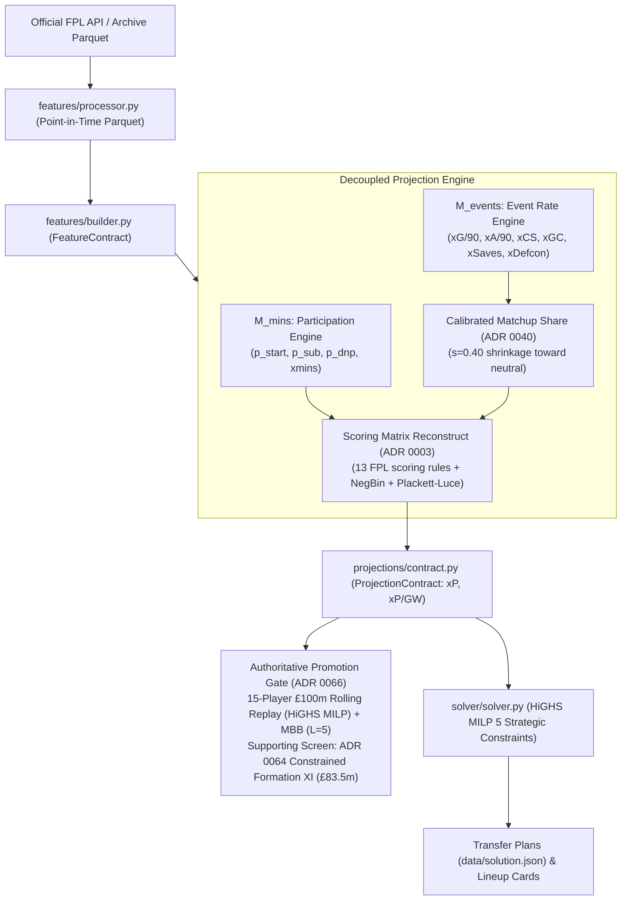

# FPL Candidate Model Ideation Prompt Brief

You are a Principal Quantitative Sports Modeler and Machine Learning Engineer specializing in association football (soccer) analytics and combinatorial lineup optimization for Fantasy Premier League (FPL).

Use model-neutral language for the LLM producing this proposal: identify the source by specialist role and date, without LLM provider, product, version, or model names. Preserve exact FPL projection-model identifiers when discussing evaluated code.

### Critical Operational Directive
Execute this task immediately in a single comprehensive response. Do NOT ask clarifying questions, request permission, or provide conversational pleasantries. Output your candidate slate directly, beginning immediately with `### Candidate 1: <Name>`.

### Context & System Environment
You are advising the core quantitative modeling team of `fpl-jubilee-ascent`, an open-source FPL projection and combinatorial optimization engine. The codebase is publicly available on GitHub at:
https://github.com/JubileeZ/fpl-jubilee-ascent

If you have web browsing capabilities, you may inspect the public repository to verify exact interfaces, prior constants, feature contracts, and ADR specifications:
- **Repository Root**: https://github.com/JubileeZ/fpl-jubilee-ascent
- **Active Model Champion**: https://github.com/JubileeZ/fpl-jubilee-ascent/blob/main/models/def_xg_shrink_challenger.py
- **Feature Contract & Processor**: https://github.com/JubileeZ/fpl-jubilee-ascent/blob/main/features/builder.py and https://github.com/JubileeZ/fpl-jubilee-ascent/blob/main/features/processor.py
- **Authoritative Candidate Ledger**: https://github.com/JubileeZ/fpl-jubilee-ascent/blob/main/docs/research/candidate-ledger/candidate_ledger.csv
- **Promotion Foundation (ADR 0066)**: https://github.com/JubileeZ/fpl-jubilee-ascent/blob/main/docs/adr/0066-backtesting-and-promotion-foundation.md
- **Constrained XI Gate & Evaluation Rigor (ADR 0064)**: https://github.com/JubileeZ/fpl-jubilee-ascent/blob/main/docs/adr/0064-promotion-gate-and-evaluation-rigor-overhaul.md
- **Archive Testing & Leakage Boundary**: https://github.com/JubileeZ/fpl-jubilee-ascent/blob/main/docs/testing/archive-testing.md

We operate under strict empirical model governance:
- **Active Model Champion**: `def_xg_shrink_challenger` (provisional). It operates across all 38 Gameweeks using Empirical Bayes shrinkage on defender xG ($K_{\text{DEF}}=2400$) combined with learned start probabilities, three-state participation modeling, calibrated opponent matchup shares ($s=0.40$), and face-value attack weights ($1.0 \times xG$, $1.0 \times xA$).
- **Critical ADR 0066 & ADR 0064 Finding**: Under realistic squad constraints, `def_xg_shrink_challenger` decisively outperformed `adaptive_causal_challenger` on the 2025–26 Dev season ($\Delta = +0.8947$ pts/GW). The apparent unconstrained margin of earlier ML models was an artifact of selecting £110m+ illegal squads of all premiums. True predictive alpha in FPL requires accurately valuing £4.5m–£5.5m budget enablers within the 15-player £100.0m squad to fund premium assets, rather than over-indexing on expensive premiums with fragile rotation bench cover.
- **Downstream Consumer**: Multi-period HiGHS MILP solver optimizing transfer paths and lineups over a 1-10 GW horizon subject to 5 "Strategic" variance constraints (ADR 0061), horizon-scaled hit/GK friction, and diminishing emergency Free Transfer Value schedule (ADR 0065).
- **Promotion Gate (ADR 0066 Foundation & ADR 0064 Standards)**: Any new model ("Candidate") must pass our multi-season evaluation: **Primary Estimand is Rolling Transfer Plan Net FPL Points** under an independent 6-GW Strategic transfer plan replay initialized from the neutral GW1 ownership anchor (15-player £100.0m squad, bank balance, rolling transfers, hit deductions, bench cover). Evaluated via paired non-wrapping Moving Block Bootstrap ($L=5$, $B=20,000$) with family-wise error control ($\text{FWER} \le 0.05$), substantive projection non-inferiority guards (total, minutes, components), and supporting diagnostic screens (including Constrained Legal Formation XI £83.5m cap and rolling squad churn $\le \text{Champ} + 0.50$ players/GW). Four-way scientific verdicts (`pass`, `fail`, `inconclusive`, `invalid`); inconclusive directs to fresh registered confirmation without dead lever lock.
- **Historical Ledger**: 104 candidate model levers recorded. 94 have failed or been logged dead (94 currently locked under 1-year moratorium). We maintain an authoritative taxonomy of proven dead levers that must NOT be proposed.
- **Evaluation Boundary & Sealed Window**: Develop on 2025-26 with 2024-25 seed. Freeze each Candidate before its single 2024-25 confirmation run with 2023-24 seed; never tune on confirmation. 2026-27 GW6+ is sealed: no ideation evidence, tuning, smoke tests, or ablations from that window; one post-promotion check per Champion only.
  - **CRITICAL FOR WEB-BROWSING MODELS**: Do NOT inspect, query, or infer features from `data/archive/2026-27/` or any live 2026-27 performance files in the public repository. All proposals must derive strictly from 2025–26 developmental principles.

### Your Mission
Generate an actionable, innovative, and mathematically sound slate of 5 to 7 NEW Candidate Projection Models (or component mechanisms) that can defeat `def_xg_shrink_challenger` under the ADR 0066 Historical Promotion Gate.

**Focus Area**: Focus on comprehensive architectural breakthroughs across both participation/minutes ($M_{\text{mins}}$) and event rates conditioned on minutes ($M_{\text{events}}$).

### Strict Negative Constraints (Cross-Cutting Structural Dead Levers — DO NOT PROPOSE)
1. **Club 11-Man Mass Conservation** ($\sum_{{\text{{club}}}} p_{{\text{{start}}}} = 11.0$): Rotating squads rotate ~12.5 starting mass across competitions; forcing 11.0 starves elite starters while inflating unplayable bench fodder ($\Delta = -3.14 \dots -4.13$ pts/GW, 0/3 segs).
2. **Unregularized In-Season Ridge / Direct G/A Refits**: Small-sample cameo hauls cause unregularized regression weights to fluctuate wildly, degrading out-of-sample prediction ($\Delta = -0.96$ pts/GW).
3. **Relaxing Defender xG Shrinkage** ($K_{{\text{{DEF}}}} < 2400$ pseudo-minutes): Defender xG split-half reliability is $r \approx 0.15$; relaxing shrinkage inflates fluke header noise and induces the Optimizer's Curse ($\Delta = -0.39 \dots -0.84$ pts/GW).
4. **Bonus Pool Saturation Caps** ($B_{{\max}} \in [1.2, 1.5]$): Compresses the expected return of talisman forwards (Haaland, Salah), distorting captaincy allocation ($\Delta = -0.16 \dots -0.38$ pts/GW).
5. **Raw / Unshrunk Opponent Matchup Multipliers**: Raw Poisson multipliers or FDR tables drastically over-project returns in green fixtures and breach playable pool bias ($\Delta = -0.68$ pts/GW).
6. **Static Schedule Congestion Shifts** (e.g. flat $-0.20$ logit on $p_{{\text{{start}}}}$ for $<3.5$ days rest): Penalizes nailed stamina outliers (Bruno Fernandes, Saliba) who play every 3 days without performance decay; failed confirmation ($-0.105$ pts/GW).
7. **Discrete Step-Function Early ML Activation** (e.g. activating causal ML at GW8 or GW10, even with $[-10\%, +10\%]$ clamps): Early-season ML over-regularizes talisman hauls and degrades captaincy regret ($\Delta = -2.28$ to $-5.78$ pts/GW). Preserve Champion GW1-19 fallback; continuous sample-size shrinkage does not reopen locked early-activation mechanisms.
8. **Latent HMM Participation Modeling**: Discrete role transition matrices are noisy in 38-game samples; destroys minutes MAE guardrails ($\Delta = -0.90 \dots -3.70$ pts/GW).
9. **Transfer Market Churn / Price Momentum as DNP Hazard**: Casual manager selling reflects lagged sentiment and fixture swings, not manager benching hazard ($\Delta = -0.20 \dots -1.34$ pts/GW).
10. **Zero-Sum Teammate Absence xG Redistribution**: Sidelined talisman volume is absorbed by tactical shape changes and lower team quality, not linearly captured by remaining teammates ($\Delta = -0.72 \dots -2.28$ pts/GW).
11. **Empirical Bayes Yellow Card Rates / Venue Card Hazards**: Card rates add noise to baseline expected points without improving lineup discrimination ($\Delta = -0.20 \dots -0.87$ pts/GW).
12. **Defcon Dispersion Mixtures & Beta-Binomial Hit Rates**: Over-dispersion parameter estimation noise degrades defensive points ($\Delta = -0.13 \dots -1.22$ pts/GW).
13. **Natural Rate Calibration / Slope Flattening**: Addresses elite rate inflation in dev (+0.355) but collapses in confirmation ($-0.449$ pts/GW).
14. **Goalkeeper Fixture Slot Softmax**: Softmaxing GKP start probabilities per club fixture degrades minutes discrimination ($\Delta = -0.11 \dots -1.21$ pts/GW).
15. **Fitted Plackett-Luce BPS Ridge Utility on Observed BPS**: Directly regressing observed BPS introduces severe overfitting ($\Delta = -1.44 \dots -1.81$ pts/GW).

### Active Dead Levers (Structural & Cross-Cutting Subsystem)
Screen every proposal against these current ledger mechanisms, including continuous early-activation variants; matching mechanisms remain locked until their revisit dates:
- **In-season ridge G/A refit + per-player offsets n/(n+15) (any K)** (tried as: `A1 d_k50 d_k150 a_weights_only b_default_w_offsets b_default_w_k150`, result: `combined -0.13..-1.41; bias up`, locked until 2027-09-28)
- **Pooled fit without offsets** (tried as: `B2 pf_pooledfit_nooffs`, result: `combined -0.96 1/3`, locked until 2027-09-28)
- **Learned correction as Poisson GLM** (tried as: `B1 poisson_unfit_*`, result: `<= +0.51; lam10 FAIL`, locked until 2027-09-28)
- **Ensemble with component_baseline** (tried as: `B2 ens_P+CB* component_baseline*`, result: `|bias| 0.17-1.36 FAIL`, locked until 2027-09-28)
- **Equal-weight ensembles of hybrid Candidates** (tried as: `B2 ens_eq_*`, result: `best +1.01 weight-fragile; below single-model winner`, locked until 2027-09-28)
- **Fixture swing multiplicative (s_att) and additive arms** (tried as: `fixture-swing-candidates`, result: `mult breached easy cap +0.681; additive worse easy bias`, locked until 2027-09-24)
- **Opponent-relative team Poisson lambda rate multiplier** (tried as: `team-poisson-lambda`, result: `over-predicts easy fixtures`, locked until 2027-09-22)
- **Uncalibrated Matchup Share** (tried as: `matchup-share-addon`, result: `all-pool worse than neutral`, locked until 2027-09-22)
- **Terminal archive columns as model inputs** (tried as: `any`, result: `leakage: season-end values in archive features`, permanently locked)
- **Learned hurdle / direct residual correction on face-value base** (tried as: `smoke b2_res_* (6; history-reconstructed base; no memory)`, result: `all -0.98..-1.57 0/3; prior gain needed cross-GW memory`, locked until 2027-09-28)
- **Dual-Vector ratios shrunk toward 1.0** (tried as: `untried`, result: `superseded by shipped ADR 0040 (Calibrated Matchup Share); multiplicative scaling failed easy-bias cap (+0.681 vs neutral +0.221) and Jensen CS inflation`, locked until 2027-09-30)
- **True scoreline Poisson (player share x lambda; CS = e^-lambda_against)** (tried as: `smoke b1_sl_* (6)`, result: `attack half reduces algebraically to Dead opponent rate multiplier (rows void); defence half best +0.491 1/3 P 0.70`, locked until 2027-09-28)
- **Penalty-taker signal from per90 only** (tried as: `smoke a3_pen_taker_* (6)`, result: `delta +0.0000 0/3; fixture unscaling for derived penalty takers inert on top-11`, locked until 2027-09-28)
- **Pooled red-card rate (Position x state pooled red rate; player shrink K>=3600; K>=9000; K inf)** (tried as: `smoke crd_02_k3600 crd_02_k9000 crd_02_kinf (3)`, result: `all negative -0.13..-0.26; best crd_02_k9000/kinf -0.126 1/3 boot P 0.355`, locked until 2027-09-29)
- **Penalty-miss de-noising (Replace noisy per-player penalty miss rate with zero; K3600; K9000; league const)** (tried as: `smoke atk_07_zero atk_07_k3600 atk_07_k9000 atk_07_league_const (4)`, result: `all negative -0.41..-0.43 0/3 boot P <= 0.013; best atk_07_zero -0.409 0/3 P 0.013`, locked until 2027-09-29)
- **Empirical-Bayes yellow card rate (Rate = (sum w*yc + K_pos*prior)/(sum w*min + K_pos)*90; K_pos 900; 1800; 3600; Method of Moments)** (tried as: `smoke crd_01_k900 crd_01_k1800 crd_01_k3600 crd_01_mom (4)`, result: `all negative -0.51..-0.78 1/3 boot P <= 0.185; best crd_01_k1800 -0.505 1/3 P 0.185`, locked until 2027-09-29)
- **Club starting mass conservation (sum p_start=11) and vacancy redistribution (capacity-capped and formation-constrained)** (tried as: `smoke pos_cap_k90 pos_cap_k95 pos_cap_shrink form_slot_base form_slot_dnp2 form_slot_pure11 (6)`, result: `all negative -3.14..-4.13 0/3 boot P <= 0.022; Playable Pool Bias exploded 0.65-0.70 vs 0.42; Captaincy Regret regressed 5.26-5.58 vs 4.69`, locked until 2027-10-01)
- **Club x DEF pooled prior stacked with K=2400 shrinkage (club prior 5 matches; DEF K 1800-2400)** (tried as: `smoke club_def_k1800 club_def_k2400 (2)`, result: `all negative -0.81..-0.84 0/3 segs boot P <= 0.005; club-level small sample noise`, locked until 2027-10-13)
- **Apex Predator Challenger (Composite ML p_start + start duration + shrunk xG goals + LOO assist finishing with GW1-9 Champion stability and schedule congestion)** (tried as: `apex_predator_challenger`, result: `dev 2025-26 PASS +0.840 2/3 boot P 0.992; confirm 2024-25 FAIL -0.153 1/3 boot P 0.376 (early_mid regression -0.959 < -0.15)`, locked until 2027-10-21)
- **Price-Stratified Huber-Regularized Continuous-N_eff Causal Panel (price-tier centering, Huber duration, continuous N_eff ramp)** (tried as: `smoke ext_05_* (4 variants)`, result: `dev 2025-26 FAIL: combined -1.004 1/3 segs boot P 0.012; early_mid catastrophic regression -2.643 < -0.15; guardrails failed`, locked until 2027-10-26)

### Active Dead Levers by Subsystem Summary (94 Locked Levers)
94 candidate levers are currently locked under the 1-year moratorium. Proposals matching any of these archetypes will be rejected:
- **Participation & Minutes (20 dead levers)**: e.g. Beta-Binomial P(60|state), starter tenure decay, naive nailed-starter multipliers.
- **Goals & Finishing (19 dead levers)**: e.g. high-K finishing pools ($K \ge 3600$), unsharp xG slope flattening, flat position goal scales.
- **Key Passes & Assists (14 dead levers)**: e.g. pooled assist finishing offsets, uncalibrated raw xA.
- **Goalkeepers & Saves (3 dead levers)**: e.g. club SoT volume x pooled save rate, slot probability softmax.
- **Defense & Clean Sheets (7 dead levers)**: e.g. defcon venue/opposition pressure, post-link CS inflation, club-pooled per90 GC.
- **Bonus Points / BPS (11 dead levers)**: e.g. BPS pool saturation caps, softmax temperature retuning.
- **Budget & Valuation (0 dead levers)**: pricing and budget mechanisms.
- **Structural & Cross-Cutting (20 dead levers)**: full current list above.

### Observed Operational Data Catalog & Permitted Input Covariates
Every proposed Candidate model must strictly derive from the following verified data sources.
In Section 8, all input variables must be prefixed with `features.<col>` or `history.<col>`:

#### 1. Target Gameweek Pre-Match Features (`features.<col>`)
Computed point-in-time for target fixture $g$ prior to deadline $\mathcal{H}_{<g}$:
- **Player Identity & Position**: `player_id` (Unique integer player ID in FPL API); `web_name` (Display name on shirt (e.g. 'Haaland')); `first_name` (Player first name); `second_name` (Player surname); `code` (Immutable official player code across seasons); `club_id` (Club ID (1-20)); `position_id` (Position (1=GKP, 2=DEF, 3=MID, 4=FWD)); `now_cost` (Cost in £0.1m units (e.g. 140 = £14.0m, 45 = £4.5m)); `status` (Availability flag: 'a' (available), 'd' (doubtful), 'i' (injured), 's' (suspended), 'u' (unavailable))
- **Participation & Availability Priors**: `chance_of_playing` (Official reported playing chance % (0-100 or null)); `chance_of_playing_this_round` (Playing chance for immediate round (0-100 or null)); `chance_of_playing_next_round` (Playing chance for subsequent round (0-100 or null)); `news` (Official injury/suspension news string); `news_added` (Timestamp when news was reported); `p_start` (Learned probability of starting match [0.0, 1.0]); `p_sub_in` (Learned probability of appearing as substitute [0.0, 1.0]); `p_dnp` (Learned probability of Did Not Play [0.0, 1.0] (sum to 1.0)); `p_start_prior` (Empirical Bayes prior probability of starting); `p_sub_in_prior` (Empirical Bayes prior probability of subbing in); `p_dnp_prior` (Empirical Bayes prior probability of DNP); `p_60_if_start` (Probability of playing 60+ minutes if starting (clip((mins-45)/30, 0, 1))); `p_60_if_sub_in` (Probability of playing 60+ minutes if substitute (typically 0.0)); `xmins_if_start` (Expected minutes conditioned on starting (~78.0 outfield)); `xmins_if_sub_in` (Expected minutes conditioned on substitute cameo (~18.0)); `xmins_cap` (Hard ceiling on expected minutes); `n_starts_historical` (Number of starts in historical window); `starts` (Cumulative observed starts in season); `minutes` (Cumulative observed minutes in season); `appearance_probability` (Total appearance probability p_start + p_sub_in)
- **Club Strength & Fixture Context**: `fixture_id` (Unique fixture ID); `gameweek_id` (Target Gameweek ID (1-38)); `opponent_id` (Opponent Club ID (1-20)); `is_home` (Boolean flag: True if home fixture, False if away); `kickoff_time` (Scheduled match kickoff timestamp); `difficulty` (Official FPL Fixture Difficulty Rating (FDR 1-5)); `team_strength` (Official FPL team overall strength rating); `team_attack_strength` (Official home/away attack strength); `team_defence_strength` (Official home/away defence strength); `opponent_attack_strength` (Opponent home/away attack strength); `opponent_defence_strength` (Opponent home/away defence strength); `attack_multiplier` (Calibrated attacking matchup multiplier (ADR 0040 s=0.40)); `defence_multiplier` (Calibrated defensive matchup multiplier (ADR 0040 s=0.40)); `is_immediate_next_gw` (Boolean flag: True if target GW is immediate deadline)
- **Per-90 Rate Baseline Covariates**: `per90_xg` (Empirical Bayes shrunk expected goals per 90 (K_DEF=2400, attack K=360)); `per90_xa` (Empirical Bayes shrunk expected assists per 90); `per90_goals` (Observed goals scored per 90 minutes); `per90_assists` (Observed assists per 90 minutes); `per90_clean_sheets` (Observed clean sheets per 90 minutes); `per90_goals_conceded` (Observed goals conceded per 90 minutes); `per90_saves` (Observed goalkeeper saves per 90 minutes); `per90_bonus` (Observed bonus points per 90 minutes); `per90_defensive_contribution` (Observed Defcon actions (tackles+CBI) per 90 minutes); `per90_threat` (FPL ICT Threat index per 90 minutes); `per90_creativity` (FPL ICT Creativity index per 90 minutes); `per90_influence` (FPL ICT Influence index per 90 minutes); `per90_yellow_cards` (Observed yellow cards per 90 minutes); `per90_red_cards` (Observed red cards per 90 minutes); `per90_penalties_saved` (Goalkeeper penalty saves per 90 minutes); `per90_penalties_missed` (Attacker penalties missed per 90 minutes); `per90_own_goals` (Own goals per 90 minutes)
- **Set-Piece Hierarchies**: `penalties_order` (Penalty taker rank order (1=primary taker, 2=secondary)); `direct_freekicks_order` (Direct free kick taker rank order (1=primary)); `corners_and_indirect_freekicks_order` (Corner and indirect free kick taker rank order)
- **Aggregated Season Totals (Point-in-Time)**: `expected_goals` (Cumulative Opta expected goals (xG)); `expected_assists` (Cumulative Opta expected assists (xA)); `expected_goal_involvements` (Cumulative Opta expected goal involvements (xGI)); `expected_goals_conceded` (Cumulative Opta expected goals conceded (xGC)); `goals_scored` (Cumulative goals scored); `assists` (Cumulative official FPL assists); `clean_sheets` (Cumulative clean sheets); `goals_conceded` (Cumulative goals conceded); `saves` (Cumulative goalkeeper saves); `bonus` (Cumulative FPL bonus points awarded (1-3)); `bps` (Cumulative Bonus Points System raw performance score); `total_points` (Cumulative FPL fantasy points); `influence` (Cumulative FPL ICT Influence); `creativity` (Cumulative FPL ICT Creativity); `threat` (Cumulative FPL ICT Threat); `ict_index` (Cumulative FPL ICT Index); `selected_by_percent` (Current FPL manager ownership %)

#### 2. Historical Match Performance Primitives (`history.<col>`)
Historical records from observed fixtures prior to target deadline $\mathcal{H}_{<g}$. Candidates may propose new causal aggregations (EWM, Empirical Bayes shrinkage, Leave-One-Out club sums) computed strictly over these base primitives:
- **Match Context**: `player_id` (Unique player ID); `fixture_id` (Unique fixture ID); `gameweek_id` (Gameweek when match was played (1-38)); `opponent_club_id` (Opposing club ID (1-20)); `was_home` (Boolean flag: True if player played at home); `kickoff_time` (Exact kickoff timestamp); `team_h_score` (Home club final score); `team_a_score` (Away club final score)
- **Participation & Points**: `minutes` (Actual minutes played in match (0-90+)); `starts` (Integer indicator: 1 if started match, 0 if substitute/benched); `total_points` (Official FPL points earned in match)
- **Attacking Production (Opta & FPL)**: `goals_scored` (Actual goals scored in match); `assists` (Actual official assists in match); `expected_goals` (Opta expected goals (xG) generated in match); `expected_assists` (Opta expected assists (xA) generated in match); `expected_goal_involvements` (Opta xGI in match (xG + xA))
- **Defensive & Goalkeeping Production**: `clean_sheets` (Clean sheet awarded: 1 if >=60 mins played and 0 conceded, else 0); `goals_conceded` (Goals conceded while player was on the pitch); `expected_goals_conceded` (Opta xGC while player was on the pitch); `defensive_contribution` (Defcon volume: tackles won + clearances + blocks + interceptions); `saves` (Goalkeeper saves made in match); `penalties_saved` (Penalties saved by goalkeeper); `penalties_missed` (Penalties missed by penalty taker); `own_goals` (Own goals scored); `yellow_cards` (Yellow cards received (0 or 1)); `red_cards` (Red cards received (0 or 1))
- **Bonus & Underlying Performance**: `bonus` (FPL bonus points awarded in match (0, 1, 2, or 3)); `bps` (Official raw BPS score accumulated in match); `influence` (FPL Influence index in match); `creativity` (FPL Creativity index in match); `threat` (FPL Threat index in match); `ict_index` (FPL ICT Composite Index in match)
- **Financial & Ownership Dynamics**: `price` (Player price in £0.1m increments at kickoff); `selected` (Total ownership count at kickoff); `transfers_balance` (Net transfers in - out for the gameweek); `transfers_in` (Transfers in for the gameweek); `transfers_out` (Transfers out for the gameweek)

### Strict Negative Data Constraints (Forbidden / Unobserved Telemetry — DO NOT PROPOSE)
Proposals requiring any of the following unobserved data sources will be **automatically blocked and rejected at ingestion**:

1. **Tracking & Spatial Data**: No player XY coordinates, sprint speeds, distance covered, pressing events, or positional heatmaps.
2. **Passing Sequences & Tactical Maps**: No pass completion %, progressive passes, pass networks, aerial duels, or tackle success rates.
3. **Possession & Game Flow Telemetry**: No in-match possession %, field tilt %, territory dominance, or PPDA (passes per defensive action).
4. **Betting Markets & Odds**: No bookmaker odds, Asian handicaps, betting exchange spreads, or market-implied goal totals.
5. **External Environmental Factors**: No weather conditions, pitch dimensions, referee card rates, or manager press-conference transcripts.
6. **Minute-Level Event Streams**: No timestamped match event feeds; all performance history is recorded strictly as post-match aggregates per player-fixture.

### Required Output Structure for Each Candidate Idea
Format each proposed candidate with a level-3 markdown heading `### Candidate <N>: <Concise Name>` followed by these exact numbered sections (parsed directly by our queue ingestion tool):
1. **Concept & Football Hypothesis**: Concrete statement of the physical football phenomenon or market inefficiency captured, and why existing Champion mechanisms miss it.
2. **Mathematical Formulation**: Exact equations, prior distributions, likelihoods, shrinkage parameters ($K$, $\lambda$), and link functions.
3. **Decoupled Architecture Placement**: State whether this operates in $M_{\text{mins}}$ (`xp_minutes`) or $M_{\text{events}}$ (`xp_goals`, `xp_assists`, `xp_clean_sheets`, `xp_saves`, `xp_defcon`, `xp_bonus`).
4. **Replaces / Integration Hook**: Exact Champion method or component hook this mechanism replaces or modifies.
5. **Parameter Sweep Grid**: Semicolon-separated list of $\le 6$ concrete hyperparameter variants for smoke testing (e.g. `K=600; K=1200; K=1800`).
6. **Small-Sample & Cold-Start Strategy**: How does it integrate with warm historical seeding ($N_{\text{prior}}=1$) and continuous $N_{\text{eff}}$ sample shrinkage ($N_{\min}=3500, N_{\text{full}}=7500$), avoiding Nickell bias and early-season over-regularization?
7. **Full Squad & Budget-Constrained Optimizer Interaction**: Why does this proposed profile resist the Optimizer's Curse under the 15-player £100.0m squad rolling transfer plan replay and rolling squad churn guardrail ($\le 0.50$ players/GW)? How does accurately valuing £4.5m–£5.5m starters fund premium talismans without triggering costly transfer hits?
8. **Point-in-Time Feature Requirements**: Semicolon-separated manifest of point-in-time covariates needed (must use strictly permitted fields from our Observed Data Catalog, prefixed with `features.<col>` or `history.<col>`, strictly pre-match deadline $\mathcal{H}_{<g}$; zero terminal leakage; no unobserved telemetry).
9. **Python Code Skeleton (Optional)**: Class definition stub conforming to `DefXgShrinkChallengerModel` or `BaseModel`. If response length is constrained, this can be an abbreviated stub or omitted if mathematical formulation and parameter sweep grid are fully specified; our tooling will auto-scaffold class skeletons.

### 1-Shot Concrete Exemplar

### Candidate 1: Expected Goal Involvement (xGI) Market Asymmetry for Budget Starters
1. **Concept & Football Hypothesis**: Under the 15-player £100.0m squad constraint, identifying accurate budget starters (£4.5m–£5.5m) is the primary determinant of transfer plan success because it frees bank capacity for premium talismans (Haaland/Salah). However, current attack projections apply uniform shrinkage ($K=360$) and face-value weighting ($1.0 \times xG, 1.0 \times xA$) across all price tiers. Budget starters with high underlying per-minute xGI who play on lower-table sides have their finishing expectations excessively depressed by club-wide attack priors, creating an exploitable market inefficiency.
2. **Mathematical Formulation**:
   $$\lambda_{xG, i}^*(g) = \hat{\lambda}_{xG, i} \cdot \left(1.0 + \gamma_{\text{cost}} \cdot \max\left(0.0, \frac{55.0 - \text{Cost}_i}{10.0}\right) \cdot \frac{\text{xGI}_{90, i} - \bar{\mu}_{\text{xGI}, \text{pos}}}{\bar{\sigma}_{\text{xGI}, \text{pos}} + \epsilon}\right)$$
   $$\lambda_{xA, i}^*(g) = \hat{\lambda}_{xA, i} \cdot \left(1.0 + \gamma_{\text{cost}} \cdot \max\left(0.0, \frac{55.0 - \text{Cost}_i}{10.0}\right) \cdot \frac{\text{xGI}_{90, i} - \bar{\mu}_{\text{xGI}, \text{pos}}}{\bar{\sigma}_{\text{xGI}, \text{pos}} + \epsilon}\right)$$
   where $\text{Cost}_i$ is `now_cost` in £0.1m, and $\gamma_{\text{cost}} \in [0.10, 0.25]$ scales the responsiveness for players priced $\le £5.5\text{m}$.
3. **Decoupled Architecture Placement**: Operates in $M_{\text{events}}$ (`xp_goals`, `xp_assists`).
4. **Replaces / Integration Hook**: `CalibratedMatchupHybridModel._project_event_components`
5. **Parameter Sweep Grid**: `gamma_cost=0.10,k_budget=360; gamma_cost=0.15,k_budget=540; gamma_cost=0.20,k_budget=540; gamma_cost=0.15,k_budget=720; gamma_cost=0.25,k_budget=360`
6. **Small-Sample & Cold-Start Strategy**: $\text{xGI}_{90, i}$ is shrunk toward position baseline via Empirical Bayes pseudo-minutes ($K_{\text{budget}} \in [360, 720]$) using warm historical seed data ($N_{\text{prior}}=1$), preventing small-sample cameo noise from inflating unproven enablers.
7. **Full Squad & Budget-Constrained Optimizer Interaction**: Increases projection confidence on legitimate budget talisman starters (e.g. £5.0m–£5.5m attacking midfielders), enabling the HiGHS MILP to lock them as stable 11th starters without taking transfer hits, leaving the remaining £89m+ budget for two premium talismans.
8. **Point-in-Time Feature Requirements**: `features.now_cost; features.position_id; features.per90_xg; features.per90_xa; features.team_attack_strength; history.minutes; history.starts; history.expected_goals; history.expected_assists`
9. **Python Code Skeleton (Optional)**:
```python
from models.def_xg_shrink_challenger import DefXgShrinkChallengerModel

class BudgetXgiAsymmetryChallengerModel(DefXgShrinkChallengerModel):
    def __init__(self, gamma_cost: float = 0.15, k_budget: float = 540.0, **kwargs: object) -> None:
        super().__init__(**kwargs)
        self.gamma_cost = float(gamma_cost)
        self.k_budget = float(k_budget)
```

Review the complete technical architecture and system specification below before generating candidate recommendations.

---

## Part 2: Technical Architecture & System Specification



### 1. The Active Model Champion: `def_xg_shrink_challenger` (provisional)

Source: [`def_xg_shrink_challenger.py`](https://github.com/JubileeZ/fpl-jubilee-ascent/blob/main/models/def_xg_shrink_challenger.py)

The active Champion uses an object-oriented inheritance lineage terminating in `DefXgShrinkChallengerModel`:

```
BaseModel (models/base.py)
  └── ComponentBaselineModel (models/component_baseline.py)
        └── MetricsComponentHybridModel (models/metrics_component_hybrid.py)
              └── ParticipationStateHybridModel (models/participation_state_hybrid.py)
                    └── CalibratedMatchupHybridModel (models/calibrated_matchup_hybrid.py)
                          └── HoldChaseChallengerModel (models/hold_chase_challenger.py)
                                └── FaceValueChallengerModel (models/face_value_challenger.py)
                                      └── MultiFeatureAssistChallengerModel (models/multi_feature_assist_challenger.py)
                                            └── LearnedStartChallengerModel (models/learned_start_challenger.py)
                                                  └── DefXgShrinkChallengerModel [CHAMPION] (models/def_xg_shrink_challenger.py)
```

#### Lineage Mechanism Breakdown:
1. **Event-Level Empirical Bayes & Scoring Matrix Reconstruct (ADR 0003)**:
   - Projections do not predict raw fantasy points directly. They project underlying match events and pass them through exact FPL rule calculations:
     - Goals: Position-weighted (GK/DEF: 6, MID: 5, FWD: 4).
     - Clean Sheets: Pitch clean sheet probability $e^{-\lambda_{\text{pitch}}} \times P(60+\text{ mins})$ (GK/DEF: 4, MID: 1).
     - Goals Conceded: Negative Binomial expectation $\mathbb{E}[\lfloor X/2 \rfloor]$ with dispersion $r=3.0$ ($-1$ pt per 2 GC for GK/DEF).
     - Defensive Contributions (Defcon): Negative Binomial probability of $\ge 10$ (DEF) or $\ge 12$ (MID/FWD) CBI/tackles (+2 pts).
     - Saves: Poisson expectation $\mathbb{E}[\lfloor \text{saves}/3 \rfloor]$ (+1 pt per 3 saves for GK).
     - Bonus Points System (xBPS): Synthetic BPS score modeled via Plackett-Luce rank choice.
2. **Three-State Participation Engine**:
   - For every player and fixture:
     $$P(\text{DNP}) + P(\text{Start}) + P(\text{Sub-in}) = 1.0$$
   - Expected minutes: $\mathbb{E}[\text{Mins}] = P(\text{Start}) \cdot xMins_{\text{start}} + P(\text{Sub-in}) \cdot xMins_{\text{sub}}$ (where baseline $xMins_{\text{start}} \approx 78.0$, $xMins_{\text{sub}} \approx 18.0$).
   - $P(60+\mid \text{state}) = \text{clip}\left(\frac{\text{minutes} - 45.0}{30.0}, 0.0, 1.0\right)$.
   - Operational Hard DNP (ADR 0056): FPL injury status $\in \{'i', 's', 'u', 'n'\}$ or `chance_of_playing == 0` forces $P(\text{DNP}) = 1.0$.
3. **Calibrated Matchup Share (ADR 0040)**:
   - Eliminates volatile FDR tables. Multipliers scale club attacking and defensive strength relative to league averages, shrunk by $s = 0.40$ toward neutral ($1.0$).
4. **Face-Value Attack & Minute-Pooled Goal Finishing (ADR 0045)**:
   - Fixed weights: $1.0 \times xG$ and $1.0 \times xA$ (raw threat/creativity zeroed out).
   - Finishing skill offset over $K=1800$ pseudo-minutes:
     $$\text{Offset}_i = \frac{\sum (\text{Goals}_i - xG_i) \cdot 90}{\sum \text{Minutes}_i + 1800.0}$$
5. **Defender xG Shrinkage (ADR 0055)**:
   - Defenders exhibit split-half xG reliability of $r \approx 0.15$. The Champion shrinks defender xG/90 toward the position mean using $K_{\text{DEF}}=2400$ pseudo-minutes (attackers use $K=360$):
     $$\hat{\lambda}_{xG, \text{DEF}} = \frac{\sum xG_{\text{observed}} \cdot 90 + K_{\text{DEF}} \cdot \bar{\lambda}_{\text{pos}}}{\sum \text{Minutes} + K_{\text{DEF}}}$$
   - Prevents the optimizer from loading up on center-backs who head home early fluke goals.
6. **Decoupled Architecture Seams (ADR 0064 & Issue #174)**:
   - Projections apply uniformly across all 38 Gameweeks from season open, avoiding artificial step-function activation cliffs while utilizing warm historical seed data ($N_{\text{prior}}=1$).
   - Participation interventions ($M_{\text{mins}}$) hook into `LearnedStartChallengerModel` (`_predict_participation_states`, `_p_start`, `p_sub`, `xp_minutes`).
   - Match event interventions ($M_{\text{events}}$) hook into `CalibratedMatchupHybridModel` or `DefXgShrinkChallengerModel` (`_project_event_components`, `_project_clean_sheets`, `_project_defcon`, `xp_goals`, `xp_assists`, `xp_saves`, `xp_bonus`).
7. **Continuous $N_{\text{eff}}$ Sample Accumulation**:
   - Hypotheses may explore continuous sample-size shrinkage using $N_{\text{eff}, g} = 0.5 N_{\text{seed}} + N_{\text{in\_season}, <g}$ ($N_{\min}=3500, N_{\text{full}}=7500$) to smoothly ramp in-season learned parameters without Nickell bias.

---

### 2. Downstream Optimization: HiGHS MILP Solver & Strategic Constraints (ADR 0061, ADR 0065)

The solver optimizes a multi-period Mixed-Integer Linear Program over horizon $W \in [1, 10]$ gameweeks, balancing squad transfers, bank value, captaincy, and bench order:

$$\max_{\mathbf{x}, \mathbf{c}, \mathbf{b}, \mathbf{t}_{\text{in}}, \mathbf{t}_{\text{out}}} \sum_{w=1}^W \gamma^{w-1} \left( \sum_{p=1}^P \left( x_{p,w} \hat{y}_{p,w} + c_{p,w} \hat{y}_{p,w} + b_{p,w} v_b \hat{y}_{p,w} \right) - \text{Cost}(w) - \text{Penalties}(w) \right)$$

Where:
- $x_{p,w} \in \{0, 1\}$: Starting lineup indicator (exactly 11 players, 1 GKP, 3–5 DEF, 2–5 MID, 1–3 FWD).
- $c_{p,w} \in \{0, 1\}$: Captain indicator ($\sum_p c_{p,w} = 1$, $c_{p,w} \le x_{p,w}$).
- $b_{p,w} \in \{0, 1\}$: Bench players ($v_b \approx 0.10$ expected autosub weight).
- $\text{Cost}(w)$: Transfer hit cost ($4.0$ pts per paid transfer above free transfer limit).

#### The 5 Strategic Variance Constraints (ADR 0061)
Because optimizers aggressively exploit uncalibrated variance (The Optimizer's Curse), unconstrained solves select fragile, rotation-prone assets. ADR 0061 embeds 5 linear constraints with continuous slack variables:

ADR 0065 scales one-off hit/GK friction by cumulative discounted horizon relative to $H_0=5$ (default decay $\delta=0.85$):
$$s(H) = \frac{\sum_{k=0}^{H-1} \delta^k}{\sum_{k=0}^{4} \delta^k}$$

1. **Hit Friction Buffer**:
   $$\text{Penalty}_{\text{hit}}(w) = 1.8 \cdot s(H) \cdot \text{PaidHits}(w)$$
   Effective hit hurdle: $4.0 + 1.8 \cdot s(H)$ projected points ($5.8$ at $H=5$).
2. **Starter Expected Minutes Floor**:
   $$\forall p \in \text{Outfield Starters}, \quad xMins_{p,w} + s^{\text{mins}}_{p,w} \ge 65.0, \quad s^{\text{mins}}_{p,w} \ge 0$$
   Objective penalty: $-10.0 \cdot s^{\text{mins}}_{p,w}$. Prevents fielding 50-minute high-upside wingers as core starters.
3. **First-Bench Cover Nailedness**:
   $$\sum_{p \in \text{Squad}} \mathbb{I}(xMins_{p,w} \ge 65.0) + s^{\text{bench}}_w \ge 12, \quad s^{\text{bench}}_w \ge 0$$
   Objective penalty: $-1.5 \cdot s^{\text{bench}}_w$. Ensures at least 1 bench outfielder is a guaranteed 65+ minute starter.
4. **Defensive Stack Limiter**:
   $$\forall c \in \text{Clubs}, \quad \sum_{p \in \text{DEF} \cup \text{GKP}, \text{club}(p)=c} x_{p,w} - s^{\text{stack}}_{c,w} \le 2, \quad s^{\text{stack}}_{c,w} \ge 0$$
   Objective penalty: $-1.2 \cdot s^{\text{stack}}_{c,w}$. Prevents triple-defense correlation wipeouts on single match outcomes.
5. **Goalkeeper Transfer Friction**:
   $$-1.5 \cdot s(H)\text{ pt objective penalty on non-Wildcard/non-Free-Hit GKP transfer-in}.$$

#### Emergency Free Transfer Value (ADR 0065)
Strategic marginal FT values for bank states 2-5: `ft_value_list = {"2": 2.0, "3": 1.2, "4": 0.6, "5": 0.2} * s(H)`. First spare FT receives highest emergency value; marginal credits diminish toward the 5-FT cap. Weekly starter/bench/defensive slack penalties and `ft_use_penalty = 0.2` remain unscaled. `unconstrained` and `no_hit` arms clear this schedule.

---

### 3. The Historical Promotion Gate (ADR 0066 Foundation & ADR 0064 Standards)

A Candidate must pass all criteria across both Development (2025–26, seeded with 2024–25) and Confirmation (2024–25, warm-seeded with 2023–24) seasons:

```python
# backtesting/promotion.py gate constants
BOOTSTRAP_DRAWS = 20_000
BOOTSTRAP_BLOCK_GWS = 5  # Non-wrapping Moving Block Bootstrap (L=5)
BOOTSTRAP_MIN_P = 0.75  # Dev season threshold
CONFIRMATION_BOOTSTRAP_MIN_P = 0.65  # Warm-seeded confirmation threshold
POOLED_BOOTSTRAP_MIN_P = 0.85  # Pooled 2-season stratified threshold
CHURN_GUARDRAIL_TOL = 0.5  # Max excess squad churn players/GW
```

#### Requirement 1: Authoritative Rolling Transfer Plan Net Points Primary (ADR 0066)
The primary promotion estimand is the **actual cumulative net FPL points** achieved under an independent rolling 6-Gameweek Strategic transfer plan replay (`backtesting/rolling_replay.py`), initialized from the neutral GW1 ownership anchor (15-player £100.0m squad).

#### Supporting Diagnostic Screen: Constrained Legal Formation XI Regret (ADR 0064)
Fast single-gameweek diagnostic screen using `select_legal_formation_xi`, solved via HiGHS/scipy MILP enforcing:
- $\le 3$ players per club.
- Starting XI budget cap: $B_{\text{XI}} \le £83.5\text{m}$ ($835.0$ in FPL 0.1m units, reflecting ~£16.5m bench allocation).
- Deterministic tie-breaking: `[pred DESC, cost ASC, id ASC]`.
- Combined Primary Delta: $\bar{\Delta} = \overline{\text{Regret}}_{\text{champ}} - \overline{\text{Regret}}_{\text{cand}} > 0.0$ pts/GW.

#### Requirement 2: Squad Churn Guardrail (Issue #169)
Rolling top-15 budget-feasible squad churn prevents models from generating thrashing lineups that degrade rolling MILP transfer plans:
$$\text{Churn}_g = 15 - |\mathcal{S}_g \cap \mathcal{S}_{g-1}|, \quad \overline{\text{Churn}}_{\text{cand}} \le \overline{\text{Churn}}_{\text{champ}} + 0.50 \text{ players/GW}$$

#### Requirement 3: Non-Wrapping Moving Block Bootstrap & Pooled Stratified Gate (Issue #171)
Evaluates complete blocks of length $L=5$ consecutive gameweeks (spanning 4–6 week fixture swings) with start indices $0 \le s \le n - L$, without boundary wrapping:
- Dev Season: $P_{\text{dev}}(\bar{\Delta}^* > 0) \ge 0.75$
- Confirmation Season (warm-seeded): $P_{\text{conf}}(\bar{\Delta}^* > 0) \ge 0.65$
- Pooled 2-Season Stratified: $P_{\text{pooled}}(\bar{\Delta}^* > 0) \ge 0.85$

#### Requirement 4: $\sqrt{n_s}$-Scaled Seasonal Segment Loss Floors (Issue #172)
Standardized to uniform stringency ($z \approx -0.25 \times \text{SE}$):
- `cold_start` ($n=4$): $\Delta_{\text{cold\_start}} \ge -0.25$ pts/GW (max $-1.00$ cumulative pt)
- `early_mid` ($n=15$): $\Delta_{\text{early\_mid}} \ge -0.15$ pts/GW (max $-2.25$ cumulative pts)
- `late` ($n=19$): $\Delta_{\text{late}} \ge -0.13$ pts/GW (max $-2.47$ cumulative pts)
- Active in-season win: $\max(\Delta_{\text{early\_mid}}, \Delta_{\text{late}}) > 0.0$ pts/GW.

#### Requirement 5: Dual-Window Hard Safety Guardrails (Issue #170)
Evaluated across both full season (38 GWs) and active gameweeks $\mathcal{G}_{\text{active}} = \{g : \max_i |\hat{y}^{\text{cand}}_{i,g} - \hat{y}^{\text{champ}}_{i,g}| > 10^{-6}\}$:
- **Playable Pool MAE**: $\text{MAE}_{\text{cand}} \le \text{MAE}_{\text{champ}} \times 1.01$
- **Playable Pool Bias**: $|\text{Bias}_{\text{cand}}| \le |\text{Bias}_{\text{champ}}| + 0.01$
- **Captaincy Regret**: $\text{CapRegret}_{\text{cand}} \le \text{CapRegret}_{\text{champ}} + 0.15$ pts/GW
- **Minutes MAE**: $\text{xMinsMAE}_{\text{cand}} \le \text{xMinsMAE}_{\text{champ}} \times 1.01$
- **Spearman Correlation**: $\rho_{\text{cand}} \ge \rho_{\text{champ}} - 0.005$

---

### 4. Verified Dead-Lever Archetypes (from 104 Historical Trials)

| Archetype ID | Tested Hypotheses | Empirical Fate | Mathematical Cause of Failure |
|---|---|---|---|
| **ARCH-01** | Club 11-Man Mass Conservation ($\sum p_{\text{start}} = 11.0$) | Dev $\Delta = -3.14 \dots -4.13$, 0/3 segs. | Pep/Arteta squads rotate ~12.5 starting mass across competitions; forcing 11.0 starves elite assets while inflating unplayable bench fodder. |
| **ARCH-02** | In-Season Unregularized Ridge / Direct G/A Refits | Dev $\Delta = -0.13 \dots -1.41$, bias up. | Small-sample cameo hauls cause regression weights to fluctuate wildly; explodes out-of-sample prediction error. |
| **ARCH-03** | Relaxing Defender xG Shrinkage ($K < 2400$) | Dev $\Delta = -0.39 \dots -0.84$, 0/3 segs. | Defender attacking split-half reliability is $r \approx 0.15$. Relaxing shrinkage causes optimizer to bench reliable mids for fluke-scoring center backs. |
| **ARCH-04** | Bonus Pool Saturation ($B_{\max} \in [1.2, 1.5]$) | Dev $\Delta = -0.16 \dots -0.38$, boot $P \le 0.37$. | Cap compresses expected return of talisman forwards (Haaland/Salah), distorting captaincy allocation. |
| **ARCH-05** | Raw / Unshrunk Opponent Matchup Multipliers | Dev $\Delta = -0.68$, Easy bias $+0.75$. | Jensen's inequality and over-dispersion cause multiplicative swings to drastically over-project returns in green fixtures. |
| **ARCH-06** | Static Schedule Congestion Logit Shifts (-0.20 logit) | Dev $+0.063$, Confirmation $-0.105$. | Flat shifts misclassify nailed stamina outliers (Bruno Fernandes, Saliba) who play 90 mins every 3 days without decay. |
| **ARCH-07** | Latent-Role HMM Participation Modeling | Dev $\Delta = -0.90 \dots -3.70$, 0/3 segs. | Discrete role transition matrices are noisy in 38-game samples; severe degradation of minutes MAE guardrails. |
| **ARCH-08** | Step-Function Early ML Activation (GW8–12) | Confirm $\Delta = -2.28$, $P_{\text{pooled}} = 0.000$. | Early ML without sufficient panel samples distorts captaincy allocation and causes catastrophic early-mid collapse. |
| **ARCH-09** | Transfer Churn / Price Velocity as DNP Hazard | Dev $\Delta = -0.20 \dots -1.34$. | Casual manager selling activity reflects lagged sentiment and fixture swings, not manager benching hazard. |
| **ARCH-10** | Teammate Absence Share Redistribution | Dev $\Delta = -0.72 \dots -2.28$. | Sidelined talisman volume is absorbed by tactical shape changes and lower team quality, not linearly captured by teammates. |
| **ARCH-11** | Empirical Bayes Yellow Card Rates / Multipliers | Dev $\Delta = -0.20 \dots -0.87$, 0/3 segs. | Booking noise degrades point discrimination without improving lineup selection. |
| **ARCH-12** | Defcon Over-Dispersion Mixtures & Beta-Binomial | Dev $\Delta = -0.13 \dots -1.22$, 0/3 segs. | Parametric mixture fitting on sparse defensive event counts introduces high estimation variance. |
| **ARCH-13** | Natural Rate Slope / Untrimmed Low-xG Calibration | Dev PASS $+0.355$, Conf FAIL $-0.449$. | Rate adjustments on elite assets fail to replicate out-of-sample across different seasonal scoring baselines. |

---

### 5. High-Priority Exploration Vectors (Grounded in Technical Feasibility)

Candidates are strongly encouraged to explore mechanisms within these unreserved design spaces:
1. **Budget Enabler Pricing Efficiency under £100m Squad Cap ($M_{\text{events}} / M_{\text{mins}}$)**:
   - Under the 15-player £100.0m squad rolling replay, identifying stable £4.5m–£5.5m outfield starters with high underlying event generation enables funding premium captaincy assets. Modeling decoupled price-band shrinkage and role persistence using `now_cost`, `per90_xg`, `per90_xa`, and `p_start`.
2. **Opta Event Finishing Volatility & Venue Gradients ($M_{\text{events}}$)**:
   - Attackers exhibit distinct home/away finishing efficiency and xG conversion rates. Modeling venue-conditioned Empirical Bayes finishing offsets using `expected_goals`, `expected_assists`, `goals_scored`, `assists`, and `is_home` without raw FDR multipliers.
3. **Defcon Action Demand & Opponent Strength Gradients ($M_{\text{events}}$)**:
   - Defensive action volume (tackles won + CBI) increases when defending against high-possession/high-attack clubs. Modeling Defcon threshold probabilities conditioned on `opponent_attack_strength` and `team_defence_strength` using observed `defensive_contribution`.
4. **Goalkeeper Save Volume Floor conditioned on Opponent Attack/Defence Gradients ($M_{\text{events}}$)**:
   - Mid-table goalkeepers facing high-threat attacks generate high save volume despite conceding goals. Modeling save expectation conditioned on opponent strength ratio `opponent_attack_strength / team_defence_strength` using `per90_saves` and historical `saves`.
5. **Position-Conditioned Micro-Cycle Minutes Hazard ($M_{\text{mins}}$)**:
   - High-sprint outfielders (wingers, fullbacks) face non-linear substitution risks and rotation across 3-day fixture turnarounds. Modeling position-specific participation hazards using `kickoff_time`, `starts`, `minutes`, `n_starts_historical`, and `chance_of_playing` without external fitness telemetry.
