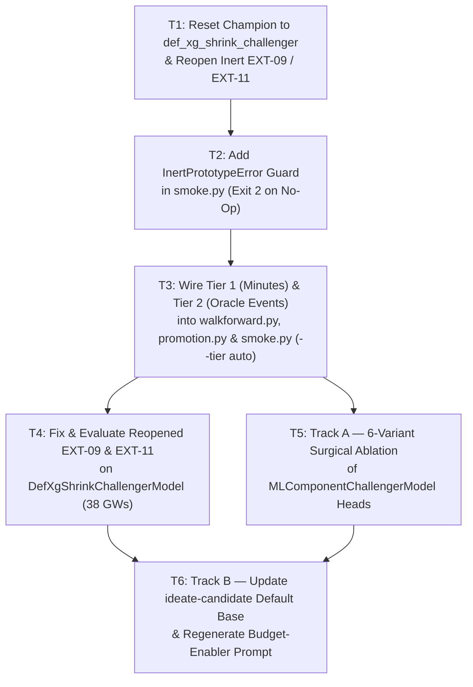

# Wayfinder Execution Blueprint: Candidate Pipeline Reform & ADR 0064 Baseline Alignment

**Updated**: 2026-10-28 (+07:00)  
**Target Executor**: Any coding agent (including fast/lightweight models)  
**Wayfinder Map Manifest**: [`wayfinder-tickets.json`](file:///home/jubileez/fpl-jubilee-ascent/docs/research/candidate-ideation/wayfinder-tickets.json)  
**Active Work Packet**: [`.agents/work-packets/wayfinder-candidate-pipeline-reform.md`](file:///home/jubileez/fpl-jubilee-ascent/.agents/work-packets/wayfinder-candidate-pipeline-reform.md)

> [!IMPORTANT]
> **Execution Contract for Agent**:
> Execute Tickets **T1 through T6** strictly in order. Do not skip verification commands between tickets. Every code snippet, file path, and CLI command below has been verified against the current repository state.

---

## Architecture & Workflow Overview



---

## Ticket T1: Align `config/model_selection.json`, `candidate_ledger.csv`, and `idea_queue.csv` (`t1_champion_baseline_reset`)

### Objective
Align active Model Champion with ADR 0064 (`def_xg_shrink_challenger`), reclassify Inert Prototypes `EXT-09` and `EXT-11` from `dead` to `open` in the Candidate Ledger, and reset them to `untested` in `idea_queue.csv`.

### Step 1.1: Edit [`config/model_selection.json`](file:///home/jubileez/fpl-jubilee-ascent/config/model_selection.json)
Replace the entire file content with:
```json
{
  "schema_version": 1,
  "champion": "def_xg_shrink_challenger",
  "candidates": [
    "adaptive_causal_challenger",
    "club_def_prior_challenger"
  ],
  "promotion_status": "provisional"
}
```

### Step 1.2: Edit [`docs/research/candidate-ledger/candidate_ledger.csv`](file:///home/jubileez/fpl-jubilee-ascent/docs/research/candidate-ledger/candidate_ledger.csv)
In `docs/research/candidate-ledger/candidate_ledger.csv`, update rows 95 (`ext_09_binomial_fixture_exposure`) and 98 (`ext_11_role_*`) from `dead` to `open` and clear their `revisit_after` column (`""`) as required by `tests/test_candidate_ledger.py`:

- **Target (Row 95)**:
  ```csv
  dead,"Binomial fixture-exposure likelihood for inherited learned-start anchor (DGW starts/trials, predictors and mass fixed)",smoke ext_09_binomial_fixture_exposure,adaptive_causal_challenger,dev 2025-26 FAIL 0.0 0/3 boot P 0.5779 (best ext_09_binomial_fixture_exposure; all 1 variants dev FAIL); guardrails True; no confirmation,2026-10-28,2027-10-28,docs/research/candidate-ideation/smoke_results.csv
  ```
  **Replacement**:
  ```csv
  open,"Binomial fixture-exposure likelihood for inherited learned-start anchor (DGW starts/trials, predictors and mass fixed)",smoke ext_09_binomial_fixture_exposure,adaptive_causal_challenger,inert prototype on adaptive_causal_challenger (0.0 delta due to Head 1 overwrite); reopened on def_xg_shrink_challenger,2026-10-28,,docs/research/candidate-ideation/smoke_results.csv
  ```

- **Target (Row 98)**:
  ```csv
  dead,"Opponent conditional attacking role allocation (relative concession contrasts by MID/FWD profile, club attacker normalization)",smoke ext_11_role_* (3 variants),adaptive_causal_challenger,dev 2025-26 FAIL 0.0 0/3 boot P 0.000 (best ext_11_role_l25/50/100; all 3 variants dev FAIL); guardrails True; no confirmation,2026-10-28,2027-10-28,docs/research/candidate-ideation/smoke_results.csv
  ```
  **Replacement**:
  ```csv
  open,"Opponent conditional attacking role allocation (relative concession contrasts by MID/FWD profile, club attacker normalization)",smoke ext_11_role_* (3 variants),adaptive_causal_challenger,inert prototype (0.0 delta due to ~known & counts>0 club skip guard); reopened with known-attacker subset filter,2026-10-28,,docs/research/candidate-ideation/smoke_results.csv
  ```

### Step 1.3: Edit [`docs/research/candidate-ledger/candidate-ledger.md`](file:///home/jubileez/fpl-jubilee-ascent/docs/research/candidate-ledger/candidate-ledger.md)
Move the `ext_09_binomial_fixture_exposure` and `ext_11_role_*` rows out of `## Dead` into `## Open (next-lever pool; not proven dead)` so the markdown view matches `candidate_ledger.csv`.

### Step 1.4: Edit [`docs/research/candidate-ideation/idea_queue.csv`](file:///home/jubileez/fpl-jubilee-ascent/docs/research/candidate-ideation/idea_queue.csv)
For `EXT-09` (order `9`) and `EXT-11` (order `11`), change `status` from `fail` to `untested` and clear `ledger_result` (set trailing column after the last comma to empty).

### Step 1.5: Verify T1
```bash
uv run pytest tests/test_candidate_ledger.py tests/test_model_selection.py -q
```

---

## Ticket T2: Add `InertPrototypeError` Guard to `smoke.py` (`t2_inert_prototype_guard`)

### Objective
Prevent any prototype that produces zero active gameweeks or fails to perturb the Exogenous Playable Pool (`< 0.01` pts with `0.0` combined delta) from writing to `smoke_results.csv` or locking a 1-year Dead Lever.

### Step 2.1: Edit [`.agents/skills/explore-candidate/smoke.py`](file:///home/jubileez/fpl-jubilee-ascent/.agents/skills/explore-candidate/smoke.py)
1. Import `PLAYABLE_MINUTES_THRESHOLD`, `PLAYABLE_XP_THRESHOLD`, and `identify_active_gameweeks` from `backtesting.promotion`.
2. Add `InertPrototypeError` and `check_inert_prototype` right after `class LeakageError(RuntimeError): pass`:
```python
class InertPrototypeError(RuntimeError):
    pass


def max_playable_pool_shift(reference_df: pd.DataFrame, candidate_df: pd.DataFrame) -> float:
    """Return max |cand_xp - champ_xp| across the Exogenous Playable Pool (mins >= 30 or champ_xp >= 2.0)."""
    cols = ["gameweek", "player_id", "projected_points"]
    champ_cols = [*cols, "actual_minutes"] if "actual_minutes" in reference_df.columns else cols
    merged = pd.merge(
        reference_df[champ_cols].rename(columns={"projected_points": "champ_xp"}),
        candidate_df[cols].rename(columns={"projected_points": "cand_xp"}),
        on=["gameweek", "player_id"],
        how="inner",
    )
    if merged.empty:
        return 0.0
    mins = merged["actual_minutes"] if "actual_minutes" in merged.columns else pd.Series(0.0, index=merged.index)
    playable = (merged["champ_xp"] >= PLAYABLE_XP_THRESHOLD) | (mins >= PLAYABLE_MINUTES_THRESHOLD)
    subset = merged.loc[playable]
    if subset.empty:
        return 0.0
    return float((subset["cand_xp"] - subset["champ_xp"]).abs().max())


def check_inert_prototype(
    name: str,
    reference: WalkforwardResult,
    candidate: WalkforwardResult,
    *,
    combined_delta: float,
    min_playable_shift: float = 0.01,
) -> None:
    """Raise InertPrototypeError if prototype produces no active GWs or negligible playable shift with zero delta."""
    active_gws = identify_active_gameweeks(reference.df_eval, candidate.df_eval)
    if not active_gws:
        raise InertPrototypeError(f"{name}: zero active gameweeks (max |cand_xp - champ_xp| <= 1e-6)")
    max_shift = max_playable_pool_shift(reference.df_eval, candidate.df_eval)
    if max_shift < min_playable_shift and abs(combined_delta) < 1e-9:
        raise InertPrototypeError(
            f"{name}: inert on Exogenous Playable Pool (max |delta_xp| = {max_shift:.6f} < {min_playable_shift:.2f}) "
            f"with combined_delta = {combined_delta:+.6f}"
        )
```
3. In `smoke.py` `main()`, after computing `verdict = compare_to_reference(base, result, bootstrap_min_p=bar)` (for prototype runs), call:
```python
            if name in prototype_names:
                try:
                    check_inert_prototype(
                        name,
                        base,
                        result,
                        combined_delta=verdict.combined_primary_delta,
                    )
                except InertPrototypeError as error:
                    print(f"INERT FAIL: {error}", flush=True)
                    leaked = True
                    continue
```

### Step 2.2: Add Unit Tests in `tests/test_smoke_harness.py`
Create or update `tests/test_smoke_harness.py` testing `check_inert_prototype`:
1. Identical `reference` and `candidate` frames $\to$ raises `InertPrototypeError` (`zero active gameweeks`).
2. Frame where only an unplayable bench player (`champ_xp = 0.2, actual_minutes = 0`) changes by `0.05` and `combined_delta = 0.0` $\to$ raises `InertPrototypeError` (`inert on Exogenous Playable Pool`).
3. Frame where a playable player (`champ_xp = 4.5, actual_minutes = 90`) changes by `0.15` $\to$ does not raise.

### Step 2.3: Verify T2
```bash
uv run ruff check .agents/skills/explore-candidate/smoke.py tests/test_smoke_harness.py
uv run pytest tests/test_smoke_harness.py -q
```

---

## Ticket T3: Wire Tier 1 & Tier 2 Component Gates into `walkforward.py`, `promotion.py`, and `smoke.py` (`t3_tiered_component_gating`)

### Objective
Promote `oracle_minutes` walk-forward injection and `evaluate_oracle_event_gate` into production `backtesting/`, align Tier 1 (`commands/evaluate_minutes.py`) and Tier 2 with ADR 0064 ($L=5$ MBB, £83.5m Constrained XI, $P_{\text{screen}} \ge 0.65$), and add `--tier {1,2,3,auto}` to `smoke.py`.

### Step 3.1: Edit [`backtesting/walkforward.py`](file:///home/jubileez/fpl-jubilee-ascent/backtesting/walkforward.py)
1. Add `oracle_minutes: bool = False` to `WalkforwardConfig` dataclass (after `blend_weight: float = 0.5`).
2. Add helper `inject_oracle_minutes(df_feat: pd.DataFrame, df_perf: pd.DataFrame, target_gw: int) -> pd.DataFrame`:
```python
def inject_oracle_minutes(
    df_feat: pd.DataFrame,
    df_perf: pd.DataFrame,
    target_gw: int,
) -> pd.DataFrame:
    """Inject realized match minutes into df_feat['external_xmins'] on (player_id, gameweek_id, fixture_id)."""
    df_feat = df_feat.copy()
    gw_perf = df_perf[df_perf["gameweek_id"] == target_gw]
    perf_minutes = (
        gw_perf[["player_id", "gameweek_id", "fixture_id", "minutes"]]
        .rename(columns={"minutes": "external_xmins"})
        .drop_duplicates(subset=["player_id", "gameweek_id", "fixture_id"])
    )
    if "external_xmins" in df_feat.columns:
        df_feat = df_feat.drop(columns=["external_xmins"])
    df_feat = df_feat.merge(
        perf_minutes,
        on=["player_id", "gameweek_id", "fixture_id"],
        how="left",
    )
    df_feat["external_xmins"] = df_feat["external_xmins"].fillna(0.0).astype(float)
    return df_feat
```
3. Inside `run_walkforward_backtest(config: WalkforwardConfig)` right after `df_feat = build_features(...)`:
```python
        if config.oracle_minutes:
            df_feat = inject_oracle_minutes(df_feat, df_perf, gw)
```

### Step 3.2: Edit [`backtesting/promotion.py`](file:///home/jubileez/fpl-jubilee-ascent/backtesting/promotion.py)
Add `COMPONENT_SCREEN_MIN_P = 0.65`, `ORACLE_BIAS_REL_TOL = 0.02`, `ORACLE_BIAS_HARD_CAP = 0.20`, `OracleEventGateVerdict`, and `evaluate_oracle_event_gate`:
```python
COMPONENT_SCREEN_MIN_P: float = 0.65
ORACLE_BIAS_REL_TOL: float = 0.02
ORACLE_BIAS_HARD_CAP: float = 0.20


@dataclass(frozen=True)
class OracleEventGateVerdict:
    passed: bool
    oracle_delta: float
    bootstrap_p: float | None
    candidate_playable_bias: float
    champion_playable_bias: float
    captain_regret_delta: float
    reasons: tuple[str, ...]
```
Implement `evaluate_oracle_event_gate(champion_metrics: Mapping[str, Any], candidate_metrics: Mapping[str, Any], *, gw_deltas: Sequence[float] | None = None, active_gameweeks: Sequence[int] | None = None, all_gameweeks: Sequence[int] | None = None, bootstrap_min_p: float = COMPONENT_SCREEN_MIN_P) -> OracleEventGateVerdict`:
- Primary: `oracle_delta = champ_regret - cand_regret > 0.0` (reading `oracle_formation_xi_regret` or `formation_xi_regret`).
- Bootstrap: if `gw_deltas` provided (filtered by `_filter_active_gw_deltas` when `len >= 15`), require `block_bootstrap_win_probability(resample_deltas) >= bootstrap_min_p`.
- Playable bias: `abs(cand_bias) <= min(abs(champ_bias) + ORACLE_BIAS_REL_TOL, ORACLE_BIAS_HARD_CAP)`.
- Captaincy regret: `cand_cap <= champ_cap + CAPTAIN_REGRET_ABS_TOL`.

### Step 3.3: Edit [`commands/evaluate_minutes.py`](file:///home/jubileez/fpl-jubilee-ascent/commands/evaluate_minutes.py)
Update `evaluate_minutes_gate` default `bootstrap_min_p: float = 0.65` (`COMPONENT_SCREEN_MIN_P`) and ensure active-gameweek filtering is applied to `gw_mae_deltas` when dormant fallback weeks (`abs(gw_mae_delta) <= 1e-9`) are present.

### Step 3.4: Edit [`.agents/skills/explore-candidate/smoke.py`](file:///home/jubileez/fpl-jubilee-ascent/.agents/skills/explore-candidate/smoke.py)
Add `--tier` argument (`choices=("1", "2", "3", "auto"), default="auto"`):
- Lookup prototype component from `getattr(module, "COMPONENTS", {}).get(name)` or `docs/research/candidate-ideation/idea_queue.csv` (matching `lane` / `idea_id.lower().replace("-", "_")`), defaulting to `"all"`.
- When `tier == "1"` or (`tier == "auto"` and `component == "xp_minutes"` and `args.season == "dev"`):
  Evaluate `evaluate_minutes_gate` on the walk-forward `df_eval` frames first. If Tier 1 fails, prepend `"tier1_minutes_fail: ..."` to `reasons` and mark `pass = False`.
- When `tier == "2"` or (`tier == "auto"` and `component in {"xp_goals", "xp_assists", "xp_clean_sheet", "xp_clean_sheets", "xp_saves", "xp_defcon", "xp_bonus"}` and `args.season == "dev"`):
  Run Oracle walk-forward (`oracle_minutes=True`) first and evaluate `evaluate_oracle_event_gate`. If Tier 2 fails, record the failure row with `"tier2_oracle_fail: ..."` without running the second (Tier 3) walk-forward; if Tier 2 passes, proceed to Tier 3 (`oracle_minutes=False`).

### Step 3.5: Verify T3
```bash
uv run ruff check backtesting/ commands/evaluate_minutes.py .agents/skills/explore-candidate/smoke.py
uv run pytest tests/test_decoupled_models.py tests/test_promotion.py -q
```

---

## Ticket T4: Fix & Evaluate Reopened `EXT-09` and `EXT-11` Against `def_xg_shrink_challenger` (`t4_reopen_fix_ext09_ext11`)

### Objective
Fix the two reopened mechanisms (`EXT-09` and `EXT-11`) so they subclass `DefXgShrinkChallengerModel` across all 38 Gameweeks and run them through `smoke.py`.

### Step 4.1: Fix `EXT-09` ([`docs/research/candidate-ideation/prototypes/ext_09/prototypes.py`](file:///home/jubileez/fpl-jubilee-ascent/docs/research/candidate-ideation/prototypes/ext_09/prototypes.py))
1. Change base class of `BinomialFixtureExposure` from `AdaptiveCausalChallengerModel` to `DefXgShrinkChallengerModel` (`from models.def_xg_shrink_challenger import DefXgShrinkChallengerModel`).
2. Remove the `target_gw < 20` hard block in `corrected_probabilities` and `predict` so `corrected_probabilities` activates whenever `target_gw >= _MIN_TRAIN_GW` and `len(train) >= _MIN_ROWS` and `train["fixture_count"].gt(1).any()` (or in-season + seed DGW history exists).
3. Add `COMPONENTS = {"ext_09_binomial_fixture_exposure": "xp_minutes"}`.

### Step 4.2: Fix `EXT-11` ([`docs/research/candidate-ideation/prototypes/ext_11/prototypes.py`](file:///home/jubileez/fpl-jubilee-ascent/docs/research/candidate-ideation/prototypes/ext_11/prototypes.py))
1. Change base class of `OpponentRoleAllocation` from `AdaptiveCausalChallengerModel` to `DefXgShrinkChallengerModel` (`from models.def_xg_shrink_challenger import DefXgShrinkChallengerModel`) and remove the `cutoff < self.min_ml_gw` GW20 gate (use `cutoff < 4` cold-start guard instead).
2. In `_apply_role_counts`, replace the broken club-skipping guard:
   ```python
   # BROKEN (skipped every club whenever any 0-min bench player had counts > 0):
   if np.any(~known & (counts > 0)):
       continue
   new_counts = normalized_counts(counts, role_contrasts, alpha)
   ```
   with subset normalization over known active attackers only:
   ```python
   active_mask = known & (counts > 0)
   if int(np.sum(active_mask)) < 2:
       continue
   new_counts = counts.copy()
   new_counts[active_mask] = normalized_counts(
       counts[active_mask], role_contrasts[active_mask], alpha
   )
   ```
3. Add `COMPONENTS = {name: "xp_goals" for name in PROTOTYPES}`.

### Step 4.3: Audit, Run, and Record `EXT-09` & `EXT-11`
```bash
uv run python .agents/skills/explore-candidate/smoke.py docs/research/candidate-ideation/prototypes/ext_09/prototypes.py --audit_only
uv run python .agents/skills/explore-candidate/smoke.py docs/research/candidate-ideation/prototypes/ext_11/prototypes.py --audit_only
uv run pytest docs/research/candidate-ideation/prototypes/ext_11/checks_role.py docs/research/candidate-ideation/prototypes/ext_09/checks.py -q
uv run python .agents/skills/explore-candidate/smoke.py docs/research/candidate-ideation/prototypes/ext_09/prototypes.py --lane ext_09 --workers 2 --out docs/research/candidate-ideation/smoke_results.csv
uv run python .agents/skills/explore-candidate/smoke.py docs/research/candidate-ideation/prototypes/ext_11/prototypes.py --lane ext_11 --workers 2 --out docs/research/candidate-ideation/smoke_results.csv
```
Update `candidate_ledger.csv`, `candidate-ledger.md`, and `idea_queue.csv` with the new empirical verdicts against `def_xg_shrink_challenger`.

---

## Ticket T5: Execute Track A 6-Variant Surgical Ablation of `MLComponentChallengerModel` Heads (`t5_track_a_ml_head_ablation`)

### Objective
Test whether any individual or combined head of `AdaptiveCausalChallengerModel` / `MLComponentChallengerModel` passes the ADR 0064 £83.5m Constrained Formation XI gate against `def_xg_shrink_challenger` once Group A goal inflation is isolated.

### Step 5.1: Create `docs/research/candidate-ideation/prototypes/track_a/prototypes.py`
Write a clean prototype module defining the 6 locked variants subclassing `AdaptiveCausalChallengerModel` (and `ExposureReplay` from `ext_07` for variant 4):
1. `track_a_h1_only`: `enable_mins_h1=True, enable_mins_h3=False, enable_goals=False, enable_assists=False`
2. `track_a_h3_only`: `enable_mins_h1=False, enable_mins_h3=True, enable_goals=False, enable_assists=False`
3. `track_a_mins_h1_h3`: `enable_mins_h1=True, enable_mins_h3=True, enable_goals=False, enable_assists=False`
4. `track_a_mins_h1_h3_coherent`: `ExposureReplay` with `enable_mins_h1=True, enable_mins_h3=True, enable_goals=False, enable_assists=False`
5. `track_a_group_b_assists`: `enable_mins_h1=False, enable_mins_h3=False, enable_goals=False, enable_assists=True`
6. `track_a_no_goals_h1_h3_b`: `enable_mins_h1=True, enable_mins_h3=True, enable_goals=False, enable_assists=True`

### Step 5.2: Audit and Execute Track A Smoke Run
```bash
uv run python .agents/skills/explore-candidate/smoke.py docs/research/candidate-ideation/prototypes/track_a/prototypes.py --audit_only
uv run python .agents/skills/explore-candidate/smoke.py docs/research/candidate-ideation/prototypes/track_a/prototypes.py --lane track_a --tier 3 --workers 2 --out docs/research/candidate-ideation/smoke_results.csv
```
- Log results in `candidate_ledger.csv` and `candidate-ledger.md`.
- If any variant achieves `pass == True` on Dev 2025–26 ($P \ge 0.75$, all segment floors and guardrails passed), promote it to a registered `BaseModel` in `models/`, freeze on Dev, and run Confirmation (`--season confirm`) once per `.agents/skills/explore-candidate/SKILL.md` steps 6–7.

---

## Ticket T6: Update `ideate-candidate` Tooling for 38-GW `DefXgShrinkChallengerModel` & Refresh Budget-Enabler Brief (`t6_track_b_budget_enabler_ideation`)

### Objective
Update `generate_prompt.py` and `ingest_ideas.py` so future ideation briefs and auto-generated code skeletons build on `DefXgShrinkChallengerModel` across all 38 Gameweeks and target the untapped `Budget & Valuation` (`--focus budget-enablers`) frontier.

### Step 6.1: Edit [`.agents/skills/ideate-candidate/generate_prompt.py`](file:///home/jubileez/fpl-jubilee-ascent/.agents/skills/ideate-candidate/generate_prompt.py) and [`.agents/skills/ideate-candidate/ingest_ideas.py`](file:///home/jubileez/fpl-jubilee-ascent/.agents/skills/ideate-candidate/ingest_ideas.py)
1. In `generate_prompt.py`:
   - Update the Active Model Champion description and 1-shot exemplar skeleton so when `champion == "def_xg_shrink_challenger"`, the prompt instructs models to subclass `DefXgShrinkChallengerModel` (`from models.def_xg_shrink_challenger import DefXgShrinkChallengerModel`) operating across all 38 Gameweeks (with Empirical Bayes or continuous $N_{\text{eff}}$ shrinkage), rather than hardcoding a GW20 step cliff.
2. In `ingest_ideas.py`:
   - Update `_synthesize_code_skeleton` to import and subclass `DefXgShrinkChallengerModel` (from `models.def_xg_shrink_challenger`) by default instead of `AdaptiveCausalChallengerModel`.

### Step 6.2: Regenerate the Prompt Brief & Run Full Verification Gate
```bash
uv run python .agents/skills/ideate-candidate/generate_prompt.py --focus budget-enablers
uv run ruff check .
uv run pytest
bash tests/verify.sh
```
Delete any temporary scratch files under `.tmp/agent/` and delete `.agents/work-packets/wayfinder-candidate-pipeline-reform.md` in the final commit checkpoint once all 6 tickets are complete.
