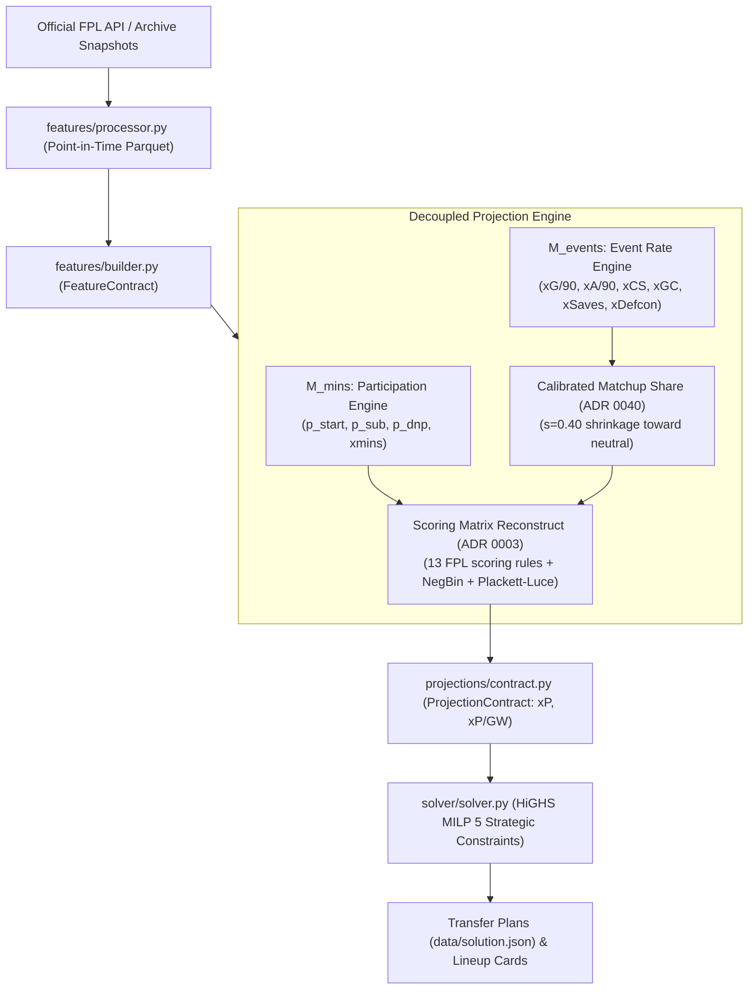

# Brief 01: FPL Candidate Model Ideation & Projections Architecture

**Target Audience**: 3rd-Party Frontier LLM (Claude 3.5 Sonnet, GPT-4o, Gemini 1.5 Pro)  
**Task Type**: Quantitative Modeling Ideation, Mathematical Specification & Algorithmic Design  
**Repository**: `fpl-jubilee-ascent`  
**Current Champion**: `adaptive_causal_challenger` (ADR 0063)  
**Primary Downstream Consumer**: HiGHS MILP Solver with Strategic Variance Constraints (ADR 0061)

---

## Part 1: Copy-Paste Prompt for the 3rd-Party LLM

```markdown
You are a Principal Quantitative Sports Modeler and Machine Learning Engineer specializing in association football (soccer) analytics and combinatorial lineup optimization for Fantasy Premier League (FPL).

### Context & System Environment
You are advising the core team of `fpl-jubilee-ascent`, a premier open-source FPL projection and optimization engine. The engine operates on Python 3.14, utilizing a point-in-time temporal pipeline, an expanding-window causal feature store, empirical Bayes scoring models, and a vendored HiGHS Mixed-Integer Linear Programming (MILP) solver.

We have reached an inflection point:
- Our active Model Champion is `adaptive_causal_challenger` (ADR 0063), which utilizes an empirical Bayes baseline (`def_xg_shrink_challenger`) with 100% stability across Gameweeks 1–19, and activates a decoupled Causal Panel ML model (Ridge logistic $p_{\text{start}}$, Ridge duration offset, shrunk xG goals residual, and leave-one-out assist finishing) exclusively from Gameweek 20 onward once 19 round-robin fixtures provide sufficient sample maturity.
- Projections are consumed directly by a multi-period HiGHS MILP solver that optimizes transfer paths and lineups over a 5–10 GW horizon under 5 "Strategic" variance constraints (hit friction, starter minutes floors, bench coverage, defensive stack caps, and GK transfer penalties).
- Over 93 candidate model levers have been rigorously evaluated against our Historical Promotion Gate (Legal Formation XI Regret under circular block bootstrap on historical seasons). 85+ have failed or regressed. We have compiled a comprehensive taxonomy of dead levers that must NOT be repeated.

### Your Mission
Generate an actionable, innovative, and mathematically sound slate of 5 to 7 NEW Candidate Projection Models (or component mechanisms) that can defeat `adaptive_causal_challenger` under our Historical Promotion Gate.

### Strict Negative Constraints (Dead Levers — DO NOT PROPOSE)
1. DO NOT propose club 11-man starting probability conservation ($\sum_{\text{club}} p_{\text{start}} = 11.0$). This compresses elite rotating squads (Man City/Chelsea) and artificially inflates bench fodder ($\Delta = -3.5$ pts/GW).
2. DO NOT propose unregularized in-season ridge/GLM refits of player goal/assist rates without heavy priors ($\Delta = -0.96$ pts/GW; overfits cameo hauls).
3. DO NOT propose relaxing defender xG shrinkage ($K_{\text{DEF}} = 2400$ pseudo-minutes) for unseeded starters or high-creativity defenders. Defender xG split-half reliability is $r \approx 0.15$; relaxing shrinkage inflates haul noise and triggers optimizer's curse ($\Delta = -0.48$ pts/GW).
4. DO NOT propose bonus pool saturation caps ($B_{\max} \in [1.2, 1.5]$). It starves forward expected value ($\Delta = -0.28$ pts/GW).
5. DO NOT propose raw/unshrunk opponent matchup multipliers (e.g. multiplicative team Poisson $\lambda$ or raw FDR scales). They over-project easy fixtures and severely breach playable pool bias ($\Delta = -0.68$ pts/GW).
6. DO NOT propose static schedule congestion shifts (e.g. flat $-0.20$ logit on $p_{\text{start}}$ for $<3.5$ days rest). It passed dev but catastrophically failed confirmation ($-0.105$ pts/GW).
7. DO NOT propose step-function early ML activation (e.g. activating causal ML at GW8 or GW10, even with $[-10\%, +10\%]$ output clamps). In unseeded regimes (2024–25), early-season ML over-regularizes talisman hauls (Palmer/Haaland) and regresses by $-2.28$ pts/GW.
8. DO NOT propose latent Hidden Markov Models (HMM) for participation transitions. Parameter estimation noise severely breaks minutes MAE.
9. DO NOT propose transfer market churn or ownership momentum as DNP hazard signals. Transfer drops lag true availability and introduce negative regret.
10. DO NOT propose zero-sum teammate absence xG redistribution. Over-allocates vacated volume to sub-optimal replacements.

### Required Output Structure for Each Candidate Idea
For each candidate model or component mechanism you propose:
1. **Concept & Hypothesis**: Clear statement of the market inefficiency or physical football phenomenon captured, and why existing Champion mechanisms miss it.
2. **Mathematical Formulation**: Exact equations, prior distributions, likelihoods, shrinkage parameters ($K$, $\lambda$), and link functions.
3. **Decoupled Architecture Placement**: State whether this operates in $M_{\text{mins}}$ (participation/minutes) or $M_{\text{events}}$ (rate conditioned on minutes).
4. **Cold-Start & Sample Maturity Strategy**: How does it behave in GW1–4 (cold-start) and GW5–19 (early-mid) where prior-season data is either unavailable (unseeded) or sparse?
5. **Optimizer Interaction Analysis**: Why does this proposed return profile NOT induce the "Optimizer's Curse" in our HiGHS MILP solver?
6. **Feature Contract Requirements**: Specific point-in-time covariates needed (strictly pre-match deadline; no terminal leakages).
7. **Python Code Skeleton**: Adheres to our `BaseModel` / `CompositeProjectionModel` interfaces.

Begin by reviewing the comprehensive technical context below before outputting your candidate recommendations.
```

---

## Part 2: Technical Architecture & System Specification



### 1. The Active Model Champion: `adaptive_causal_challenger` (ADR 0063)

The active Champion uses an object-oriented inheritance lineage terminating in `AdaptiveCausalChallengerModel`:

```
BaseModel (models/base.py)
  └── ComponentBaselineModel (models/component_baseline.py)
        └── MetricsComponentHybridModel (models/metrics_component_hybrid.py)
              └── ParticipationStateHybridModel (models/participation_state_hybrid.py)
                    └── CalibratedMatchupHybridModel (models/calibrated_matchup_hybrid.py)
                          └── HoldChaseChallengerModel (models/hold_chase_challenger.py)
                                └── FaceValueChallengerModel (models/face_value_challenger.py)
                                      └── MultiFeatureAssistChallengerModel (models/multi_feature_assist_challenger.py)
                                            └── LearnedStartChallengerModel (models/learned_start_challenger.py)
                                                  └── DefXgShrinkChallengerModel (models/def_xg_shrink_challenger.py)
                                                        └── MLComponentChallengerModel (models/ml_component_challenger.py)
                                                              └── AdaptiveCausalChallengerModel [CHAMPION] (models/adaptive_causal_challenger.py)
```

#### Lineage Mechanism Breakdown:
1. **Event-Level Empirical Bayes & Scoring Matrix Reconstruct (ADR 0003)**:
   - Projections do not predict raw fantasy points. They project underlying match events and pass them through exact FPL rule calculations:
     - Goals: Position-weighted (GK/DEF: 6, MID: 5, FWD: 4).
     - Clean Sheets: Pitch clean sheet probability $e^{-\lambda_{\text{pitch}}} \times P(60+\text{ mins})$ (GK/DEF: 4, MID: 1).
     - Goals Conceded: Negative Binomial expectation $\mathbb{E}[\lfloor X/2 \rfloor]$ with dispersion $r=3.0$ ($-1$ pt per 2 GC for GK/DEF).
     - Defensive Contributions (Defcon): Negative Binomial probability of $\ge 10$ (DEF) or $\ge 12$ (MID/FWD) CBI/tackles (+2 pts).
     - Saves: Poisson expectation $\mathbb{E}[\lfloor \text{saves}/3 \rfloor]$ (+1 pt per 3 saves for GK).
     - Bonus Points System (xBPS): Synthetic BPS score modeled via Plackett-Luce rank choice.
2. **Three-State Participation Engine**:
   - For every player and fixture:
     $$P(\text{DNP}) + P(\text{Start}) + P(\text{Sub-in}) = 1.0$$
   - Expected minutes: $\mathbb{E}[\text{Mins}] = P(\text{Start}) \cdot xMins_{\text{start}} + P(\text{Sub-in}) \cdot xMins_{\text{sub}}$ (where baseline $xMins_{\text{start}} \approx 78.0$, $xMins_{\text{sub}} \approx 18.0$).
   - $P(60+\mid \text{state}) = \text{clip}\left(\frac{\text{minutes} - 45.0}{30.0}, 0.0, 1.0\right)$.
   - Operational Hard DNP (ADR 0056): FPL injury status $\in \{\text{'i', 's', 'u', 'n'}\}$ or `chance_of_playing == 0` forces $P(\text{DNP}) = 1.0$.
3. **Calibrated Matchup Share (ADR 0040)**:
   - Eliminates volatile FDR tables. Multipliers scale club attacking and defensive strength relative to league averages, shrunk by $s = 0.40$ toward neutral ($1.0$).
4. **Face-Value Attack & Minute-Pooled Goal Finishing (ADR 0045)**:
   - Fixed weights: $1.0 \times xG$ and $1.0 \times xA$ (raw threat/creativity zeroed out).
   - Finishing skill offset over $K=1800$ pseudo-minutes:
     $$\text{Offset}_i = \frac{\sum (\text{Goals}_i - xG_i) \cdot 90}{\sum \text{Minutes}_i + 1800.0}$$
5. **Defender xG Shrinkage (ADR 0055)**:
   - Defenders exhibit split-half xG reliability of $r \approx 0.15$. The Champion shrinks defender xG/90 toward the position mean using $K=2400$ pseudo-minutes (attackers use $K=360$):
     $$\hat{\lambda}_{xG, \text{DEF}} = \frac{\sum xG_{\text{observed}} \cdot 90 + K_{\text{DEF}} \cdot \bar{\lambda}_{\text{pos}}}{\sum \text{Minutes} + K_{\text{DEF}}}$$
   - This single change prevented the MILP optimizer from loading up on center-backs who happened to head home a corner early in the season.
6. **Adaptive Causal ML Activation (ADR 0063)**:
   - **GW 1–19**: Evaluates purely through `def_xg_shrink_challenger`. Guarantees non-catastrophic loss bounds on cold-start and early-mid segments ($\Delta_{\text{cold\_start}} = 0.00$, $\Delta_{\text{early\_mid}} = 0.00$).
   - **GW 20+**: Activates stacked Causal Panel ML models via a 5-GW Bayesian ramp ($w_{\text{ML}} = \min(1.0, \frac{\text{GW} - 19}{5})$):
     - **Tier 1 Minutes**: Ridge logistic regression on $p_{\text{start}}$ ($H_1$) + Ridge linear regression on starter duration offset ($H_3$). Sub-in classifier ($H_2$) disabled (proven noisy).
     - **Tier 2 Events**: Group A Shrunk xG Goals Residual + Group B Calibrated Leave-One-Out (LOO) Assist Finishing ($\omega = 0.95^{\Delta \text{GW}}$ exponential decay, bounded $[0.88, 1.15]$). Defensive and Bonus ML heads disabled (proven negative).
   - **Evidence**: 2025–26 Dev season $\Delta = +0.736$ pts/GW, bootstrap $P = 0.992$, 5/5 guardrails green. 2024–25 Confirmation season (unseeded) $\Delta = +0.226$ pts/GW, bootstrap $P = 0.656$, 5/5 guardrails green.

---

### 2. Downstream Optimization: HiGHS MILP Solver & Strategic Constraints (ADR 0061)

The solver does not merely pick 11 players; it solves a multi-period Mixed-Integer Linear Program over horizon $W \in [5, 10]$ gameweeks, balancing squad transfers, bank value, captaincy, and bench order.

$$\max_{\mathbf{x}, \mathbf{c}, \mathbf{b}, \mathbf{t}_{\text{in}}, \mathbf{t}_{\text{out}}} \sum_{w=1}^W \gamma^{w-1} \left( \sum_{p=1}^P \left( x_{p,w} \hat{y}_{p,w} + c_{p,w} \hat{y}_{p,w} + b_{p,w} v_b \hat{y}_{p,w} \right) - \text{Cost}(w) - \text{Penalties}(w) \right)$$

Where:
- $x_{p,w} \in \{0, 1\}$: Starting lineup indicator (exactly 11 players, 1 GKP, 3–5 DEF, 2–5 MID, 1–3 FWD).
- $c_{p,w} \in \{0, 1\}$: Captain indicator ($\sum_p c_{p,w} = 1$, $c_{p,w} \le x_{p,w}$).
- $b_{p,w} \in \{0, 1\}$: Bench players ($v_b \approx 0.10$ expected autosub weight).
- $\text{Cost}(w)$: Transfer hit cost ($4.0$ pts per paid transfer above free transfer limit).

#### The 5 Strategic Variance Constraints (ADR 0061)
Because optimizers relentlessly exploit uncalibrated variance (The Optimizer's Curse), unconstrained solves frequently selected fragile, rotation-prone players with high nominal $xP$. ADR 0061 embeds 5 quantitative linear constraints with continuous slack variables:

1. **Hit Friction Buffer**:
   $$\text{Penalty}_{\text{hit}}(w) = 1.8 \cdot \text{PaidHits}(w)$$
   Raises the effective breakeven hurdle for an immediate transfer hit from $4.0$ to $5.8$ projected points, eliminating speculative -4 point churn.
2. **Starter Expected Minutes Floor**:
   $$\forall p \in \text{Outfield Starters}, \quad xMins_{p,w} + s^{\text{mins}}_{p,w} \ge 65.0, \quad s^{\text{mins}}_{p,w} \ge 0$$
   Objective penalty: $-10.0 \cdot s^{\text{mins}}_{p,w}$. Prevents the optimizer from fielding 50-minute high-upside wingers as core starters.
3. **First-Bench Cover Nailedness**:
   $$\sum_{p \in \text{Squad}} \mathbb{I}(xMins_{p,w} \ge 65.0) + s^{\text{bench}}_w \ge 12, \quad s^{\text{bench}}_w \ge 0$$
   Objective penalty: $-1.5 \cdot s^{\text{bench}}_w$. Ensures at least 1 bench outfield player is a guaranteed 65+ minute starter in case of unexpected DNP.
4. **Defensive Stack Limiter**:
   $$\forall c \in \text{Clubs}, \quad \sum_{p \in \text{DEF} \cup \text{GKP}, \text{club}(p)=c} x_{p,w} - s^{\text{stack}}_{c,w} \le 2, \quad s^{\text{stack}}_{c,w} \ge 0$$
   Objective penalty: $-1.2 \cdot s^{\text{stack}}_{c,w}$. Prevents triple-defense correlation wipeouts on single match outcomes.
5. **Goalkeeper Transfer Friction**:
   $$-1.5\text{ pt objective penalty on any non-wildcard GKP transfer-in}.$$
   Goalkeeper variance is dominated by Poisson save/CS noise; burning FTs on lateral GK moves is mathematically negative.

---

### 3. The 10 Proven Dead-Lever Archetypes (from 93 Historical Trials)

| Archetype ID | Tested Hypotheses | Empirical Fate | Mathematical Cause of Failure |
|---|---|---|---|
| **ARCH-01** | Club 11-Man Mass Conservation ($\sum p_{\text{start}} = 11.0$) | Dev $\Delta = -3.14 \dots -4.13$, 0/3 segs. | Pep/Arteta squads rotate ~12.5 starting mass across competitions; forcing 11.0 starves elite assets while inflating unplayable bench fodder. |
| **ARCH-02** | In-Season Unregularized Ridge / Direct G/A Refits | Dev $\Delta = -0.13 \dots -1.41$, bias up. | Small-sample cameo hauls cause regression weights to fluctuate wildly; explodes out-of-sample prediction error. |
| **ARCH-03** | Relaxing Defender xG Shrinkage ($K < 2400$) | Dev $\Delta = -0.39 \dots -0.84$, 0/3 segs. | Defender attacking split-half reliability is $r \approx 0.15$. Relaxing shrinkage causes optimizer to bench reliable mids for fluke-scoring center backs. |
| **ARCH-04** | Bonus Pool Saturation ($B_{\max} \in [1.2, 1.5]$) | Dev $\Delta = -0.16 \dots -0.38$, boot $P \le 0.37$. | Cap compresses the expected return of talisman forwards (Haaland/Salah), distorting captaincy allocation. |
| **ARCH-05** | Raw/Unshrunk Opponent Matchup Multipliers | Dev $\Delta = -0.68$, Easy bias $+0.75$. | Jensen's inequality and over-dispersion cause multiplicative swings to drastically over-project returns in green fixtures. |
| **ARCH-06** | Static Schedule Congestion Logit Shifts (-0.20 logit) | Dev $+0.063$, Confirmation $-0.105$. | Flat shifts misclassify nailed stamina outliers (e.g. Bruno Fernandes, Saliba) who play 90 minutes every 3 days without performance decay. |
| **ARCH-07** | Latent-Role HMM Participation Modeling | Dev $\Delta = -0.90 \dots -3.70$, 0/3 segs. | Discrete role transition matrices are noisy in 38-game samples; severe degradation of minutes MAE guardrails. |
| **ARCH-08** | Un-damped Early-GW ML Activation (GW8–12) | Confirm $\Delta = -2.280$, $P = 0.012$. | With zero prior-season seed, ML models regularize true superstar hauls (Palmer 2024–25 GW6 4-goal haul) as outliers, causing catastrophic early losses. |
| **ARCH-09** | Transfer Churn / Price Velocity as DNP Hazard | Dev $\Delta = -0.20 \dots -1.34$. | Casual manager selling activity reflects lagged sentiment and fixture swings, not true manager benching hazard. |
| **ARCH-10** | Teammate Absence Share Redistribution | Dev $\Delta = -0.72 \dots -2.28$. | Sidelined talisman xG/xA is absorbed by tactical shape changes and lower team quality, not linearly captured by remaining teammates. |

---

### 4. Promising & Uncharted Exploration Vectors

External LLMs are strongly encouraged to explore mechanisms within these specific design spaces:
1. **Asymmetric Substitution Hazard ($M_{\text{mins}}$)**:
   - Center-backs and goalkeepers almost never sub out unless injured (duration conditional on start is 90.0). Wingers and attacking fullbacks are routinely substituted at 60'–70' for fresh legs. A hazard model conditioned on position and trailing tactical substitution patterns.
2. **Sub-In Cameo Return Intensity ($M_{\text{events}}$)**:
   - Currently, a sub-in appearance is treated as possessing the same per-minute event rate as a start. In reality, attacking substitutes face tired legs in higher-variance game states (e.g. chasing a goal), whereas defensive substitutes have near-zero goal involvement rates.
3. **Calibrated Receiver Finishing Quality for Assists ($M_{\text{events}}$)**:
   - xA measures key passes, but actual FPL assist conversion depends heavily on the finishing quality of the target recipient (e.g. Kevin De Bruyne passing to Erling Haaland vs. a midfielder passing to a low-conversion forward).
4. **Goalkeeper Shot-Volume Threat vs. Danger Ratio ($M_{\text{events}}$)**:
   - Goalkeepers for mid-table counter-attacking teams face high-volume, low-danger shots from outside the box, generating immense save volume with low conceded variance. Elite teams face rare, high-danger breakaways.
5. **Continuous Bayesian Information Ramp ($M_{\text{mins}} / M_{\text{events}}$)**:
   - Rather than a hard step-activation at GW20, can an effective sample size (ESS) formulation gracefully blend from prior/empirical shrinkage into causal ML as a continuous function of observed club and player minutes?
