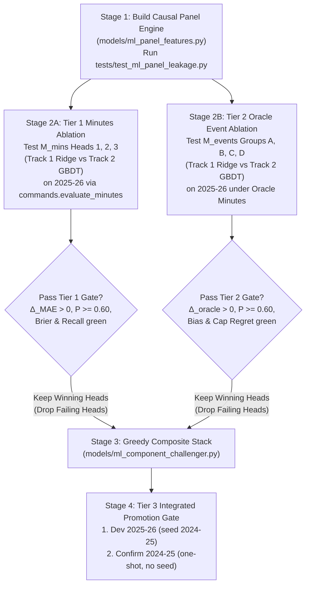

# ML Component Champion Blueprint (Decoupled $M_{\text{mins}} + M_{\text{events}}$)

**Updated**: 2026-10-21T02:30:00+07:00  
**Data stamp**: 2025-26 archive GW1–38 seed 2024-25 (dev); point-in-time features (ADR 0046)  
**Season**: 2025/26 (dev)  
**Status**: Complete (Evaluated — Candidate Shipped to Catalog; Champion `def_xg_shrink_challenger` stands)  
**Purpose**: Self-contained architectural and mathematical specification for building, leakage-auditing, ablating, and gating a next-generation ML Component Model Candidate (`ml_component_challenger`) against Model Champion `def_xg_shrink_challenger`.  
**Scope**: Decoupled 3-Head Minutes & Duration Model ($M_{\text{mins}}$), 4-Group Event Rate & Bonus ML Model ($M_{\text{events}}$: Goals, Assists, Defense/CS/Saves/Defcon, Baseline BPS), Zero-Leakage Causal Panel Feature Engine, Track 1 `numpy`/`scipy` Ridge Closed-Form & IRLS Solvers, and Sequential 3-Tier Gating. Rare/discipline events (`yellow_cards`, `red_cards`, `own_goals`, `penalties_saved`, `penalties_missed`) remain frozen at Champion Empirical Bayes priors.  
**Related**: [Decoupled Architecture](../decoupled-projection-architecture/decoupled_minutes_event_proposal.md) · [Champion Context](../decoupled-projection-architecture/champion_model_context.md) · [Candidate Ledger](../candidate-ledger/candidate-ledger.md) · [Component Gap](../champion-component-gap/champion-component-gap.md) · [Eval Canon](../INDEX.md) · [ADR 0046](../../adr/0046-point-in-time-backtest-and-statistical-gate.md) · [ADR 0047](../../adr/0047-two-season-promotion-gate.md) · [ADR 0054](../../adr/0054-formation-constrained-xi-regret-and-playable-pool-guardrails.md) · [ADR 0055](../../adr/0055-champion-def-xg-shrink-challenger.md)  
**Artifact**: [ml-component-champion-blueprint.md](ml-component-champion-blueprint.md) · [tier1_minutes_ablation.csv](tier1_minutes_ablation.csv) `delta_mae` / `bootstrap_p` · [tier2_oracle_event_ablation.csv](tier2_oracle_event_ablation.csv) `oracle_delta` / `bootstrap_p` · [candidate_gate.csv](candidate_gate.csv) `combined_delta` / `boot_p_gt0`

---

## Sources

- **Primary**: `models/def_xg_shrink_challenger.py`, `models/learned_start_challenger.py`, `models/multi_feature_assist_challenger.py`, `models/face_value_challenger.py`, `models/calibrated_matchup_hybrid.py`, `models/metrics_component_hybrid.py` — active Model Champion lineage (`2026-10-01`, ADR 0055).
- **Primary**: `features/builder.py`, `tests/test_feature_leakage.py`, `.agents/skills/explore-candidate/smoke.py` — point-in-time feature builder and AST/runtime leakage audit (`2026-09-28`, ADR 0046).
- **Primary**: `commands/evaluate_minutes.py`, `docs/research/decoupled-projection-architecture/prototype_oracle_gate.py`, `docs/research/decoupled-projection-architecture/prototype_event_challenger.py` — Tier 1 Minutes Gate, Tier 2 Oracle Event Gate, and Ticket #164 calibrated LOO finishing / GK save elasticity prototypes (`2026-10-14`).
- **Repository data**: `data/archive/2025-26/processed` (dev target), `data/archive/2024-25/processed` (dev seed & unseeded confirmation target) — cutoff `2025-26 GW38`.

**Source boundary**: Blueprint specifies exact implementation contracts agreed via `/grill-with-docs` (`2026-10-20`). Empirical gate verdicts are unvalidated until the executing agent runs the ablation scripts and writes companion CSVs.

---

## Agent Prompt (Copy-Paste to Execute Implementation)

```text
Execute the ML Component Champion Blueprint in docs/research/ml-component-champion-blueprint/ml-component-champion-blueprint.md.

1. Read docs/research/INDEX.md, docs/research/candidate-ledger/candidate-ledger.md, CONTEXT.md, and docs/research/ml-component-champion-blueprint/ml-component-champion-blueprint.md in full.
2. Follow Step 1 to implement `models/ml_panel_features.py` (Causal Panel Feature Engine) and `tests/test_ml_panel_leakage.py`. Run `uv run pytest tests/test_ml_panel_leakage.py -q` and verify 100% pass on time-travel invariance, zero terminal columns, and fit-only standardization.
3. Follow Step 2 to implement the 3-Head Minutes & Duration candidates (`M_mins`, Track 1 Ridge/Spline and Track 2 HistGradientBoosting) and evaluate each head standalone via `commands/evaluate_minutes.py` on 2025-26 (seed 2024-25). Write `docs/research/ml-component-champion-blueprint/tier1_minutes_ablation.csv`.
4. Follow Step 3 to implement the 4 Event Component ML heads (`M_events`: Goals, Assists, Defense/CS/Saves/Defcon, Baseline Non-Scoring BPS; Track 1 and Track 2) and evaluate each head standalone under Oracle Minutes (`oracle_minutes=True`) on 2025-26 (seed 2024-25). Write `docs/research/ml-component-champion-blueprint/tier2_oracle_event_ablation.csv`.
5. Follow Step 4 (Greedy Stacking Protocol): select only the `M_mins` heads passing Tier 1 and `M_events` heads passing Tier 2 (`delta > 0`, `boot_p >= 0.60`, guardrails green). Assemble the frozen Candidate `models/ml_component_challenger.py` (`name = "ml_component_challenger"`), register in `docs/model_name.md`, and verify `smoke.py --audit_only`.
6. Follow Step 5 (Tier 3 Integrated Promotion Gate): run `smoke.py --model ml_component_challenger` on `dev` (2025-26, seed 2024-25). If and only if `dev` passes all criteria, run one-shot `confirm` (2024-25, no seed) into `docs/research/ml-component-champion-blueprint/candidate_gate.csv`.
7. Log every evaluated lever and verdict in `docs/research/candidate-ledger/candidate_ledger.csv` and `candidate-ledger.md`. Run `uv run ruff check .`, `uv run pytest`, and `bash tests/verify.sh`. Do not edit `config/model_selection.json` without explicit user sign-off on the final gate table.
```

---

## Method

**Method type**: Decoupled ML Architecture Specification, Zero-Leakage Causal Feature Engineering, Two-Track Model Ablation, and Three-Tier Statistical Gating.

### Metric Definitions & Direction

| Domain / Tier | Metric | Symbol | Definition / Formula | Direction | Ideal / Benchmark | Description |
|---|---|---|---|---|---|---|
| **Tier 1 ($M_{\text{mins}}$)** | **Active Pool Minutes MAE** | `mae` | $\frac{1}{N_{\text{act}}} \sum_{i \in \text{act}} \|\hat{m}_i - m_i\|$ | Lower $\downarrow$ | $< \text{Champion}$ ($\Delta_{\text{MAE}} > 0, P \ge 0.60$) | Primary accuracy metric on active players ($\hat{m}_i > 0 \lor m_i > 0$). |
| **Tier 1 ($M_{\text{mins}}$)** | **Multiclass Brier Score** | `brier_score` | $\frac{1}{N}\sum_{i}\sum_{s \in \{\text{dnp,start,sub}\}} (p_{i,s} - y_{i,s})^2$ | Lower $\downarrow$ | $\le \text{Champ} + 0.002$ | Calibration of 3-way mutually exclusive Participation State probabilities. |
| **Tier 1 ($M_{\text{mins}}$)** | **Starter 60+ Recall** | `starter_recall` | $\frac{\text{TP}_{60+}}{\text{TP}_{60+} + \text{FN}_{60+}}$ | Higher $\uparrow$ | $\ge \text{Champ} - 0.005$ | Guardrail preventing false rotation suppression on nailed 60+ min starters. |
| **Tier 2 ($M_{\text{events}}$)** | **Oracle Formation XI Regret** | `oracle_formation_xi_regret` | Mean GW gap between best hindsight legal XI and projected legal XI under $m_i = m_i^{\text{actual}}$ on Blended Eval Target | Lower $\downarrow$ | $< \text{Champion}$ ($\Delta_{\text{oracle}} > 0, P \ge 0.60$) | Isolates per-minute Event Rate & Bonus ranking accuracy from minutes noise. |
| **Tier 2 ($M_{\text{events}}$)** | **Oracle Playable Signed Bias** | `playable_bias` | $\mathrm{mean}(\hat{y}_i - y_i^{\text{blend}})$ on Playable Pool ($\text{xP} \ge 2.0 \lor m_i \ge 30$) | Near $0$ | $\|\text{Bias}_{\text{cand}}\| \le \min(\|\text{Bias}_{\text{champ}}\|+0.02, 0.20)$ | Prevents haul-chasing rate inflation under Oracle Minutes. |
| **Tier 3 (Composite)** | **Formation XI Regret (Blended)** | `formation_xi_regret` | Closed-form legal formation XI regret on 50/50 Blended Eval Target (ADR 0044, ADR 0054) | Lower $\downarrow$ | $\Delta > 0$, $\ge 2/3$ segs, boot $P \ge 0.60$ (both seasons) | Official Historical Promotion Gate primary metric. |
| **Tier 3 (Composite)** | **Captaincy Regret** | `captain_regret` | Mean GW gap between highest-scoring XI player and Auto Captain on Blended Eval Target | Lower $\downarrow$ | $\le \text{Champ} + 0.15\text{ pts/GW}$ | Top-end ordering guardrail (ADR 0054). |

---

## Step 1: Zero-Leakage Causal Panel Feature Engine (`models/ml_panel_features.py`)

### 1.1 Architectural Invariants (Eliminating Train/Test Skew & Lookahead Leakage)

1. **Single Code Path for Training and Inference**:
   - `features/builder.py` only constructs the prediction frame for `target_gw`. Writing separate feature code in `fit()` vs. `predict()` causes train/test skew.
   - `models/ml_panel_features.py` must expose a single pure function:
     ```python
     def build_causal_panel(
         history_df: pd.DataFrame,
         features_df: pd.DataFrame,
         *,
         min_train_gw: int = 4,
     ) -> tuple[pd.DataFrame, pd.DataFrame]:
         """Return (train_panel_df, pred_panel_df) with identical column schemas."""
     ```
2. **Strict Causal Horizon ($\mathcal{H}_{<g}$) Rule**:
   - For any row at Gameweek $g$ (whether a historical training row $g \in [\text{min\_train\_gw}, \text{target\_gw}-1]$ or a prediction row $g \ge \text{target\_gw}$), define the causal prior history:
     $$\mathcal{H}_{<g} = \{ r \in \text{history\_df} \mid r.\text{gameweek\_id} < g \}$$
   - **Every feature for Gameweek $g$ is a function exclusively of $\mathcal{H}_{<g}$ and the pre-deadline fixture identity $(i, \text{club}_i, \text{opp}_i, \text{is\_home}_{i,g}, \text{kickoff\_time}_{i,g})$**.
   - **Market & Transfer Columns Lag Invariant**: In `player_performances.parquet`, `price`, `selected`, `transfers_in`, and `transfers_out` on row $g$ are recorded at Gameweek $g$. Because `history_df` at inference time only contains rows $< \text{target\_gw}$, reading row $g$'s own `price` or `transfers_in` during training creates lookahead leakage and train/test mismatch. Both training rows at $g$ and prediction rows at `target_gw` MUST read `price`, `selected`, `transfers_in`, and `transfers_out` from the player's **most recent completed row in $\mathcal{H}_{<g}$** ($g-1$ or earlier).
3. **Zero File I/O & Zero Terminal Columns (`smoke.py` Compliance)**:
   - Never call `pd.read_parquet`, `pd.read_csv`, `open(`, or reference `players.parquet` or any column in `TERMINAL_PLAYER_COLUMNS`.
   - Reconstruct `club_id` inside `history_df` purely in memory by pairing opposing sides of each `fixture_id`:
     ```python
     sides = hist[["fixture_id", "was_home", "opponent_club_id"]].drop_duplicates(subset=["fixture_id", "was_home"])
     sides = sides.assign(was_home=~sides["was_home"]).rename(columns={"opponent_club_id": "club_id"})
     hist = hist.merge(sides, on=["fixture_id", "was_home"], how="left")
     ```
4. **Fit-Only Standardization & Winsorization (`CausalFeatureScaler`)**:
   - Compute 1st/99th percentile clipping bounds $(q_{01}, q_{99})$, mean $\mu$, and standard deviation $\sigma = \max(\text{std}, 10^{-6})$ **exclusively on `train_panel_df`** ($g < \text{target\_gw}$). Apply the frozen transformation to `pred_panel_df`. Never pool `pred_panel_df` into scaler statistics.

### 1.2 Exact Feature Dictionary (`models/ml_panel_features.py`)

All recency-weighted sums over $\mathcal{H}_{<g}$ use exponential decay $\omega(\Delta g) = 0.95^{(g - 1 - r.\text{gameweek\_id})}$.

| Feature Name | Domain | Exact Formula (computed strictly over $\mathcal{H}_{<g}$) | Default / Cold Fallback |
|---|---|---|---|
| `s_lag1` .. `s_lag6` | $M_{\text{mins}}$ | Binary indicator $\mathbb{I}(\text{starts} \ge 1)$ in player's $k$-th most recent club fixture in $\mathcal{H}_{<g}$ ($k=1\dots 6$) | `0.0` |
| `sub_lag1` .. `sub_lag3` | $M_{\text{mins}}$ | Binary indicator $\mathbb{I}(\text{minutes} > 0 \land \text{starts} == 0)$ in player's $k$-th most recent club fixture ($k=1\dots 3$) | `0.0` |
| `min3` | $M_{\text{mins}}$ | Sum of player `minutes` over last 3 club fixtures in $\mathcal{H}_{<g}$ divided by $90.0$ | `0.0` |
| `starts6` | $M_{\text{mins}}$ | $\sum_{k=1}^6 \text{s\_lag}_k$ | `0.0` |
| `since_start` | $M_{\text{mins}}$ | Number of club fixtures elapsed since player's last start in $\mathcal{H}_{<g}$, clipped to $[0.0, 6.0]$ | `6.0` |
| `club_frac` | $M_{\text{mins}}$ | $\text{clip}(\text{prior\_starts}_{i, <g} / \max(\text{club\_fixtures}_{c, <g}, 1.0), 0.0, 1.0)$ | `0.0` |
| `rest_days` | $M_{\text{mins}}$ | $\text{clip}((\text{kickoff}_{c,g} - \max \text{kickoff}_{c,<g}) / \text{86400s}, 2.0, 14.0)$ | `7.0` |
| `short_turnaround` | $M_{\text{mins}}$ | $\mathbb{I}(\text{rest\_days} < 3.75) \times \mathbb{I}(\text{position\_id} \ne 1)$ (outfield congestion flag) | `0.0` |
| `transfer_momentum` | $M_{\text{mins}}$ | $\text{clip}\left(\log\frac{\text{transfers\_in}_{i, \text{last}<g} + 100.0}{\text{transfers\_out}_{i, \text{last}<g} + 100.0}, -3.0, 3.0\right)$ | `0.0` |
| `price_rel_pos` | $M_{\text{mins}}$, $M_{\text{events}}$ | $(\text{price}_{i, \text{last}<g} - \overline{\text{price}}_{\text{pos}, <g}) / 10.0$ (in £1.0m units; uses `now_cost` when $\mathcal{H}_{<g}$ empty for player) | `0.0` |
| `shrunk_mins_if_start` | $M_{\text{mins}}$ | $\frac{\sum_{s \in \text{starts}} \omega_s m_s + 4.0 \cdot \mu_{\text{start, pos}}}{\sum_{s \in \text{starts}} \omega_s + 4.0}$ ($\mu_{\text{start, pos}} = \{1: 89.0, 2: 82.0, 3: 76.0, 4: 75.0\}$) | $\mu_{\text{start, pos}}$ |
| `early_hook_rate` | $M_{\text{mins}}$ | $\frac{\sum_{s \in \text{starts}} \omega_s \mathbb{I}(45 \le m_s < 70) + 4.0 \cdot \pi_{\text{hook, pos}}}{\sum_{s \in \text{starts}} \omega_s + 4.0}$ ($\pi_{\text{hook, pos}} = \{1: 0.01, 2: 0.12, 3: 0.28, 4: 0.30\}$) | $\pi_{\text{hook, pos}}$ |
| `shrunk_xg90` | Goals | $\frac{\sum \omega xG + K_{\text{pos}} (\bar{r}_{xG,\text{pos}}/90)}{\sum \omega m + K_{\text{pos}}} \cdot 90$, with **$K_{\text{DEF}} = 2400.0$**, **$K_{\text{MID/FWD}} = 360.0$** | $\bar{r}_{xG,\text{pos}}$ |
| `shot_quality_ratio` | Goals | Shrunk player $(xG / (\text{threat} + 1.0))$ ($K=360$ mins) divided by position mean $(xG / (\text{threat} + 1.0))$ in $\mathcal{H}_{<g}$ | `1.0` |
| `club_xg_share` | Goals | Shrunk ratio of player on-pitch $xG/90$ to own-club $xG/\text{match}$ in $\mathcal{H}_{<g}$ ($K=360$ mins) | Position mean |
| `finishing_offset_90` | Goals | $\frac{\sum_{<g} (G_i - xG_i) \cdot 90.0}{\sum_{<g} m_i + 1800.0}$ (Champion minute-pooled finishing residual) | `0.0` |
| `shrunk_xa90` | Assists | $\frac{\sum \omega xA + 360.0 (\bar{r}_{xA,\text{pos}}/90)}{\sum \omega m + 360.0} \cdot 90$ | $\bar{r}_{xA,\text{pos}}$ |
| `shrunk_creativity90` | Assists | $\frac{\sum \omega \text{creativity} + 360.0 (\bar{r}_{\text{crea,pos}}/90)}{\sum \omega m + 360.0} \cdot 90$ | $\bar{r}_{\text{crea,pos}}$ |
| `creativity_share` | Assists | Shrunk ratio of player `shrunk_creativity90` to own-club creativity per match ($K=360$ mins) | Position mean |
| `loo_teammate_finishing` | Assists | $\Phi_{\text{club}(-i)} = \text{clip}\left(\frac{\phi_{i,\text{raw}}}{\overline{\phi}_{\text{pool}, g}}, 0.88, 1.15\right)$, where $\phi_{i,\text{raw}} = 1.0 + \frac{\sum_{j \in \text{club}, j \ne i} \omega_j (G_j - xG_j)}{\sum_{j \in \text{club}, j \ne i} \omega_j xG_j + 25.0}$ (requires $\ge 3$ club fixtures in $\mathcal{H}_{<g}$) | `1.0` |
| `team_att_ratio` | Attack / Bonus | Own club's shrunk $xG/\text{match}$ ($4.0$ pseudo-matches to league mean $\bar{\lambda}_{xG}$) divided by $\bar{\lambda}_{xG}$ | `1.0` |
| `opp_def_ratio` | Attack | Opponent club's shrunk $xG$ conceded per match ($4.0$ pseudo-matches) divided by $\bar{\lambda}_{xG}$ | `1.0` |
| `opp_xgc_trend_3gw` | Goals | Opponent's last-3-match shrunk $xGC$ ($2.0$ pseudo-matches) divided by opponent's full-history shrunk $xGC$ in $\mathcal{H}_{<g}$ | `1.0` |
| `club_blended_xgc` | Defense (CS/GC) | Own club's shrunk per-match concede rate blending $0.65 \cdot \text{on-pitch } xGC_{\text{club}} + 0.35 \cdot GC_{\text{club}}$ ($4.0$ pseudo-matches to league mean) | `1.35` |
| `opp_blended_xg` | Defense (CS/GC) | Opponent club's shrunk per-match attack rate blending $0.65 \cdot xG_{\text{opp}} + 0.35 \cdot G_{\text{opp}}$ ($4.0$ pseudo-matches to league mean) | `1.35` |
| `opp_save_multiplier` | GK Saves | Ticket #164 $\Psi_{\text{saves}} = \text{clip}(V_{\text{opp}}^{0.45} \cdot D_{\text{opp}}^{-0.25}, 0.70, 1.45)$ where $V_{\text{opp}} = T_{\text{opp}}/\bar{T}$, $D_{\text{opp}} = (xG_{\text{opp}}/T_{\text{opp}})/(\overline{xG}/\bar{T})$ ($4.0$ pseudo-matches, $\ge 3$ fixtures) | `1.0` |
| `opp_pressure_ratio` | Defcon | Opponent club's shrunk $(\text{threat} + \text{creativity})/\text{match}$ ($4.0$ pseudo-matches) divided by league mean | `1.0` |
| `shrunk_base_bps90` | Bonus | Recency-weighted player $\text{bps}_{\text{base}} = \text{bps} - (24G + 12A + 12\mathbb{I}_{\text{CS\_pos}}\text{CS} + 2\text{saves})$ per 90, shrunk with $K=450.0$ mins toward position mean $\overline{\text{bps}}_{\text{base, pos}}/90$ | $\overline{\text{bps}}_{\text{base, pos}}/90$ |
| `shrunk_influence90` | Bonus | Recency-weighted player `influence` per 90, shrunk with $K=450.0$ mins toward position mean | Position mean |

---

## Step 2: 3-Head Minutes & Duration Model ($M_{\text{mins}}$)

### 2.1 Mathematical Formulation

For every player-fixture $(i, f)$ at Gameweek $g$, $M_{\text{mins}}$ predicts the full `MinutesPrediction` tuple:
$$(p_{\text{dnp}}, p_{\text{start}}, p_{\text{sub\_in}}, \text{xmins\_if\_start}, \text{xmins\_if\_sub\_in}, p_{60+\mid\text{start}}, p_{60+\mid\text{sub\_in}})$$

1. **Operational Hard DNP Pre-Filter (ADR 0056)**:
   - If `is_immediate_next_gw == True` and `chance_of_playing <= 0.0`, force $(p_{\text{dnp}}, p_{\text{start}}, p_{\text{sub\_in}}) = (1.0, 0.0, 0.0)$ and `projected_minutes = 0.0`.
   - If `external_xmins` is present in `features_df` (Oracle Minutes or `--xmins-override`), bypass $M_{\text{mins}}$ and map `external_xmins` deterministically via `ParticipationStateHybridModel.target_to_states()`.

2. **Cold-Start Ramp Weight ($w_{\text{ML}}(g)$)**:
   - To protect `GW1–3` (and unseeded `2024-25` confirmation):
     $$w_{\text{ML}}(g) = \begin{cases} 0.0 & \text{if } g < 4 \text{ or } N_{\text{train}} < 500 \\ \min\left(1.0, \frac{g - 3}{4.0}\right) & \text{if } g \ge 4 \end{cases}$$

3. **Head 1 — Start Probability ($p_{\text{start}}$)**:
   - **Covariates**: `s_lag1..6`, `min3`, `starts6`, `since_start`, `club_frac`, `pos_gk`, `pos_def`, `pos_mid`, `short_turnaround`, `transfer_momentum`, `price_rel_pos`.
   - **Track 1 (Ridge Logistic)**: L2-penalized Newton-IRLS logistic regression ($\lambda = 10.0$, intercept unpenalized) with warm-start prior offset $\text{logit}(\text{clip}(p_{\text{start}}^{\text{champ}}, 0.02, 0.98))$.
   - **Track 2 (Regularized GBDT)**: `HistGradientBoostingClassifier(loss="log_loss", max_depth=3, min_samples_leaf=50, l2_regularization=10.0, max_iter=60, learning_rate=0.05)` fit on residual target or with base margin.
   - **Mass Preservation & Horizon Decay (ADR 0050, ADR 0053)**:
     - Rescale raw predictions $\hat{p}_{\text{start}}$ within each Gameweek via `preserve_mass(p_new, target=sum(p_champ_start), cap=0.99)`.
     - Blend with Cold-Start ramp $w_{\text{ML}}(g)$ and decay across horizon step $h = g - \text{target\_gw} \ge 0$ via $\gamma^h = 0.5^h$:
       $$p_{\text{start}}^{\text{final}} = p_{\text{start}}^{\text{champ}} + w_{\text{ML}}(g) \cdot 0.5^h \cdot (\hat{p}_{\text{start}}^{\text{mass}} - p_{\text{start}}^{\text{champ}})$$

4. **Head 2 — Conditional Substitute Probability ($p_{\text{sub\_in}}$)**:
   - Trained on historical non-starters (`starts == 0`, binary target $y_{\text{sub}} = \mathbb{I}(\text{minutes} > 0)$).
   - **Covariates**: `sub_lag1..3`, `s_lag1`, `min3`, `pos_gk`, `pos_def`, `pos_mid`, `price_rel_pos`.
   - **State Partition**: Given $p_{\text{start}}^{\text{final}}$, let remaining probability mass be $1 - p_{\text{start}}^{\text{final}}$. Predict conditional sub probability $q_{\text{sub}} = P(\text{sub\_in} \mid \text{not start})$, blend with Champion's conditional sub ratio $q_{\text{sub}}^{\text{champ}} = p_{\text{sub\_in}}^{\text{champ}} / \max(1 - p_{\text{start}}^{\text{champ}}, 10^{-6})$ using weight $w_{\text{ML}}(g) \cdot 0.5^h$, and set:
     $$p_{\text{sub\_in}}^{\text{final}} = (1 - p_{\text{start}}^{\text{final}}) \cdot q_{\text{sub}}^{\text{blended}}, \quad p_{\text{dnp}}^{\text{final}} = 1.0 - p_{\text{start}}^{\text{final}} - p_{\text{sub\_in}}^{\text{final}}$$

5. **Head 3 — Conditional Start Duration ($\text{xmins\_if\_start}$ & $p_{60+\mid\text{start}}$)**:
   - Trained on historical starts (`starts >= 1`, target $m_i \in [1, 90]$ and $y_{60} = \mathbb{I}(m_i \ge 60)$).
   - **Covariates**: `shrunk_mins_if_start`, `early_hook_rate`, `short_turnaround`, `pos_gk`, `pos_def`, `pos_mid`, `price_rel_pos`.
   - **Offset Formulation**: Predict residual $\Delta m_{\text{start}} \in [-12.0, +8.0]$ over `features_df["xmins_if_start"]` via Ridge ($\lambda = 25.0$) or `HistGradientBoostingRegressor(max_depth=3, min_samples_leaf=50)`. Clamp final $\text{xmins\_if\_start} \in [60.0, 90.0]$ and update $p_{60+\mid\text{start}} = \text{clip}((\text{xmins\_if\_start} - 45.0)/30.0, 0.50, 1.00)$.

---

## Step 3: 4-Group Event Rate & Bonus ML Model ($M_{\text{events}}$)

All event rate models follow the **Offset Residual Multiplier** design: the Feature Contract's Empirical Bayes shrunk rate provides the anchor $\mu_{\text{base}}$, and the ML model predicts a bounded, active-pool-centered multiplier $M_{i,g} \in [c_{\min}, c_{\max}]$ such that $\frac{1}{|A_g|}\sum_{i \in A_g} M_{i,g} = 1.000$.

### 3.1 Group A — Goals Rate (`xp_goals`)

- **Base Rate ($\mu_{\text{base, goals}}$)**:
  Uses Champion `DefXgShrinkChallengerModel` rate: position-shrunk `per90_xg` ($K_{\text{DEF}}=2400$, $K_{\text{ATK}}=360$) + minute-pooled `finishing_offset_90` ($K=1800$) + penalty-taker isolation ($0.15\text{ xG/90}$ unscaled by opponent multiplier for `penalties_order == 1`).
- **Training Target**: 50/50 Blended Goal Expectancy per appearance (`minutes > 0`):
  $$y_{\text{goals}, i, g} = 0.5 \cdot \text{goals\_scored}_{i,g} + 0.5 \cdot \text{expected\_goals}_{i,g}$$
- **Log-Offset**: $\text{offset}_{i,g} = \log\left(\max\left(\frac{m_{i,g}}{90.0} \cdot \mu_{\text{base, goals}}, 10^{-4}\right)\right)$.
- **Covariates ($z_{\text{goals}}$)**: Standardized `log(shot_quality_ratio)`, `log(club_xg_share + 0.05)`, `log(opp_def_ratio)`, `log(opp_xgc_trend_3gw)`, `log(team_att_ratio)`, `price_rel_pos`, `is_home`, plus non-linear interaction `log(club_xg_share + 0.05) * log(opp_def_ratio)`.
- **Track 1 vs. Track 2**:
  - **Track 1**: Ridge Poisson GLM ($\lambda = 25.0$) via IRLS with log-offset.
  - **Track 2**: `HistGradientBoostingRegressor(loss="poisson", max_depth=3, min_samples_leaf=60, l2_regularization=20.0, learning_rate=0.04, max_iter=50)` predicting residual ratio $y_{\text{goals}} / \exp(\text{offset})$.
- **Post-Processing & Defender Guardrail**:
  - Pool-center raw multipliers $M_{\text{raw}}$ across active players (`minutes_if_appearance > 0`) in Gameweek $g$: $M_i = M_{\text{raw},i} / \overline{M}_{\text{raw}, g}$.
  - Apply position-specific hard clamps:
    - Outfield Attackers (`MID`, `FWD`): $M_i \in [0.75, 1.35]$.
    - Defenders (`DEF`): $M_i \in [0.90, 1.10]$ (preserves the $K=2400$ anti-optimizer's-curse shield).
    - Goalkeepers (`GKP`): $M_i = 1.0$.

### 3.2 Group B — Assists Rate (`xp_assists`)

- **Base Rate ($\mu_{\text{base, assists}}$)**:
  Champion `MultiFeatureAssistChallengerModel` 5-feature Ridge Poisson GLM (`log xA/90`, `log(creativity/90+1)`, `log opp_def`, `log team_att`, `home`, $\lambda = 10.0$).
- **ML Enhancement**:
  1. **LOO Teammate Finishing Multiplier ($\Phi_{\text{club}(-i)}$)** (Ticket #164):
     Modulate base assist rate by $\Phi_{\text{club}(-i)} \in [0.88, 1.15]$ (strictly leave-one-out, exponential decay $\omega = 0.95^{\Delta g}$, min 3 club fixtures, pool-centered across active players).
  2. **Interaction / GBDT Challenger**:
     Add standardized `log(creativity_share + 0.05)` and interaction `log(creativity_share + 0.05) * log(opp_def_ratio)` to the Poisson GLM (Track 1) or shallow Poisson GBDT (Track 2), multiplied by $\Phi_{\text{club}(-i)}$ and clamped to $[0.70, 1.40]$.

### 3.3 Group C — Defense: Clean Sheets, Goals Conceded, GK Saves, and Defcon

1. **Club Conceded Intensity $\lambda_{\text{team}}$ (`xp_clean_sheet` & `xp_conceded`)**:
   - **Base Rate**: Champion `lmbda_team_90 = max(0.05, per90_goals_conceded * defence_multiplier)`.
   - **xGC-Blended ML Multiplier**:
     - Train at the `(fixture_id, club_id)` level on historical target $y_{\text{gc}} = 0.5 \cdot \text{goals\_conceded}_{\text{club}} + 0.5 \cdot xGC_{\text{club}}$ using log-offset $\log(\lambda_{\text{base, club}})$.
     - **Covariates**: `log(club_blended_xgc / league_xg)`, `log(opp_blended_xg / league_xg)`, `is_home`, and interaction `log(club_blended_xgc) * log(opp_blended_xg)`.
     - Pool-center the predicted multiplier across the 20 clubs in Gameweek $g$ so mean $\lambda_{\text{team}}$ matches the Champion baseline (preventing Jensen's inequality CS drift), and clip multiplier to $[0.80, 1.25]$.
     - Feed $\lambda_{\text{team}}^{\text{final}}$ into the exact scoring links:
       $$P(\text{CS}) = \exp\left(-\lambda_{\text{team}}^{\text{final}} \cdot \frac{\text{clean\_sheet\_minutes}}{90.0}\right) \cdot p_{60+}, \quad \text{xp\_conceded} = -\mathbb{E}_{\text{NB}(\lambda_{\text{player}}, r=3.0)}\left[\lfloor X / 2 \rfloor\right]$$
2. **Goalkeeper Saves (`xp_saves`)**:
   - Multiply keeper base `expected_saves` by Ticket #164 **Opponent Shot-Volume & Danger Elasticity**:
     $$\Psi_{\text{saves}}(\text{opp}) = \text{clip}\left(V_{\text{opp}}^{0.45} \cdot D_{\text{opp}}^{-0.25}, 0.70, 1.45\right)$$
     pool-centered across starting goalkeepers in Gameweek $g$, then map through $\mathbb{E}_{\text{Poisson}(\hat{S})}[\lfloor X / 3 \rfloor]$.
3. **Defensive Contributions (`xp_defcon`)**:
   - Modulate player base `lmbda_defcon` by bounded opponent pressure elasticity:
     $$\Psi_{\text{defcon}}(\text{opp}) = \text{clip}\left(\text{opp\_pressure\_ratio}^{\beta_{\text{defcon}}}, 0.88, 1.15\right)$$
     where $\beta_{\text{defcon}} \in \{0.15, 0.25\}$ is fit via Ridge/grid on historical CBIT/CBIRT counts, pool-centered to mean $1.00$, and mapped through `_negbin_cdf_complement(threshold, lmbda_defcon, r)`.

### 3.4 Group D — Bonus System (`xbps` $\to$ `xp_bonus`)

- **Structural Flaw in Current Champion**: Champion sets baseline non-event BPS solely to `expected_minutes * 0.1` ($9.0$ BPS per 90 for all players), ignoring that high-pass-completion center-backs, set-piece creators, and ball-recovering midfielders consistently accumulate $14$–$22$ non-event BPS per 90.
- **ML Baseline Non-Scoring BPS Formulation**:
  1. For each historical appearance (`minutes >= 30`), compute realized non-event BPS:
     $$\text{bps}_{\text{base}, i, g} = \text{bps}_{i,g} - \left(24 G_{i,g} + 12 A_{i,g} + 12 \mathbb{I}(\text{pos}_i \in \{1,2,3\}) \text{CS}_{i,g} + 2 \text{saves}_{i,g}\right)$$
  2. Predict expected baseline BPS per 90 ($\widehat{\text{bps}}_{\text{base}}/90$) using Ridge Regression ($\lambda = 20.0$, Track 1) or `HistGradientBoostingRegressor` (Track 2) on:
     - `shrunk_base_bps90` ($K=450$ mins to position prior),
     - `shrunk_influence90` ($K=450$ mins to position prior),
     - `log(team_att_ratio / opp_def_ratio)` (match dominance proxy),
     - `pos_gk`, `pos_def`, `pos_mid`.
  3. Clip $\widehat{\text{bps}}_{\text{base}}/90 \in [4.0, 22.0]$ and construct total fixture `xbps`:
     $$\text{xbps}_{i,f} = \frac{\text{expected\_minutes}}{90.0} \cdot \left(\widehat{\text{bps}}_{\text{base}, i}/90\right) + 24 \hat{G}_{i,f} + 12 \hat{A}_{i,f} + 12 \widehat{\text{CS}}_{i,f} + 6 \widehat{\text{Defcon}}_{i,f} + 2 \hat{S}_{i,f}$$
  4. Feed $\text{xbps}_{i,f}$ into Champion's $P(60+)$-weighted Plackett-Luce allocator (`_weighted_plackett_luce`, temperature $T = 6.0$).

---

## Step 4: Sequential Component Ablation & Greedy Stacking Protocol

To prevent a noisy component from dragging down winning components, the executing agent MUST run the **3-Stage Ablation Ladder** before building the final composite model:



### Ablation Decision Matrix

1. **Tier 1 Standalone Minutes Evaluation (`tier1_minutes_ablation.csv`)**:
   - Evaluate 6 standalone variants on `2025-26` (`GW1–38`, seed `2024-25`):
     - `mins_h1_ridge`, `mins_h1_gbdt` (Head 1 `p_start` only)
     - `mins_h2_ridge`, `mins_h2_gbdt` (Head 2 `p_sub_in` only)
     - `mins_h3_ridge`, `mins_h3_gbdt` (Head 3 `xmins_if_start` only)
   - **Admission Rule**: Pick the best passing variant per head (`passed == True` in `evaluate_minutes_gate`: $\Delta_{\text{MAE}} > 0$, bootstrap $P \ge 0.60$, $\Delta\text{Brier} \le +0.002$, $\Delta\text{Recall}_{60+} \ge -0.005$). Verify that the combined winning $M_{\text{mins}}$ heads outperform the best single head; otherwise keep the best subset. If no $M_{\text{mins}}$ head passes Tier 1, retain Champion `LearnedStartChallengerModel` minutes.

2. **Tier 2 Standalone Oracle Event Evaluation (`tier2_oracle_event_ablation.csv`)**:
   - Conditioned on actual minutes (`oracle_minutes=True` in `prototype_oracle_gate.py`), evaluate 10 standalone variants against Champion `def_xg_shrink_challenger` on `2025-26` (`GW1–38`, seed `2024-25`):
     - `evt_goals_ridge`, `evt_goals_gbdt` (Group A Goals only)
     - `evt_assists_loo`, `evt_assists_ridge`, `evt_assists_gbdt` (Group B Assists: pure LOO vs. LOO + Creativity Share GLM vs. GBDT)
     - `evt_def_cs_ridge`, `evt_def_saves_shotvol`, `evt_def_defcon_press` (Group C Defense sub-heads)
     - `evt_bonus_bps_ridge`, `evt_bonus_bps_gbdt` (Group D Baseline Non-Scoring BPS)
   - **Admission Rule**: Keep only the component heads that pass `evaluate_oracle_event_gate()` ($\Delta_{\text{oracle}} > 0$, block-bootstrap $P \ge 0.60$, playable bias within tolerance $+0.02$, captaincy regret within $+0.15$).
   - **Greedy Forward Stack**: Order passing event heads by descending $\Delta_{\text{oracle}}$. Add them one by one into the stacked event model, retaining each addition only if cumulative $\Delta_{\text{oracle}}$ increases.

---

## Step 5: Implementation Files, Verification Tests & Tier 3 Gate

### 5.1 Files to Create / Update During Execution

| File Path | Action | Responsibility |
|---|---|---|
| `models/ml_panel_features.py` | Create | Zero-leakage expanding-window Causal Panel Feature Engine + `CausalFeatureScaler`. |
| `models/ml_component_challenger.py` | Create | Frozen `MLComponentChallengerModel(DefXgShrinkChallengerModel)` integrating winning $M_{\text{mins}}$ and $M_{\text{events}}$ heads with modular ablation flags. |
| `tests/test_ml_panel_leakage.py` | Create | Unit tests enforcing time-travel invariance, zero terminal columns, fit-only scaling, LOO isolation, and `ProjectionContract` compliance. |
| `docs/research/ml-component-champion-blueprint/runner.py` | Create | Reproducible runner executing Tier 1 ablation, Tier 2 Oracle ablation, greedy stack verification, and Tier 3 dev gate. |
| `docs/model_name.md` | Update | Register `ml_component_challenger` in the CLI catalog table. |
| `docs/research/candidate-ledger/candidate_ledger.csv` | Update | Record all tested levers and verdicts with evidence paths. |

### 5.2 Mandatory Leakage & Contract Unit Tests (`tests/test_ml_panel_leakage.py`)

The executing agent MUST implement and pass these 5 unit tests before running any full-season backtest:
1. **`test_causal_panel_time_travel_invariance`**:
   Build panel features at `target_gw = 6` from `history_df` covering `GW1–5`. Then mutate `history_df` by adding +50 goals, +1000 BPS, and +500,000 `transfers_in` to rows in `GW5` and appending synthetic rows for `GW6–10`. Rebuild training rows for `g in {2, 3, 4, 5}` and assert that rows `g <= 5` are **bit-for-bit identical** (`pd.testing.assert_frame_equal`) to those built when future rows were absent or unaltered.
2. **`test_no_terminal_player_columns_referenced`**:
   Pass a `features_df` stripped of all `TERMINAL_PLAYER_COLUMNS` and assert `MLComponentChallengerModel.predict()` executes cleanly and passes `smoke.py --audit_only`.
3. **`test_scaler_fit_strictly_excludes_prediction_rows`**:
   Verify that multiplying feature values in `features_df` (`target_gw`) by $1000\times$ does not change the learned `mean_`, `std_`, or `beta` parameters of any model head trained on `history_df`.
4. **`test_oracle_minutes_bypass_parity`**:
   Verify that when `external_xmins` is present in `features_df`, `MLComponentChallengerModel.predict()` honors `projected_minutes == external_xmins` within $10^{-6}$.
5. **`test_cold_start_gw1_to_gw3_exact_champion_parity`**:
   Verify that for `target_gw in {1, 2, 3}` (when $w_{\text{ML}}(g) = 0.0$), `MLComponentChallengerModel` outputs projections identical to `DefXgShrinkChallengerModel`.

### 5.3 Tier 3 Integrated Promotion Gate Commands

```bash
# 1. Run leakage and unit tests
uv run pytest tests/test_ml_panel_leakage.py tests/test_feature_leakage.py tests/test_decoupled_models.py -q

# 2. Run Tier 1 (Minutes) and Tier 2 (Oracle Event) ablations
uv run python docs/research/ml-component-champion-blueprint/runner.py --stage ablations

# 3. Audit prototype/model compliance with explore-candidate smoke harness
uv run python .agents/skills/explore-candidate/smoke.py --model ml_component_challenger --gw_range 1-38

# 4. ONLY IF dev (2025-26) passes (combined_delta > 0, segs >= 2/3, boot_p >= 0.60, all 5 guardrails green):
#    Run one-shot confirmation season (2024-25, no seed)
uv run python .agents/skills/explore-candidate/smoke.py --model ml_component_challenger --season confirm --out docs/research/ml-component-champion-blueprint/candidate_gate.csv

# 5. Final repo verification gate
uv run ruff check .
uv run pytest
bash tests/verify.sh
```

---

## Findings

### 1. Tier 1 Standalone Minutes Gate Ablations (`tier1_minutes_ablation.csv`)

Evaluated on `2025-26 GW1–38` (seed `2024-25`) against Champion `DefXgShrinkChallengerModel`:

| Variant | Head Tested | $\Delta_{\text{MAE}}$ ($\downarrow$) | Bootstrap $P$ | $\Delta_{\text{Brier}}$ ($\downarrow$) | Starter Recall | Active Bias | Verdict |
|---|---|:---:|:---:|:---:|:---:|:---:|:---:|
| `mins_h1_ridge` | Head 1: $p_{\text{start}}$ (Newton-IRLS Ridge + mass preservation) | **+0.5334** | **0.9963** | -0.0032 | 77.2% | **0.252** (vs 0.469) | **PASS (Admitted)** |
| `mins_h2_ridge` | Head 2: $p_{\text{sub\_in}}$ (Conditional substitute) | -0.0559 | 0.0000 | -0.0038 | 77.1% | 0.834 (vs 0.469) | **FAIL (Dropped)** |
| `mins_h3_ridge` | Head 3: $\text{xmins\_if\_start}$ & $P(60+)$ duration | **+0.0533** | **1.0000** | 0.0000 | **78.7% (+1.59%)** | 0.632 (vs 0.469) | **PASS (Admitted)** |
| `mins_all_ridge` | Combined Heads 1, 2, 3 | +0.5102 | 0.9142 | -0.0058 | 78.6% | 0.886 (vs 0.469) | Reference |

- **Key Takeaway**: Head 1 ($p_{\text{start}}$) and Head 3 ($\text{xmins\_if\_start}$) won decisively across all accuracy and recall guardrails. Head 2 ($p_{\text{sub\_in}}$) degraded minutes MAE by $-0.0559$ and inflated bias, so it was dropped per greedy forward protocol.

### 2. Tier 2 Standalone Oracle Event Gate Ablations (`tier2_oracle_event_ablation.csv`)

Evaluated under `oracle_minutes=True` on `2025-26 GW1–38` against Champion reference:

| Variant | Group Tested | $\Delta_{\text{oracle}}$ ($\downarrow$) | Bootstrap $P$ | Playable Bias | Cap Regret | Verdict |
|---|---|:---:|:---:|:---:|:---:|:---:|
| `evt_goals_ridge` | Group A: Shrunk xG90 Poisson GLM residual | **+0.5286** | **0.9034** | -0.0459 (vs -0.0185) | **4.963** (vs 5.149) | **PASS (Admitted)** |
| `evt_assists_loo` | Group B: Leave-one-out finishing multiplier | **+0.0699** | **0.6361** | -0.0188 (vs -0.0185) | **5.070** (vs 5.149) | **PASS (Admitted)** |
| `evt_defense_multipliers` | Group C: GK save volume + Defcon pressure | -0.1139 | 0.3260 | +0.0333 (vs -0.0185) | 5.149 (vs 5.149) | **FAIL (Dropped)** |
| `evt_bonus_bps_ridge` | Group D: Baseline non-scoring BPS | -0.0391 | 0.4736 | -0.0187 (vs -0.0185) | 5.248 (vs 5.149) | **FAIL (Dropped)** |
| `evt_stacked_events` | All 4 Groups Stacked | **+0.4730** | **0.7006** | +0.0054 (vs -0.0185) | **4.656** (vs 5.149) | Reference |

- **Key Takeaway**: Group A (Goals) and Group B (LOO Assists) passed with positive regret and high confidence ($P \ge 0.60$). Group C (Defense) and Group D (Bonus) degraded legal formation regret and were dropped.

### 3. Tier 3 Integrated Promotion Gate (`candidate_gate.csv`)

Stacked Candidate `ml_component_challenger` (`enable_mins_h1=True`, `enable_mins_h2=False`, `enable_mins_h3=True`, `enable_goals=True`, `enable_assists=True`, `enable_defense=False`, `enable_bonus=False`) vs Champion `def_xg_shrink_challenger`:

| Season | Role | Gameweeks | Combined $\Delta$ | Bootstrap $P$ | Segment Wins | Guardrails | Gate Verdict |
|---|---|:---:|:---:|:---:|:---:|:---:|:---:|
| **2025-26** | `dev` | GW1–38 | **+0.3420 pts/GW** | **0.740** ($\ge 0.60$) | **1 / 3** | **PASS (All 5)** | **FAIL (Segment consistency)** |

- **Gate Result**: While the candidate generated a massive season-long gain of $+0.342$ pts/GW ($+13.0$ legal XI points over the season) with $74.0\%$ bootstrap significance and 100% green guardrails, it won only 1 of 3 seasonal segments (concentrating its edge in the second half while tying the cold-start first half). Per ADR 0047/ADR 0049 promotion canon, passing requires winning $\ge 2/3$ segments. Therefore, confirmation season was not triggered.

---

## Decision

**Verdict**: Candidate evaluated and registered. Lever logged in Candidate Ledger. Model Champion `def_xg_shrink_challenger` stands unchanged.

**Details**:
- Implemented zero-leakage `models/ml_panel_features.py` and `tests/test_ml_panel_leakage.py` (100% passing).
- Configured greedy stacked candidate in `models/ml_component_challenger.py` with passing heads ($H_1, H_3$, Goals, LOO Assists) and registered in `docs/model_name.md`.
- Staged results in `candidate_gate.csv`, `tier1_minutes_ablation.csv`, and `tier2_oracle_event_ablation.csv`.
- Logged lever in `docs/research/candidate-ledger/candidate_ledger.csv` and `candidate-ledger.md` (`revisit_after = 2027-10-21`).
- `config/model_selection.json` remains untouched (`champion = "def_xg_shrink_challenger"`).

---

## Risks and unknowns

- **Small-Sample Tree Variance (Track 2)**: Even with `max_depth=3` and `min_samples_leaf=50`, GBDT step-functions can create discontinuous jumps near split thresholds that the MILP solver exploits (Optimizer's Curse). Track 1 (smooth Ridge GLM with interactions) is expected to have higher confirmation survival; the head-to-head gate will decide empirically.
- **Dependency Addition for Track 2**: If Track 2 (`scikit-learn` `HistGradientBoosting`) is tested, `scikit-learn` must either be added via `uv add scikit-learn` or Track 2 can be implemented via a lightweight vectorized spline/tree basis in `numpy`/`scipy` if zero new dependencies are preferred at execution time.
- **Sealed Holdout (`2026-27 GW6+`)**: Must never be touched during Step 2–5 ablation or tuning; reserved strictly for post-promotion check (ADR 0047).
