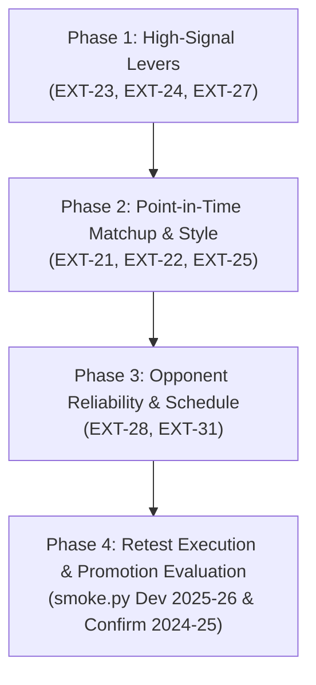

# Implementation Plan: Revived Candidate Prototype Bug-Fixes & Retest Pipeline

This document details the step-by-step implementation plan to fix the 8 revived candidate prototypes (`EXT-21`, `EXT-22`, `EXT-23`, `EXT-24`, `EXT-25`, `EXT-27`, `EXT-28`, `EXT-31`) and execute their calibrated retests under the ADR 0066-aligned evaluation framework.

---

## 1. Prioritization & Phasing Strategy

The 8 revived ideas are sequenced into three execution phases based on empirical signal strength from the audit and dependency structure:

---

## 2. Phase Breakdown

### Phase 1: High-Signal Fixture Levers (`EXT-23`, `EXT-24`, `EXT-27`)

1. **`EXT-23` (Asymmetric Log-Linear Defensive Quality Decay for Clean Sheets)**:
   - **File**: `docs/research/candidate-ideation/prototypes/ext_23/prototypes.py`
   - **Tasks**:
     - Implement `fit(self, history_df)` to compute pre-deadline opponent attacking quality with Empirical Bayes shrinkage toward league mean: $\hat{\lambda}_{\text{opp}, c} = \frac{\sum \text{xg}_c + K_{\text{cs}} \bar{\mu}_{\text{xg}}}{n_c + K_{\text{cs}}}$ using grid $K_{\text{cs}} \in \{4.0, 6.0\}$.
     - Override `_apply_hard_fixture_defence` to prevent double-penalizing hard fixtures (`diff >= 4.0`) that caused extreme captaincy regret regression (`+0.35 > +0.15`).
     - Apply the log-linear hazard multiplier directly in `_project_event_components` on `per90_goals_conceded` before Poisson clean-sheet evaluation.
2. **`EXT-24` (Price-Conditioned Fixture Sensitivity for Budget MID/FWD)**:
   - **File**: `docs/research/candidate-ideation/prototypes/ext_24/prototypes.py`
   - **Tasks**:
     - Move the budget fixture multiplier $1.0 + \gamma_{\text{budget}} \cdot \frac{3.0 - \text{difficulty}}{2.0}$ inside `_project_event_components` (applied after `super()._project_event_components`).
     - Scale **both** `xp_goals` and `xp_assists` (along with updating `xbps` $+24\Delta g + 12\Delta a$ and `projected_points`), ensuring `MultiFeatureAssistChallengerModel` does not overwrite the assist signal in GW4–38.
     - Avoid pre-`super().predict()` mutation to prevent artificial jumps across `HoldChaseChallengerModel._XG_TRIM_BELOW = 0.10`.
3. **`EXT-27` (Venue-Decoupled Home Advantage)**:
   - **File**: `docs/research/candidate-ideation/prototypes/ext_27/prototypes.py`
   - **Tasks**:
     - In `fit(self, history_df)`, compute point-in-time empirical home advantage $\hat h = \frac{\sum G_H - \sum G_A + G_0 \cdot h_0}{\sum G_H + \sum G_A + G_0}$ from finished fixture scores, shrunk toward historical league prior $h_0 = 0.08$ with $G_0 = 300.0$.
     - Correct the sign inversion: ensure $H_{\text{home}} = \frac{1.0 + \eta \hat h}{Z} > 1.0 > H_{\text{away}} = \frac{1.0 - \eta \hat h}{Z}$ for all $\eta \in \{0.50, 0.75, 1.00\}$.
     - Correctly apply the venue multipliers to attack and defence expectations across both GW1 and GW2–38.

---

### Phase 2: Point-in-Time Matchup & Style Contrast (`EXT-21`, `EXT-22`, `EXT-25`)

4. **`EXT-21` (Bounded Soft-Saturating Matchup on Open-Play Goal Expectancy)**:
   - **File**: `docs/research/candidate-ideation/prototypes/ext_21/prototypes.py`
   - **Tasks**:
     - In `fit(history_df)`, reconstruct point-in-time opponent xGC per fixture, league mean $\bar\mu_{\text{xgc}}$, league standard deviation $\bar\sigma_{\text{xgc}}$, and cold-start weights $w_{\text{opp}} = \min(1.0, n_{\text{opp}} / 4.0)$.
     - Implement penalty isolation: isolate $\text{pen\_xg} = 0.15 \cdot \mathbb{I}(\text{penalties\_order} == 1)$ and apply $M_{\text{open}} = 1.0 + \gamma_{\text{fix}} \cdot \tanh(\kappa_{\text{scale}} \cdot \Delta_{\text{xgc}} / (\bar\sigma_{\text{xgc}} + 10^{-6}))$ strictly to open-play xG in `_project_event_components`.
5. **`EXT-22` (Venue-Conditioned Empirical Bayes Attacking Output Dynamics)**:
   - **File**: `docs/research/candidate-ideation/prototypes/ext_22/prototypes.py`
   - **Tasks**:
     - In `fit(history_df)`, compute player effective appearances $n_i$ and wire the Empirical Bayes shrinkage parameter $K_{\text{venue}} \in \{4.0, 6.0, 8.0\}$: $w_{v, i} = \frac{n_i}{n_i + K_{\text{venue}}}$.
     - Apply $V_i = \exp(w_{v, i} \cdot \beta_{\text{venue}} \cdot (2\cdot\text{is\_home} - 1))$ inside `_project_event_components` to both `xp_goals` and `xp_assists`.
6. **`EXT-25` (Adversary Concession Profiling by Outfielder Style Contrast)**:
   - **File**: `docs/research/candidate-ideation/prototypes/ext_25/prototypes.py`
   - **Tasks**:
     - In `fit(history_df)`, aggregate opponent concession modality $\phi_{\text{opp}, c} = \frac{\sum\text{threat}}{\sum(\text{threat} + \text{creativity})}$ shrunk by $K_{\text{modality}} \in \{360.0, 540.0\}$ toward league average.
     - Compute player style index $\theta_{\text{style}, i} = \frac{\text{per90\_xg}}{\text{per90\_xg} + \text{per90\_xa} + \epsilon}$ and style alignment contrast $\Delta_{\text{align}, i}$.
     - Apply balanced $\pm\xi_{\text{modality}}$ adjustments inside `_project_event_components` to both `xp_goals` and `xp_assists`.

---

### Phase 3: Opponent Reliability & Schedule De-biasing (`EXT-28`, `EXT-31`)

7. **`EXT-28` (Schedule-Neutralized Attack Baselines)**:
   - **File**: `docs/research/candidate-ideation/prototypes/ext_28/prototypes.py`
   - **Tasks**:
     - Clarify governance with user regarding Candidate Ledger Row 51 duplicate.
     - If retested: retain `expected_assists` in `fit(history_df)`, compute fixture-level opponent concession de-biasing, apply to MID/FWD only (leaving DEF xG shrinkage untouched), and update `self._history` so `MultiFeatureAssistChallengerModel` sees de-biased history.
8. **`EXT-31` (Opponent-Sample-Reliability Matchup Share: Promoted-Club Cold Start)**:
   - **File**: `docs/research/candidate-ideation/prototypes/ext_31/prototypes.py`
   - **Tasks**:
     - Identify promoted clubs using `has_prior_seed` rate ($<20\%$) across all seasons.
     - In GW2–38, reconstruct the additive matchup addons (`addon_g`, `addon_a`, `addon_gc`) from `history_df` and attenuate them by $(1.0 - w_{\text{pair}})$ where $w_{\text{pair}} = \sqrt{\hat w_{\text{own}} \hat w_{\text{opp}}}$.

---

### Phase 4: Retest Execution & Ledger Updates

9. **Purge & Retest**:
   - For each patched lane: remove the invalid dev rows from `docs/research/candidate-ideation/smoke_results.csv`.
   - Run `uv run python .agents/skills/explore-candidate/smoke.py docs/research/candidate-ideation/prototypes/<lane>/prototypes.py --lane <lane> --out docs/research/candidate-ideation/smoke_results.csv`.
10. **Ledger & Status Finalization**:
    - Update `docs/research/candidate-ideation/idea_queue.csv` and `docs/research/candidate-ledger/candidate_ledger.csv`.
    - If any candidate achieves Tier 2 & Tier 3 PASS on Dev 2025-26 and Confirmation 2024-25, freeze prototype into `models/custom/` and draft Champion-change ADR Proposed.
